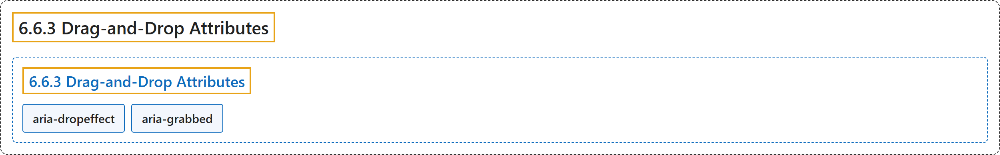

# 6.6.3 Drag-and-Drop Attributes

## Classification

## Glossary

| Term | Definition | 中文翻译 | Source |
|---|---|---|---|
| **6.6.3 Drag-and-Drop Attributes** 拖放属性 | "This section lists attributes which indicate information about **drag-and-drop interface elements**, such as draggable elements and their drop targets." | 本节列出指示**拖放界面元素**信息的属性，例如可拖动元素及其放置目标。 | [World Wide Web Consortium, 2023, section 6.6.3](https://www.w3.org/TR/wai-aria-1.2/) |
| **aria-dropeffect** 放置效果 | "[Deprecated in ARIA 1.1] Indicates **what functions can be performed when a dragged object is released on the drop target**." | [在 ARIA 1.1 中已弃用] 指示**被拖动的对象释放到放置目标上时可以执行哪些功能**。 | [World Wide Web Consortium, 2023, section 6.7, aria-dropeffect](https://www.w3.org/TR/wai-aria-1.2/#aria-dropeffect) |
| **aria-grabbed** 抓取状态 | "[Deprecated in ARIA 1.1] Indicates an element's "**grabbed**" state in a drag-and-drop operation." | [在 ARIA 1.1 中已弃用] 指示元素在拖放操作中的“**被抓取**”状态。 | [World Wide Web Consortium, 2023, section 6.7, aria-grabbed](https://www.w3.org/TR/wai-aria-1.2/#aria-grabbed) |

## References

World Wide Web Consortium. (2023, June 6). *Accessible Rich Internet Applications (WAI-ARIA) 1.2* (W3C Recommendation). <https://www.w3.org/TR/wai-aria-1.2/>
