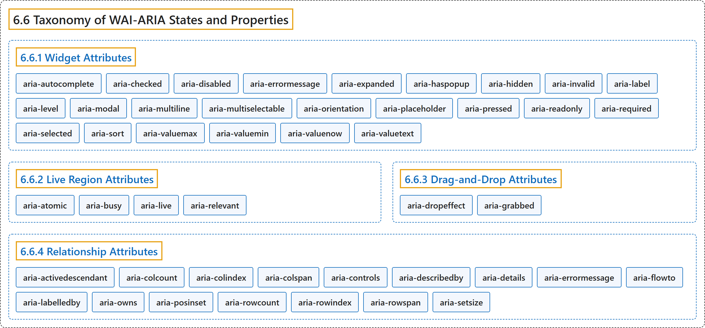

# 6.6 Taxonomy of WAI-ARIA States and Properties

## Classification

## Glossary

| Term | Definition | 中文翻译 | Source |
|---|---|---|---|
| **6.6 Taxonomy of WAI-ARIA States and Properties** WAI-ARIA 状态和属性的分类 | (context) "States and properties are **categorized as follows**:" | （语境）状态和属性**分类如下**： | [World Wide Web Consortium, 2023, section 6.6](https://www.w3.org/TR/wai-aria-1.2/) |
| **[6.6.1 Widget Attributes](widget-attributes.md)** 控件属性 | "This section contains attributes specific to **common user interface elements** found on GUI systems or in rich internet applications which **receive user input and process user actions**." | 本节包含专用于 GUI 系统或富互联网应用中**常见用户界面元素**的属性，这些元素**接收用户输入并处理用户操作**。 | [World Wide Web Consortium, 2023, section 6.6.1](https://www.w3.org/TR/wai-aria-1.2/) |
| **[6.6.2 Live Region Attributes](live-region-attributes.md)** 实时区域属性 | "This section contains attributes specific to **live regions** in rich internet applications." | 本节包含专用于富互联网应用中**实时区域**的属性。 | [World Wide Web Consortium, 2023, section 6.6.2](https://www.w3.org/TR/wai-aria-1.2/) |
| **[6.6.3 Drag-and-Drop Attributes](drag-and-drop-attributes.md)** 拖放属性 | "This section lists attributes which indicate information about **drag-and-drop interface elements**, such as draggable elements and their drop targets." | 本节列出指示**拖放界面元素**信息的属性，例如可拖动元素及其放置目标。 | [World Wide Web Consortium, 2023, section 6.6.3](https://www.w3.org/TR/wai-aria-1.2/) |
| **[6.6.4 Relationship Attributes](relationship-attributes.md)** 关系属性 | "This section lists attributes that indicate **relationships or associations between elements** which cannot be readily determined from the document structure." | 本节列出指示**元素之间的关系或关联**的属性，这些关系无法从文档结构中直接确定。 | [World Wide Web Consortium, 2023, section 6.6.4](https://www.w3.org/TR/wai-aria-1.2/) |

## References

World Wide Web Consortium. (2023, June 6). *Accessible Rich Internet Applications (WAI-ARIA) 1.2* (W3C Recommendation). <https://www.w3.org/TR/wai-aria-1.2/>
