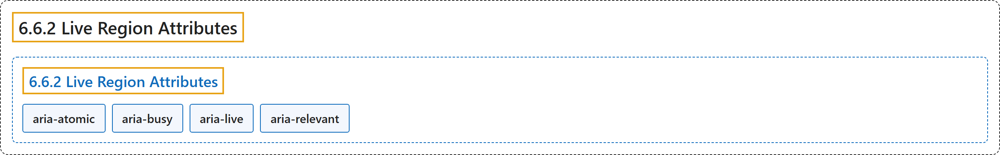

# 6.6.2 Live Region Attributes

## Classification

## Glossary

| Term | Definition | 中文翻译 | Source |
|---|---|---|---|
| **6.6.2 Live Region Attributes** 实时区域属性 | "This section contains attributes specific to **live regions** in rich internet applications." | 本节包含专用于富互联网应用中**实时区域**的属性。 | [World Wide Web Consortium, 2023, section 6.6.2](https://www.w3.org/TR/wai-aria-1.2/) |
| **aria-atomic** 整体呈现 | "Indicates whether assistive technologies will present **all, or only parts of, the changed region** based on the change notifications defined by the aria-relevant attribute." | 指示辅助技术将根据 aria-relevant 属性定义的变化通知，呈现**整个变化区域还是只呈现其中一部分**。 | [World Wide Web Consortium, 2023, section 6.7, aria-atomic](https://www.w3.org/TR/wai-aria-1.2/#aria-atomic) |
| **aria-busy** 忙碌 | "Indicates an element is **being modified** and that assistive technologies MAY want to **wait until the modifications are complete** before exposing them to the user." | 指示元素**正在被修改**，辅助技术可以**等修改完成后**再向用户公开。 | [World Wide Web Consortium, 2023, section 6.7, aria-busy](https://www.w3.org/TR/wai-aria-1.2/#aria-busy) |
| **aria-live** 实时 | "Indicates that an element **will be updated**, and describes the **types of updates** the user agents, assistive technologies, and user can expect from the live region." | 指示元素**将会更新**，并描述用户代理、辅助技术和用户可以从该实时区域预期的**更新类型**。 | [World Wide Web Consortium, 2023, section 6.7, aria-live](https://www.w3.org/TR/wai-aria-1.2/#aria-live) |
| **aria-relevant** 相关变化 | "Indicates **what notifications the user agent will trigger** when the accessibility tree within a live region is modified." | 指示实时区域内的无障碍树被修改时，**用户代理将触发哪些通知**。 | [World Wide Web Consortium, 2023, section 6.7, aria-relevant](https://www.w3.org/TR/wai-aria-1.2/#aria-relevant) |

## References

World Wide Web Consortium. (2023, June 6). *Accessible Rich Internet Applications (WAI-ARIA) 1.2* (W3C Recommendation). <https://www.w3.org/TR/wai-aria-1.2/>
