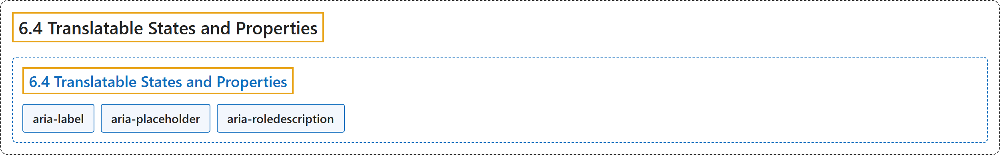

# 6.4 Translatable States and Properties

## Classification

## Glossary

| Term | Definition | 中文翻译 | Source |
|---|---|---|---|
| **6.4 Translatable States and Properties** 可翻译的状态和属性 | "In order to be understandable by assistive technology users, the values of the following states and properties are **translatable attributes** and **should be translated when a page is localized**:" | 为了让辅助技术用户能够理解，下列状态和属性的值是**可翻译属性**，**在页面本地化时应当翻译**： | [World Wide Web Consortium, 2023, section 6.4](https://www.w3.org/TR/wai-aria-1.2/) |
| **aria-label** 标签 | "Defines a **string value that labels the current element**." | 定义**标注当前元素的字符串值**。 | [World Wide Web Consortium, 2023, section 6.7, aria-label](https://www.w3.org/TR/wai-aria-1.2/#aria-label) |
| **aria-placeholder** 占位提示 | "Defines a **short hint** (a word or short phrase) intended to **aid the user with data entry** when the control has no value." | 定义一个**简短提示**（一个词或短语），在控件没有值时**帮助用户输入数据**。 | [World Wide Web Consortium, 2023, section 6.7, aria-placeholder](https://www.w3.org/TR/wai-aria-1.2/#aria-placeholder) |
| **aria-roledescription** 角色描述 | "Defines a **human-readable, author-localized description for the role** of an element." | 定义元素**角色的人类可读、由作者本地化的描述**。 | [World Wide Web Consortium, 2023, section 6.7, aria-roledescription](https://www.w3.org/TR/wai-aria-1.2/#aria-roledescription) |

## References

World Wide Web Consortium. (2023, June 6). *Accessible Rich Internet Applications (WAI-ARIA) 1.2* (W3C Recommendation). <https://www.w3.org/TR/wai-aria-1.2/>
