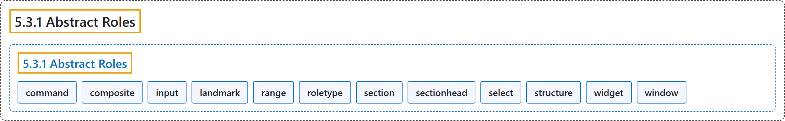

# 5.3.1 Abstract Roles

## Classification

## Glossary

| Term | Definition | 中文翻译 | Source |
|---|---|---|---|
| **5.3.1 Abstract Roles** 抽象角色 | "The following roles are used to **support the WAI-ARIA Roles Model** for the purpose of **defining general role concepts**." | 下列角色用于**支持 WAI-ARIA 角色模型**，目的是**定义一般的角色概念**。 | [World Wide Web Consortium, 2023, section 5.3.1](https://www.w3.org/TR/wai-aria-1.2/) |
| **command** 命令 | "A form of widget that **performs an action** but **does not receive input data**." | 一种控件，它**执行动作**但**不接收输入数据**。 | [World Wide Web Consortium, 2023, section 5.4, command](https://www.w3.org/TR/wai-aria-1.2/#command) |
| **composite** 复合控件 | "A widget that may contain **navigable descendants or owned children**." | 可以包含**可导航后代或从属子元素**的控件。 | [World Wide Web Consortium, 2023, section 5.4, composite](https://www.w3.org/TR/wai-aria-1.2/#composite) |
| **input** 输入 | "A generic type of widget that **allows user input**." | 一种通用控件类型，**允许用户输入**。 | [World Wide Web Consortium, 2023, section 5.4, input](https://www.w3.org/TR/wai-aria-1.2/#input) |
| **landmark** 地标 | "A perceivable section containing content that is **relevant to a specific, author-specified purpose** and **sufficiently important** that users will likely want to be able to navigate to the section easily and to have it listed in a summary of the page." | 可感知的一节，其内容**与作者指定的特定目的相关**且**足够重要**，用户很可能希望能轻松导航到该节，并让它列在页面摘要中。 | [World Wide Web Consortium, 2023, section 5.4, landmark](https://www.w3.org/TR/wai-aria-1.2/#landmark) |
| **range** 范围 | "An element representing a **range of values**." | 表示**值的范围**的元素。 | [World Wide Web Consortium, 2023, section 5.4, range](https://www.w3.org/TR/wai-aria-1.2/#range) |
| **roletype** 角色类型 | "The **base role from which all other roles inherit**." | **所有其他角色都继承自的基础角色**。 | [World Wide Web Consortium, 2023, section 5.4, roletype](https://www.w3.org/TR/wai-aria-1.2/#roletype) |
| **section** 节 | "A **renderable structural containment unit** in a document or application." | 文档或应用中**可呈现的结构性容纳单元**。 | [World Wide Web Consortium, 2023, section 5.4, section](https://www.w3.org/TR/wai-aria-1.2/#section) |
| **sectionhead** 节标题 | "A structure that **labels or summarizes the topic of its related section**." | **标注或概括相关节的主题**的结构。 | [World Wide Web Consortium, 2023, section 5.4, sectionhead](https://www.w3.org/TR/wai-aria-1.2/#sectionhead) |
| **select** 选择 | "A form widget that allows the user to **make selections from a set of choices**." | 一种表单控件，允许用户**从一组选项中进行选择**。 | [World Wide Web Consortium, 2023, section 5.4, select](https://www.w3.org/TR/wai-aria-1.2/#select) |
| **structure** 结构 | "A **document structural element**." | **文档结构元素**。 | [World Wide Web Consortium, 2023, section 5.4, structure](https://www.w3.org/TR/wai-aria-1.2/#structure) |
| **widget** 控件 | "An **interactive component of a graphical user interface** (GUI)." | **图形用户界面（GUI）的交互式组件**。 | [World Wide Web Consortium, 2023, section 5.4, widget](https://www.w3.org/TR/wai-aria-1.2/#widget) |
| **window** 窗口 | "A **browser or application window**." | **浏览器或应用窗口**。 | [World Wide Web Consortium, 2023, section 5.4, window](https://www.w3.org/TR/wai-aria-1.2/#window) |

## References

World Wide Web Consortium. (2023, June 6). *Accessible Rich Internet Applications (WAI-ARIA) 1.2* (W3C Recommendation). <https://www.w3.org/TR/wai-aria-1.2/>
