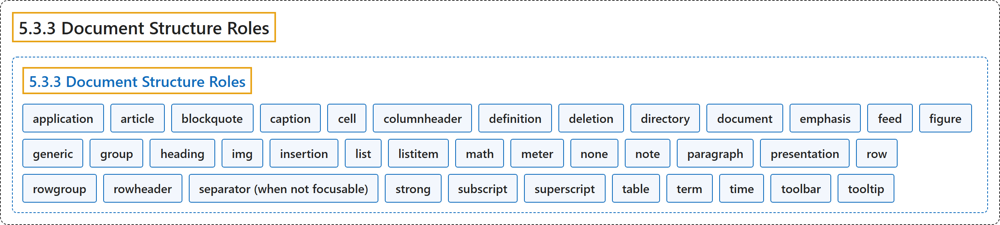

# 5.3.3 Document Structure Roles

## Classification

## Glossary

| Term | Definition | 中文翻译 | Source |
|---|---|---|---|
| **5.3.3 Document Structure Roles** 文档结构角色 | "The following roles describe **structures that organize content in a page**." | 下列角色描述**在页面中组织内容的结构**。 | [World Wide Web Consortium, 2023, section 5.3.3](https://www.w3.org/TR/wai-aria-1.2/) |
| **application** 应用 | "A structure containing **one or more focusable elements requiring user input**, such as keyboard or gesture events, that **do not follow a standard interaction pattern** supported by a widget role." | 一种结构，包含**一个或多个需要用户输入的可聚焦元素**（如键盘或手势事件），它们**不遵循控件角色所支持的标准交互模式**。 | [World Wide Web Consortium, 2023, section 5.4, application](https://www.w3.org/TR/wai-aria-1.2/#application) |
| **article** 文章 | "A section of a page that consists of a composition that forms an **independent part of a document, page, or site**." | 页面的一节，由一篇构成**文档、页面或站点的独立部分**的作品组成。 | [World Wide Web Consortium, 2023, section 5.4, article](https://www.w3.org/TR/wai-aria-1.2/#article) |
| **blockquote** 块引用 | "A section of content that is **quoted from another source**." | **引自其他来源**的一段内容。 | [World Wide Web Consortium, 2023, section 5.4, blockquote](https://www.w3.org/TR/wai-aria-1.2/#blockquote) |
| **caption** 标题说明 | "Visible content that **names, and may also describe**, a figure, table, grid, or treegrid." | 可见内容，用来**命名并可能描述**图、表格、网格或树形网格。 | [World Wide Web Consortium, 2023, section 5.4, caption](https://www.w3.org/TR/wai-aria-1.2/#caption) |
| **cell** 单元格 | "A **cell in a tabular container**." | **表格式容器中的单元格**。 | [World Wide Web Consortium, 2023, section 5.4, cell](https://www.w3.org/TR/wai-aria-1.2/#cell) |
| **columnheader** 列标题 | "A cell containing **header information for a column**." | 包含**列的标题信息**的单元格。 | [World Wide Web Consortium, 2023, section 5.4, columnheader](https://www.w3.org/TR/wai-aria-1.2/#columnheader) |
| **definition** 定义 | "A **definition of a term or concept**." | **术语或概念的定义**。 | [World Wide Web Consortium, 2023, section 5.4, definition](https://www.w3.org/TR/wai-aria-1.2/#definition) |
| **deletion** 删除 | "A deletion contains content that is **marked as removed** or content that is **being suggested for removal**." | 删除包含**标记为已移除**的内容，或**建议移除**的内容。 | [World Wide Web Consortium, 2023, section 5.4, deletion](https://www.w3.org/TR/wai-aria-1.2/#deletion) |
| **directory** 目录 | "[Deprecated in ARIA 1.2] A **list of references to members of a group**, such as a static table of contents." | [在 ARIA 1.2 中已弃用] **指向组成员的引用列表**，例如静态目录。 | [World Wide Web Consortium, 2023, section 5.4, directory](https://www.w3.org/TR/wai-aria-1.2/#directory) |
| **document** 文档 | "An element containing content that assistive technology users may want to **browse in a reading mode**." | 一种元素，其内容是辅助技术用户可能想要**以阅读模式浏览**的。 | [World Wide Web Consortium, 2023, section 5.4, document](https://www.w3.org/TR/wai-aria-1.2/#document) |
| **emphasis** 强调 | "One or more **emphasized characters**." | 一个或多个**被强调的字符**。 | [World Wide Web Consortium, 2023, section 5.4, emphasis](https://www.w3.org/TR/wai-aria-1.2/#emphasis) |
| **feed** 信息流 | "A **scrollable list of articles** where scrolling may cause articles to be **added to or removed from either end** of the list." | **可滚动的文章列表**，滚动可能使文章**在列表任一端被添加或移除**。 | [World Wide Web Consortium, 2023, section 5.4, feed](https://www.w3.org/TR/wai-aria-1.2/#feed) |
| **figure** 图 | "A perceivable section of content that typically contains a **graphical document, images, code snippets, or example text**." | 可感知的一段内容，通常包含**图形文档、图像、代码片段或示例文本**。 | [World Wide Web Consortium, 2023, section 5.4, figure](https://www.w3.org/TR/wai-aria-1.2/#figure) |
| **generic** 通用容器 | "A **nameless container element** that has **no semantic meaning on its own**." | **无名称的容器元素**，它**本身没有语义**。 | [World Wide Web Consortium, 2023, section 5.4, generic](https://www.w3.org/TR/wai-aria-1.2/#generic) |
| **group** 组 | "A set of user interface objects that is **not intended to be included in a page summary or table of contents** by assistive technologies." | 一组用户界面对象，**不打算被辅助技术收入页面摘要或目录**。 | [World Wide Web Consortium, 2023, section 5.4, group](https://www.w3.org/TR/wai-aria-1.2/#group) |
| **heading** 标题 | "A **heading for a section** of the page." | 页面中**某一节的标题**。 | [World Wide Web Consortium, 2023, section 5.4, heading](https://www.w3.org/TR/wai-aria-1.2/#heading) |
| **img** 图像 | "A container for a **collection of elements that form an image**." | 一个容器，装着**构成一幅图像的一组元素**。 | [World Wide Web Consortium, 2023, section 5.4, img](https://www.w3.org/TR/wai-aria-1.2/#img) |
| **insertion** 插入 | "An insertion contains content that is **marked as added** or content that is **being suggested for addition**." | 插入包含**标记为已添加**的内容，或**建议添加**的内容。 | [World Wide Web Consortium, 2023, section 5.4, insertion](https://www.w3.org/TR/wai-aria-1.2/#insertion) |
| **list** 列表 | "A section containing **listitem elements**." | 包含 **listitem 元素**的节。 | [World Wide Web Consortium, 2023, section 5.4, list](https://www.w3.org/TR/wai-aria-1.2/#list) |
| **listitem** 列表项 | "A **single item in a list or directory**." | **列表或目录中的单个项目**。 | [World Wide Web Consortium, 2023, section 5.4, listitem](https://www.w3.org/TR/wai-aria-1.2/#listitem) |
| **math** 数学 | "Content that represents a **mathematical expression**." | 表示**数学表达式**的内容。 | [World Wide Web Consortium, 2023, section 5.4, math](https://www.w3.org/TR/wai-aria-1.2/#math) |
| **meter** 计量器 | "An element that represents a **scalar measurement within a known range**, or a fractional value." | 表示**已知范围内的标量测量值**或分数值的元素。 | [World Wide Web Consortium, 2023, section 5.4, meter](https://www.w3.org/TR/wai-aria-1.2/#meter) |
| **none** 无 | "An element whose **implicit native role semantics will not be mapped to the accessibility API**." | 一种元素，其**隐式原生角色语义不会映射到无障碍 API**。 | [World Wide Web Consortium, 2023, section 5.4, none](https://www.w3.org/TR/wai-aria-1.2/#none) |
| **note** 注释 | "A section whose content is **parenthetic or ancillary to the main content** of the resource." | 内容**对资源主内容起插入或辅助作用**的节。 | [World Wide Web Consortium, 2023, section 5.4, note](https://www.w3.org/TR/wai-aria-1.2/#note) |
| **paragraph** 段落 | "A **paragraph of content**." | **一段内容**。 | [World Wide Web Consortium, 2023, section 5.4, paragraph](https://www.w3.org/TR/wai-aria-1.2/#paragraph) |
| **presentation** 呈现 | "An element whose **implicit native role semantics will not be mapped to the accessibility API**." | 一种元素，其**隐式原生角色语义不会映射到无障碍 API**。 | [World Wide Web Consortium, 2023, section 5.4, presentation](https://www.w3.org/TR/wai-aria-1.2/#presentation) |
| **row** 行 | "A **row of cells in a tabular container**." | **表格式容器中的一行单元格**。 | [World Wide Web Consortium, 2023, section 5.4, row](https://www.w3.org/TR/wai-aria-1.2/#row) |
| **rowgroup** 行组 | "A structure containing **one or more row elements** in a tabular container." | 表格式容器中包含**一个或多个 row 元素**的结构。 | [World Wide Web Consortium, 2023, section 5.4, rowgroup](https://www.w3.org/TR/wai-aria-1.2/#rowgroup) |
| **rowheader** 行标题 | "A cell containing **header information for a row**." | 包含**行的标题信息**的单元格。 | [World Wide Web Consortium, 2023, section 5.4, rowheader](https://www.w3.org/TR/wai-aria-1.2/#rowheader) |
| **separator (when not focusable)** 分隔符 | "A divider that **separates and distinguishes sections of content or groups of menuitems**." | 一种分隔线，**分开并区分内容的各节或菜单项的各组**。 | [World Wide Web Consortium, 2023, section 5.4, separator](https://www.w3.org/TR/wai-aria-1.2/#separator) |
| **strong** 加强 | "Content that is **important, serious, or urgent**." | **重要、严肃或紧急**的内容。 | [World Wide Web Consortium, 2023, section 5.4, strong](https://www.w3.org/TR/wai-aria-1.2/#strong) |
| **subscript** 下标 | "One or more **subscripted characters**." | 一个或多个**下标字符**。 | [World Wide Web Consortium, 2023, section 5.4, subscript](https://www.w3.org/TR/wai-aria-1.2/#subscript) |
| **superscript** 上标 | "One or more **superscripted characters**." | 一个或多个**上标字符**。 | [World Wide Web Consortium, 2023, section 5.4, superscript](https://www.w3.org/TR/wai-aria-1.2/#superscript) |
| **table** 表格 | "A section containing **data arranged in rows and columns**." | 包含**按行和列排列的数据**的节。 | [World Wide Web Consortium, 2023, section 5.4, table](https://www.w3.org/TR/wai-aria-1.2/#table) |
| **term** 术语 | "A **word or phrase with a corresponding definition**." | **有对应定义的词或短语**。 | [World Wide Web Consortium, 2023, section 5.4, term](https://www.w3.org/TR/wai-aria-1.2/#term) |
| **time** 时间 | "An element that represents a **specific point in time**." | 表示**特定时间点**的元素。 | [World Wide Web Consortium, 2023, section 5.4, time](https://www.w3.org/TR/wai-aria-1.2/#time) |
| **toolbar** 工具栏 | "A **collection of commonly used function buttons or controls** represented in compact visual form." | 以紧凑视觉形式呈现的**一组常用功能按钮或控件**。 | [World Wide Web Consortium, 2023, section 5.4, toolbar](https://www.w3.org/TR/wai-aria-1.2/#toolbar) |
| **tooltip** 工具提示 | "A **contextual popup** that **displays a description for an element**." | 一种**上下文弹出框**，**显示元素的描述**。 | [World Wide Web Consortium, 2023, section 5.4, tooltip](https://www.w3.org/TR/wai-aria-1.2/#tooltip) |

## References

World Wide Web Consortium. (2023, June 6). *Accessible Rich Internet Applications (WAI-ARIA) 1.2* (W3C Recommendation). <https://www.w3.org/TR/wai-aria-1.2/>
