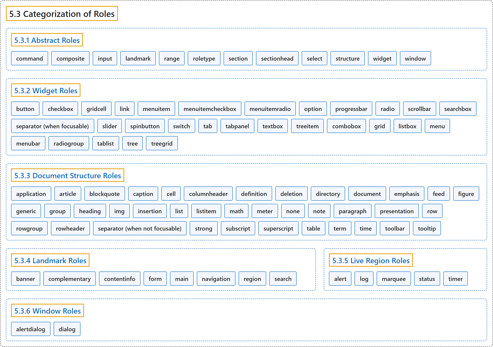

# 5.3 Categorization of Roles

## Classification

## Glossary

| Term | Definition | 中文翻译 | Source |
|---|---|---|---|
| **5.3 Categorization of Roles** 角色的分类 | "To support the current user scenario, this specification **categorizes roles** that **define user interface widgets** (sliders, tree controls, etc.) and those that **define page structure** (sections, navigation, etc.)." | 为了支持当前的用户场景，本规范把**角色分类**为**定义用户界面控件**的角色（滑块、树形控件等）和**定义页面结构**的角色（节、导航等）。 | [World Wide Web Consortium, 2023, section 5.3](https://www.w3.org/TR/wai-aria-1.2/) |
| **[5.3.1 Abstract Roles](abstract-roles.md)** 抽象角色 | "The following roles are used to **support the WAI-ARIA Roles Model** for the purpose of **defining general role concepts**." | 下列角色用于**支持 WAI-ARIA 角色模型**，目的是**定义一般的角色概念**。 | [World Wide Web Consortium, 2023, section 5.3.1](https://www.w3.org/TR/wai-aria-1.2/) |
| **[5.3.2 Widget Roles](widget-roles.md)** 控件角色 | "The following roles act as **standalone user interface widgets** or as **part of larger, composite widgets**." | 下列角色充当**独立的用户界面控件**，或充当**更大的复合控件的一部分**。 | [World Wide Web Consortium, 2023, section 5.3.2](https://www.w3.org/TR/wai-aria-1.2/) |
| **[5.3.3 Document Structure Roles](document-structure-roles.md)** 文档结构角色 | "The following roles describe **structures that organize content in a page**." | 下列角色描述**在页面中组织内容的结构**。 | [World Wide Web Consortium, 2023, section 5.3.3](https://www.w3.org/TR/wai-aria-1.2/) |
| **[5.3.4 Landmark Roles](landmark-roles.md)** 地标角色 | "The following roles are **regions of the page intended as navigational landmarks**." | 下列角色是**页面中用作导航地标的区域**。 | [World Wide Web Consortium, 2023, section 5.3.4](https://www.w3.org/TR/wai-aria-1.2/) |
| **[5.3.5 Live Region Roles](live-region-roles.md)** 实时区域角色 | "The following roles are **live regions** and **may be modified by live region attributes**." | 下列角色是**实时区域**，并**可以由实时区域属性修改**。 | [World Wide Web Consortium, 2023, section 5.3.5](https://www.w3.org/TR/wai-aria-1.2/) |
| **[5.3.6 Window Roles](window-roles.md)** 窗口角色 | "The following roles act as **windows within the browser or application**." | 下列角色充当**浏览器或应用内的窗口**。 | [World Wide Web Consortium, 2023, section 5.3.6](https://www.w3.org/TR/wai-aria-1.2/) |

## References

World Wide Web Consortium. (2023, June 6). *Accessible Rich Internet Applications (WAI-ARIA) 1.2* (W3C Recommendation). <https://www.w3.org/TR/wai-aria-1.2/>
