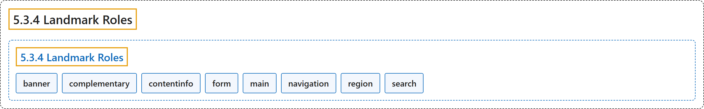

# 5.3.4 Landmark Roles

## Classification

## Glossary

| Term | Definition | 中文翻译 | Source |
|---|---|---|---|
| **5.3.4 Landmark Roles** 地标角色 | "The following roles are **regions of the page intended as navigational landmarks**." | 下列角色是**页面中用作导航地标的区域**。 | [World Wide Web Consortium, 2023, section 5.3.4](https://www.w3.org/TR/wai-aria-1.2/) |
| **banner** 横幅 | "A landmark that contains mostly **site-oriented content**, rather than page-specific content." | 一种地标，主要包含**面向站点的内容**，而非页面特有的内容。 | [World Wide Web Consortium, 2023, section 5.4, banner](https://www.w3.org/TR/wai-aria-1.2/#banner) |
| **complementary** 补充内容 | "A landmark that is designed to be **complementary to the main content** at a similar level in the DOM hierarchy, but **remaining meaningful when separated from the main content**." | 一种地标，设计为在 DOM 层次中与主内容处于相似层级、**对主内容起补充作用**，但**与主内容分离后仍有意义**。 | [World Wide Web Consortium, 2023, section 5.4, complementary](https://www.w3.org/TR/wai-aria-1.2/#complementary) |
| **contentinfo** 内容信息 | "A landmark that contains **information about the parent document**." | 包含**关于父文档的信息**的地标。 | [World Wide Web Consortium, 2023, section 5.4, contentinfo](https://www.w3.org/TR/wai-aria-1.2/#contentinfo) |
| **form** 表单 | "A landmark region that contains a collection of items and objects that, as a whole, **combine to create a form**." | 一种地标区域，包含一组项目和对象，它们作为整体**组合成一个表单**。 | [World Wide Web Consortium, 2023, section 5.4, form](https://www.w3.org/TR/wai-aria-1.2/#form) |
| **main** 主内容 | "A landmark containing the **main content of a document**." | 包含**文档主内容**的地标。 | [World Wide Web Consortium, 2023, section 5.4, main](https://www.w3.org/TR/wai-aria-1.2/#main) |
| **navigation** 导航 | "A landmark containing a **collection of navigational elements** (usually links) for navigating the document or related documents." | 包含**一组导航元素**（通常是链接）的地标，用于在文档或相关文档间导航。 | [World Wide Web Consortium, 2023, section 5.4, navigation](https://www.w3.org/TR/wai-aria-1.2/#navigation) |
| **region** 区域 | "A landmark containing content that is **relevant to a specific, author-specified purpose** and **sufficiently important** that users will likely want to be able to navigate to the section easily and to have it listed in a summary of the page." | 一种地标，其内容**与作者指定的特定目的相关**且**足够重要**，用户很可能希望能轻松导航到该节，并让它列在页面摘要中。 | [World Wide Web Consortium, 2023, section 5.4, region](https://www.w3.org/TR/wai-aria-1.2/#region) |
| **search** 搜索 | "A landmark region that contains a collection of items and objects that, as a whole, **combine to create a search facility**." | 一种地标区域，包含一组项目和对象，它们作为整体**组合成一个搜索功能**。 | [World Wide Web Consortium, 2023, section 5.4, search](https://www.w3.org/TR/wai-aria-1.2/#search) |

## References

World Wide Web Consortium. (2023, June 6). *Accessible Rich Internet Applications (WAI-ARIA) 1.2* (W3C Recommendation). <https://www.w3.org/TR/wai-aria-1.2/>
