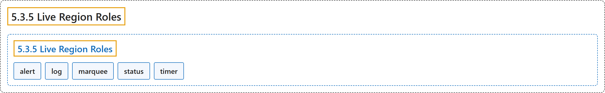

# 5.3.5 Live Region Roles

## Classification

## Glossary

| Term | Definition | 中文翻译 | Source |
|---|---|---|---|
| **5.3.5 Live Region Roles** 实时区域角色 | "The following roles are **live regions** and **may be modified by live region attributes**." | 下列角色是**实时区域**，并**可以由实时区域属性修改**。 | [World Wide Web Consortium, 2023, section 5.3.5](https://www.w3.org/TR/wai-aria-1.2/) |
| **alert** 警报 | "A type of **live region** with **important, and usually time-sensitive, information**." | 一种**实时区域**，带有**重要且通常有时效的信息**。 | [World Wide Web Consortium, 2023, section 5.4, alert](https://www.w3.org/TR/wai-aria-1.2/#alert) |
| **log** 日志 | "A type of live region where **new information is added in meaningful order** and **old information may disappear**." | 一种实时区域，其中**新信息按有意义的顺序添加**，**旧信息可能消失**。 | [World Wide Web Consortium, 2023, section 5.4, log](https://www.w3.org/TR/wai-aria-1.2/#log) |
| **marquee** 滚动字幕 | "A type of live region where **non-essential information changes frequently**." | 一种实时区域，其中**非必要信息频繁变化**。 | [World Wide Web Consortium, 2023, section 5.4, marquee](https://www.w3.org/TR/wai-aria-1.2/#marquee) |
| **status** 状态 | "A type of live region whose content is **advisory information for the user** but is **not important enough to justify an alert**, often but not necessarily presented as a status bar." | 一种实时区域，其内容是**给用户的提示信息**，但**不够重要、不足以用警报**，常常但不一定以状态栏形式呈现。 | [World Wide Web Consortium, 2023, section 5.4, status](https://www.w3.org/TR/wai-aria-1.2/#status) |
| **timer** 计时器 | "A type of live region containing a **numerical counter** which indicates an **amount of elapsed time from a start point, or the time remaining until an end point**." | 一种实时区域，包含**数字计数器**，指示**从起点起已经过的时间，或到终点为止剩余的时间**。 | [World Wide Web Consortium, 2023, section 5.4, timer](https://www.w3.org/TR/wai-aria-1.2/#timer) |

## References

World Wide Web Consortium. (2023, June 6). *Accessible Rich Internet Applications (WAI-ARIA) 1.2* (W3C Recommendation). <https://www.w3.org/TR/wai-aria-1.2/>
