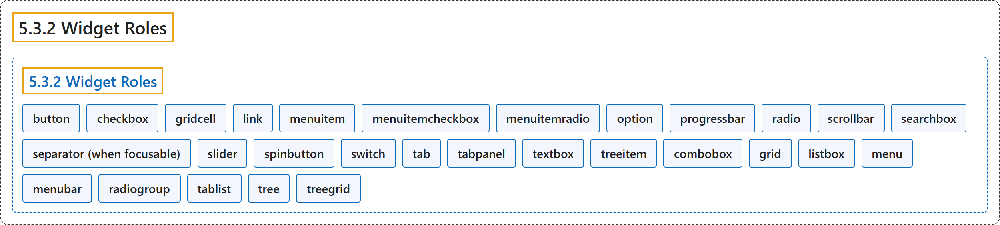

# 5.3.2 Widget Roles

## Classification

## Glossary

| Term | Definition | 中文翻译 | Source |
|---|---|---|---|
| **5.3.2 Widget Roles** 控件角色 | "The following roles act as **standalone user interface widgets** or as **part of larger, composite widgets**." | 下列角色充当**独立的用户界面控件**，或充当**更大的复合控件的一部分**。 | [World Wide Web Consortium, 2023, section 5.3.2](https://www.w3.org/TR/wai-aria-1.2/) |
| **button** 按钮 | "An input that allows for **user-triggered actions** when **clicked or pressed**." | 一种输入，在**点击或按下**时允许**用户触发动作**。 | [World Wide Web Consortium, 2023, section 5.4, button](https://www.w3.org/TR/wai-aria-1.2/#button) |
| **checkbox** 复选框 | "A **checkable input** that has **three possible values: true, false, or mixed**." | 一种**可勾选的输入**，有**三个可能的值：true、false 或 mixed**。 | [World Wide Web Consortium, 2023, section 5.4, checkbox](https://www.w3.org/TR/wai-aria-1.2/#checkbox) |
| **gridcell** 网格单元格 | "A **cell in a grid or treegrid**." | **网格或树形网格中的单元格**。 | [World Wide Web Consortium, 2023, section 5.4, gridcell](https://www.w3.org/TR/wai-aria-1.2/#gridcell) |
| **link** 链接 | "An **interactive reference to an internal or external resource** that, when activated, causes the user agent to **navigate to that resource**." | **指向内部或外部资源的交互式引用**，被激活时使用户代理**导航到该资源**。 | [World Wide Web Consortium, 2023, section 5.4, link](https://www.w3.org/TR/wai-aria-1.2/#link) |
| **menuitem** 菜单项 | "An **option in a set of choices** contained by a menu or menubar." | 菜单或菜单栏所含**一组选项中的一个选项**。 | [World Wide Web Consortium, 2023, section 5.4, menuitem](https://www.w3.org/TR/wai-aria-1.2/#menuitem) |
| **menuitemcheckbox** 复选菜单项 | "A menuitem with a **checkable state** whose possible values are **true, false, or mixed**." | 带有**可勾选状态**的菜单项，可能的值为 **true、false 或 mixed**。 | [World Wide Web Consortium, 2023, section 5.4, menuitemcheckbox](https://www.w3.org/TR/wai-aria-1.2/#menuitemcheckbox) |
| **menuitemradio** 单选菜单项 | "A **checkable menuitem** in a set of elements with the same role, **only one of which can be checked at a time**." | 同一角色的一组元素中的**可勾选菜单项**，**同一时间只能选中其中一个**。 | [World Wide Web Consortium, 2023, section 5.4, menuitemradio](https://www.w3.org/TR/wai-aria-1.2/#menuitemradio) |
| **option** 选项 | "A **selectable item in a listbox**." | **列表框中可选择的项目**。 | [World Wide Web Consortium, 2023, section 5.4, option](https://www.w3.org/TR/wai-aria-1.2/#option) |
| **progressbar** 进度条 | "An element that **displays the progress status** for tasks that take a long time." | 为耗时较长的任务**显示进度状态**的元素。 | [World Wide Web Consortium, 2023, section 5.4, progressbar](https://www.w3.org/TR/wai-aria-1.2/#progressbar) |
| **radio** 单选按钮 | "A **checkable input** in a group of elements with the same role, **only one of which can be checked at a time**." | 同一角色的一组元素中的**可勾选输入**，**同一时间只能选中其中一个**。 | [World Wide Web Consortium, 2023, section 5.4, radio](https://www.w3.org/TR/wai-aria-1.2/#radio) |
| **scrollbar** 滚动条 | "A graphical object that **controls the scrolling of content within a viewing area**, regardless of whether the content is fully displayed within the viewing area." | **控制内容在可视区域内滚动**的图形对象，无论内容是否完整显示在可视区域内。 | [World Wide Web Consortium, 2023, section 5.4, scrollbar](https://www.w3.org/TR/wai-aria-1.2/#scrollbar) |
| **searchbox** 搜索框 | "A **type of textbox** intended for **specifying search criteria**." | **一种文本框**，用于**指定搜索条件**。 | [World Wide Web Consortium, 2023, section 5.4, searchbox](https://www.w3.org/TR/wai-aria-1.2/#searchbox) |
| **separator (when focusable)** 分隔符 | "A divider that **separates and distinguishes sections of content or groups of menuitems**." | 一种分隔线，**分开并区分内容的各节或菜单项的各组**。 | [World Wide Web Consortium, 2023, section 5.4, separator](https://www.w3.org/TR/wai-aria-1.2/#separator) |
| **slider** 滑块 | "An input where the user **selects a value from within a given range**." | 一种输入，用户**从给定范围内选择一个值**。 | [World Wide Web Consortium, 2023, section 5.4, slider](https://www.w3.org/TR/wai-aria-1.2/#slider) |
| **spinbutton** 微调按钮 | "A form of range that expects the user to **select from among discrete choices**." | 一种范围形式，期望用户**从离散的选项中选择**。 | [World Wide Web Consortium, 2023, section 5.4, spinbutton](https://www.w3.org/TR/wai-aria-1.2/#spinbutton) |
| **switch** 开关 | "A type of checkbox that represents **on/off values**, as opposed to checked/unchecked values." | 一种复选框，表示**开/关值**，而不是选中/未选中值。 | [World Wide Web Consortium, 2023, section 5.4, switch](https://www.w3.org/TR/wai-aria-1.2/#switch) |
| **tab** 标签页 | "A **grouping label** providing a mechanism for **selecting the tab content** that is to be rendered to the user." | 一种**分组标签**，提供**选择标签页内容**的机制，所选内容将呈现给用户。 | [World Wide Web Consortium, 2023, section 5.4, tab](https://www.w3.org/TR/wai-aria-1.2/#tab) |
| **tabpanel** 标签页面板 | "A **container for the resources associated with a tab**, where each tab is contained in a tablist." | **装着与某个标签页相关资源的容器**，每个标签页都包含在标签页列表中。 | [World Wide Web Consortium, 2023, section 5.4, tabpanel](https://www.w3.org/TR/wai-aria-1.2/#tabpanel) |
| **textbox** 文本框 | "A type of input that allows **free-form text as its value**." | 一种输入，允许**自由格式的文本作为其值**。 | [World Wide Web Consortium, 2023, section 5.4, textbox](https://www.w3.org/TR/wai-aria-1.2/#textbox) |
| **treeitem** 树项 | "An **option item of a tree**." | **树的选项项目**。 | [World Wide Web Consortium, 2023, section 5.4, treeitem](https://www.w3.org/TR/wai-aria-1.2/#treeitem) |
| **combobox** 组合框 | "An input that **controls another element**, such as a listbox or grid, that can **dynamically pop up** to help the user set the value of the input." | 一种输入，它**控制另一个元素**（如列表框或网格），该元素可以**动态弹出**以帮助用户设置输入的值。 | [World Wide Web Consortium, 2023, section 5.4, combobox](https://www.w3.org/TR/wai-aria-1.2/#combobox) |
| **grid** 网格 | "A composite widget containing a **collection of one or more rows with one or more cells** where some or all cells in the grid are **focusable by using methods of two-dimensional navigation**, such as directional arrow keys." | 一种复合控件，包含**一行或多行、每行一个或多个单元格的集合**，其中部分或全部单元格**可以通过二维导航方法聚焦**，例如方向键。 | [World Wide Web Consortium, 2023, section 5.4, grid](https://www.w3.org/TR/wai-aria-1.2/#grid) |
| **listbox** 列表框 | "A widget that allows the user to **select one or more items from a list of choices**." | 一种控件，允许用户**从选项列表中选择一项或多项**。 | [World Wide Web Consortium, 2023, section 5.4, listbox](https://www.w3.org/TR/wai-aria-1.2/#listbox) |
| **menu** 菜单 | "A type of widget that **offers a list of choices** to the user." | 一种控件，向用户**提供选项列表**。 | [World Wide Web Consortium, 2023, section 5.4, menu](https://www.w3.org/TR/wai-aria-1.2/#menu) |
| **menubar** 菜单栏 | "A presentation of menu that **usually remains visible** and is **usually presented horizontally**." | 菜单的一种呈现形式，**通常保持可见**并**通常水平呈现**。 | [World Wide Web Consortium, 2023, section 5.4, menubar](https://www.w3.org/TR/wai-aria-1.2/#menubar) |
| **radiogroup** 单选组 | "A **group of radio buttons**." | **一组单选按钮**。 | [World Wide Web Consortium, 2023, section 5.4, radiogroup](https://www.w3.org/TR/wai-aria-1.2/#radiogroup) |
| **tablist** 标签页列表 | "A **list of tab elements**, which are references to tabpanel elements." | **tab 元素的列表**，它们是对 tabpanel 元素的引用。 | [World Wide Web Consortium, 2023, section 5.4, tablist](https://www.w3.org/TR/wai-aria-1.2/#tablist) |
| **tree** 树 | "A widget that allows the user to **select one or more items from a hierarchically organized collection**." | 一种控件，允许用户**从按层次组织的集合中选择一项或多项**。 | [World Wide Web Consortium, 2023, section 5.4, tree](https://www.w3.org/TR/wai-aria-1.2/#tree) |
| **treegrid** 树形网格 | "A grid whose **rows can be expanded and collapsed** in the same manner as for a tree." | 一种网格，其**行可以像树一样展开和折叠**。 | [World Wide Web Consortium, 2023, section 5.4, treegrid](https://www.w3.org/TR/wai-aria-1.2/#treegrid) |

## References

World Wide Web Consortium. (2023, June 6). *Accessible Rich Internet Applications (WAI-ARIA) 1.2* (W3C Recommendation). <https://www.w3.org/TR/wai-aria-1.2/>
