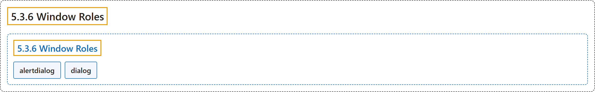

# 5.3.6 Window Roles

## Classification

## Glossary

| Term | Definition | 中文翻译 | Source |
|---|---|---|---|
| **5.3.6 Window Roles** 窗口角色 | "The following roles act as **windows within the browser or application**." | 下列角色充当**浏览器或应用内的窗口**。 | [World Wide Web Consortium, 2023, section 5.3.6](https://www.w3.org/TR/wai-aria-1.2/) |
| **alertdialog** 警报对话框 | "A type of **dialog** that **contains an alert message**, where initial focus goes to an element within the dialog." | 一种**对话框**，它**包含警报消息**，初始焦点落在对话框内的某个元素上。 | [World Wide Web Consortium, 2023, section 5.4, alertdialog](https://www.w3.org/TR/wai-aria-1.2/#alertdialog) |
| **dialog** 对话框 | "A dialog is a **descendant window of the primary window** of a web application." | 对话框是 Web 应用**主窗口的后代窗口**。 | [World Wide Web Consortium, 2023, section 5.4, dialog](https://www.w3.org/TR/wai-aria-1.2/#dialog) |

## References

World Wide Web Consortium. (2023, June 6). *Accessible Rich Internet Applications (WAI-ARIA) 1.2* (W3C Recommendation). <https://www.w3.org/TR/wai-aria-1.2/>
