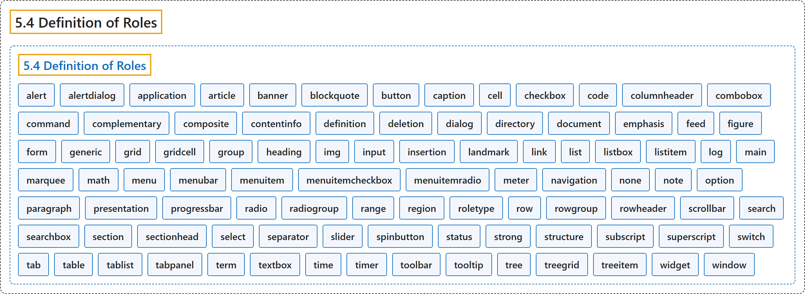

# 5.4 Definition of Roles

## Classification

## Glossary

| Term | Definition | 中文翻译 | Source |
|---|---|---|---|
| **5.4 Definition of Roles** 角色的定义 | "Below is an **alphabetical list of WAI-ARIA roles** to be used by authors." | 下面是供作者使用的 **WAI-ARIA 角色的字母顺序列表**。 | [World Wide Web Consortium, 2023, section 5.4](https://www.w3.org/TR/wai-aria-1.2/) |
| **alert** 警报 | "A type of **live region** with **important, and usually time-sensitive, information**." | 一种**实时区域**，带有**重要且通常有时效的信息**。 | [World Wide Web Consortium, 2023, section 5.4, alert](https://www.w3.org/TR/wai-aria-1.2/#alert) |
| **alertdialog** 警报对话框 | "A type of **dialog** that **contains an alert message**, where initial focus goes to an element within the dialog." | 一种**对话框**，它**包含警报消息**，初始焦点落在对话框内的某个元素上。 | [World Wide Web Consortium, 2023, section 5.4, alertdialog](https://www.w3.org/TR/wai-aria-1.2/#alertdialog) |
| **application** 应用 | "A structure containing **one or more focusable elements requiring user input**, such as keyboard or gesture events, that **do not follow a standard interaction pattern** supported by a widget role." | 一种结构，包含**一个或多个需要用户输入的可聚焦元素**（如键盘或手势事件），它们**不遵循控件角色所支持的标准交互模式**。 | [World Wide Web Consortium, 2023, section 5.4, application](https://www.w3.org/TR/wai-aria-1.2/#application) |
| **article** 文章 | "A section of a page that consists of a composition that forms an **independent part of a document, page, or site**." | 页面的一节，由一篇构成**文档、页面或站点的独立部分**的作品组成。 | [World Wide Web Consortium, 2023, section 5.4, article](https://www.w3.org/TR/wai-aria-1.2/#article) |
| **banner** 横幅 | "A landmark that contains mostly **site-oriented content**, rather than page-specific content." | 一种地标，主要包含**面向站点的内容**，而非页面特有的内容。 | [World Wide Web Consortium, 2023, section 5.4, banner](https://www.w3.org/TR/wai-aria-1.2/#banner) |
| **blockquote** 块引用 | "A section of content that is **quoted from another source**." | **引自其他来源**的一段内容。 | [World Wide Web Consortium, 2023, section 5.4, blockquote](https://www.w3.org/TR/wai-aria-1.2/#blockquote) |
| **button** 按钮 | "An input that allows for **user-triggered actions** when **clicked or pressed**." | 一种输入，在**点击或按下**时允许**用户触发动作**。 | [World Wide Web Consortium, 2023, section 5.4, button](https://www.w3.org/TR/wai-aria-1.2/#button) |
| **caption** 标题说明 | "Visible content that **names, and may also describe**, a figure, table, grid, or treegrid." | 可见内容，用来**命名并可能描述**图、表格、网格或树形网格。 | [World Wide Web Consortium, 2023, section 5.4, caption](https://www.w3.org/TR/wai-aria-1.2/#caption) |
| **cell** 单元格 | "A **cell in a tabular container**." | **表格式容器中的单元格**。 | [World Wide Web Consortium, 2023, section 5.4, cell](https://www.w3.org/TR/wai-aria-1.2/#cell) |
| **checkbox** 复选框 | "A **checkable input** that has **three possible values: true, false, or mixed**." | 一种**可勾选的输入**，有**三个可能的值：true、false 或 mixed**。 | [World Wide Web Consortium, 2023, section 5.4, checkbox](https://www.w3.org/TR/wai-aria-1.2/#checkbox) |
| **code** 代码 | "A section whose content represents a **fragment of computer code**." | 内容为**一段计算机代码**的节。 | [World Wide Web Consortium, 2023, section 5.4, code](https://www.w3.org/TR/wai-aria-1.2/#code) |
| **columnheader** 列标题 | "A cell containing **header information for a column**." | 包含**列的标题信息**的单元格。 | [World Wide Web Consortium, 2023, section 5.4, columnheader](https://www.w3.org/TR/wai-aria-1.2/#columnheader) |
| **combobox** 组合框 | "An input that **controls another element**, such as a listbox or grid, that can **dynamically pop up** to help the user set the value of the input." | 一种输入，它**控制另一个元素**（如列表框或网格），该元素可以**动态弹出**以帮助用户设置输入的值。 | [World Wide Web Consortium, 2023, section 5.4, combobox](https://www.w3.org/TR/wai-aria-1.2/#combobox) |
| **command** 命令 | "A form of widget that **performs an action** but **does not receive input data**." | 一种控件，它**执行动作**但**不接收输入数据**。 | [World Wide Web Consortium, 2023, section 5.4, command](https://www.w3.org/TR/wai-aria-1.2/#command) |
| **complementary** 补充内容 | "A landmark that is designed to be **complementary to the main content** at a similar level in the DOM hierarchy, but **remaining meaningful when separated from the main content**." | 一种地标，设计为在 DOM 层次中与主内容处于相似层级、**对主内容起补充作用**，但**与主内容分离后仍有意义**。 | [World Wide Web Consortium, 2023, section 5.4, complementary](https://www.w3.org/TR/wai-aria-1.2/#complementary) |
| **composite** 复合控件 | "A widget that may contain **navigable descendants or owned children**." | 可以包含**可导航后代或从属子元素**的控件。 | [World Wide Web Consortium, 2023, section 5.4, composite](https://www.w3.org/TR/wai-aria-1.2/#composite) |
| **contentinfo** 内容信息 | "A landmark that contains **information about the parent document**." | 包含**关于父文档的信息**的地标。 | [World Wide Web Consortium, 2023, section 5.4, contentinfo](https://www.w3.org/TR/wai-aria-1.2/#contentinfo) |
| **definition** 定义 | "A **definition of a term or concept**." | **术语或概念的定义**。 | [World Wide Web Consortium, 2023, section 5.4, definition](https://www.w3.org/TR/wai-aria-1.2/#definition) |
| **deletion** 删除 | "A deletion contains content that is **marked as removed** or content that is **being suggested for removal**." | 删除包含**标记为已移除**的内容，或**建议移除**的内容。 | [World Wide Web Consortium, 2023, section 5.4, deletion](https://www.w3.org/TR/wai-aria-1.2/#deletion) |
| **dialog** 对话框 | "A dialog is a **descendant window of the primary window** of a web application." | 对话框是 Web 应用**主窗口的后代窗口**。 | [World Wide Web Consortium, 2023, section 5.4, dialog](https://www.w3.org/TR/wai-aria-1.2/#dialog) |
| **directory** 目录 | "[Deprecated in ARIA 1.2] A **list of references to members of a group**, such as a static table of contents." | [在 ARIA 1.2 中已弃用] **指向组成员的引用列表**，例如静态目录。 | [World Wide Web Consortium, 2023, section 5.4, directory](https://www.w3.org/TR/wai-aria-1.2/#directory) |
| **document** 文档 | "An element containing content that assistive technology users may want to **browse in a reading mode**." | 一种元素，其内容是辅助技术用户可能想要**以阅读模式浏览**的。 | [World Wide Web Consortium, 2023, section 5.4, document](https://www.w3.org/TR/wai-aria-1.2/#document) |
| **emphasis** 强调 | "One or more **emphasized characters**." | 一个或多个**被强调的字符**。 | [World Wide Web Consortium, 2023, section 5.4, emphasis](https://www.w3.org/TR/wai-aria-1.2/#emphasis) |
| **feed** 信息流 | "A **scrollable list of articles** where scrolling may cause articles to be **added to or removed from either end** of the list." | **可滚动的文章列表**，滚动可能使文章**在列表任一端被添加或移除**。 | [World Wide Web Consortium, 2023, section 5.4, feed](https://www.w3.org/TR/wai-aria-1.2/#feed) |
| **figure** 图 | "A perceivable section of content that typically contains a **graphical document, images, code snippets, or example text**." | 可感知的一段内容，通常包含**图形文档、图像、代码片段或示例文本**。 | [World Wide Web Consortium, 2023, section 5.4, figure](https://www.w3.org/TR/wai-aria-1.2/#figure) |
| **form** 表单 | "A landmark region that contains a collection of items and objects that, as a whole, **combine to create a form**." | 一种地标区域，包含一组项目和对象，它们作为整体**组合成一个表单**。 | [World Wide Web Consortium, 2023, section 5.4, form](https://www.w3.org/TR/wai-aria-1.2/#form) |
| **generic** 通用容器 | "A **nameless container element** that has **no semantic meaning on its own**." | **无名称的容器元素**，它**本身没有语义**。 | [World Wide Web Consortium, 2023, section 5.4, generic](https://www.w3.org/TR/wai-aria-1.2/#generic) |
| **grid** 网格 | "A composite widget containing a **collection of one or more rows with one or more cells** where some or all cells in the grid are **focusable by using methods of two-dimensional navigation**, such as directional arrow keys." | 一种复合控件，包含**一行或多行、每行一个或多个单元格的集合**，其中部分或全部单元格**可以通过二维导航方法聚焦**，例如方向键。 | [World Wide Web Consortium, 2023, section 5.4, grid](https://www.w3.org/TR/wai-aria-1.2/#grid) |
| **gridcell** 网格单元格 | "A **cell in a grid or treegrid**." | **网格或树形网格中的单元格**。 | [World Wide Web Consortium, 2023, section 5.4, gridcell](https://www.w3.org/TR/wai-aria-1.2/#gridcell) |
| **group** 组 | "A set of user interface objects that is **not intended to be included in a page summary or table of contents** by assistive technologies." | 一组用户界面对象，**不打算被辅助技术收入页面摘要或目录**。 | [World Wide Web Consortium, 2023, section 5.4, group](https://www.w3.org/TR/wai-aria-1.2/#group) |
| **heading** 标题 | "A **heading for a section** of the page." | 页面中**某一节的标题**。 | [World Wide Web Consortium, 2023, section 5.4, heading](https://www.w3.org/TR/wai-aria-1.2/#heading) |
| **img** 图像 | "A container for a **collection of elements that form an image**." | 一个容器，装着**构成一幅图像的一组元素**。 | [World Wide Web Consortium, 2023, section 5.4, img](https://www.w3.org/TR/wai-aria-1.2/#img) |
| **input** 输入 | "A generic type of widget that **allows user input**." | 一种通用控件类型，**允许用户输入**。 | [World Wide Web Consortium, 2023, section 5.4, input](https://www.w3.org/TR/wai-aria-1.2/#input) |
| **insertion** 插入 | "An insertion contains content that is **marked as added** or content that is **being suggested for addition**." | 插入包含**标记为已添加**的内容，或**建议添加**的内容。 | [World Wide Web Consortium, 2023, section 5.4, insertion](https://www.w3.org/TR/wai-aria-1.2/#insertion) |
| **landmark** 地标 | "A perceivable section containing content that is **relevant to a specific, author-specified purpose** and **sufficiently important** that users will likely want to be able to navigate to the section easily and to have it listed in a summary of the page." | 可感知的一节，其内容**与作者指定的特定目的相关**且**足够重要**，用户很可能希望能轻松导航到该节，并让它列在页面摘要中。 | [World Wide Web Consortium, 2023, section 5.4, landmark](https://www.w3.org/TR/wai-aria-1.2/#landmark) |
| **link** 链接 | "An **interactive reference to an internal or external resource** that, when activated, causes the user agent to **navigate to that resource**." | **指向内部或外部资源的交互式引用**，被激活时使用户代理**导航到该资源**。 | [World Wide Web Consortium, 2023, section 5.4, link](https://www.w3.org/TR/wai-aria-1.2/#link) |
| **list** 列表 | "A section containing **listitem elements**." | 包含 **listitem 元素**的节。 | [World Wide Web Consortium, 2023, section 5.4, list](https://www.w3.org/TR/wai-aria-1.2/#list) |
| **listbox** 列表框 | "A widget that allows the user to **select one or more items from a list of choices**." | 一种控件，允许用户**从选项列表中选择一项或多项**。 | [World Wide Web Consortium, 2023, section 5.4, listbox](https://www.w3.org/TR/wai-aria-1.2/#listbox) |
| **listitem** 列表项 | "A **single item in a list or directory**." | **列表或目录中的单个项目**。 | [World Wide Web Consortium, 2023, section 5.4, listitem](https://www.w3.org/TR/wai-aria-1.2/#listitem) |
| **log** 日志 | "A type of live region where **new information is added in meaningful order** and **old information may disappear**." | 一种实时区域，其中**新信息按有意义的顺序添加**，**旧信息可能消失**。 | [World Wide Web Consortium, 2023, section 5.4, log](https://www.w3.org/TR/wai-aria-1.2/#log) |
| **main** 主内容 | "A landmark containing the **main content of a document**." | 包含**文档主内容**的地标。 | [World Wide Web Consortium, 2023, section 5.4, main](https://www.w3.org/TR/wai-aria-1.2/#main) |
| **marquee** 滚动字幕 | "A type of live region where **non-essential information changes frequently**." | 一种实时区域，其中**非必要信息频繁变化**。 | [World Wide Web Consortium, 2023, section 5.4, marquee](https://www.w3.org/TR/wai-aria-1.2/#marquee) |
| **math** 数学 | "Content that represents a **mathematical expression**." | 表示**数学表达式**的内容。 | [World Wide Web Consortium, 2023, section 5.4, math](https://www.w3.org/TR/wai-aria-1.2/#math) |
| **menu** 菜单 | "A type of widget that **offers a list of choices** to the user." | 一种控件，向用户**提供选项列表**。 | [World Wide Web Consortium, 2023, section 5.4, menu](https://www.w3.org/TR/wai-aria-1.2/#menu) |
| **menubar** 菜单栏 | "A presentation of menu that **usually remains visible** and is **usually presented horizontally**." | 菜单的一种呈现形式，**通常保持可见**并**通常水平呈现**。 | [World Wide Web Consortium, 2023, section 5.4, menubar](https://www.w3.org/TR/wai-aria-1.2/#menubar) |
| **menuitem** 菜单项 | "An **option in a set of choices** contained by a menu or menubar." | 菜单或菜单栏所含**一组选项中的一个选项**。 | [World Wide Web Consortium, 2023, section 5.4, menuitem](https://www.w3.org/TR/wai-aria-1.2/#menuitem) |
| **menuitemcheckbox** 复选菜单项 | "A menuitem with a **checkable state** whose possible values are **true, false, or mixed**." | 带有**可勾选状态**的菜单项，可能的值为 **true、false 或 mixed**。 | [World Wide Web Consortium, 2023, section 5.4, menuitemcheckbox](https://www.w3.org/TR/wai-aria-1.2/#menuitemcheckbox) |
| **menuitemradio** 单选菜单项 | "A **checkable menuitem** in a set of elements with the same role, **only one of which can be checked at a time**." | 同一角色的一组元素中的**可勾选菜单项**，**同一时间只能选中其中一个**。 | [World Wide Web Consortium, 2023, section 5.4, menuitemradio](https://www.w3.org/TR/wai-aria-1.2/#menuitemradio) |
| **meter** 计量器 | "An element that represents a **scalar measurement within a known range**, or a fractional value." | 表示**已知范围内的标量测量值**或分数值的元素。 | [World Wide Web Consortium, 2023, section 5.4, meter](https://www.w3.org/TR/wai-aria-1.2/#meter) |
| **navigation** 导航 | "A landmark containing a **collection of navigational elements** (usually links) for navigating the document or related documents." | 包含**一组导航元素**（通常是链接）的地标，用于在文档或相关文档间导航。 | [World Wide Web Consortium, 2023, section 5.4, navigation](https://www.w3.org/TR/wai-aria-1.2/#navigation) |
| **none** 无 | "An element whose **implicit native role semantics will not be mapped to the accessibility API**." | 一种元素，其**隐式原生角色语义不会映射到无障碍 API**。 | [World Wide Web Consortium, 2023, section 5.4, none](https://www.w3.org/TR/wai-aria-1.2/#none) |
| **note** 注释 | "A section whose content is **parenthetic or ancillary to the main content** of the resource." | 内容**对资源主内容起插入或辅助作用**的节。 | [World Wide Web Consortium, 2023, section 5.4, note](https://www.w3.org/TR/wai-aria-1.2/#note) |
| **option** 选项 | "A **selectable item in a listbox**." | **列表框中可选择的项目**。 | [World Wide Web Consortium, 2023, section 5.4, option](https://www.w3.org/TR/wai-aria-1.2/#option) |
| **paragraph** 段落 | "A **paragraph of content**." | **一段内容**。 | [World Wide Web Consortium, 2023, section 5.4, paragraph](https://www.w3.org/TR/wai-aria-1.2/#paragraph) |
| **presentation** 呈现 | "An element whose **implicit native role semantics will not be mapped to the accessibility API**." | 一种元素，其**隐式原生角色语义不会映射到无障碍 API**。 | [World Wide Web Consortium, 2023, section 5.4, presentation](https://www.w3.org/TR/wai-aria-1.2/#presentation) |
| **progressbar** 进度条 | "An element that **displays the progress status** for tasks that take a long time." | 为耗时较长的任务**显示进度状态**的元素。 | [World Wide Web Consortium, 2023, section 5.4, progressbar](https://www.w3.org/TR/wai-aria-1.2/#progressbar) |
| **radio** 单选按钮 | "A **checkable input** in a group of elements with the same role, **only one of which can be checked at a time**." | 同一角色的一组元素中的**可勾选输入**，**同一时间只能选中其中一个**。 | [World Wide Web Consortium, 2023, section 5.4, radio](https://www.w3.org/TR/wai-aria-1.2/#radio) |
| **radiogroup** 单选组 | "A **group of radio buttons**." | **一组单选按钮**。 | [World Wide Web Consortium, 2023, section 5.4, radiogroup](https://www.w3.org/TR/wai-aria-1.2/#radiogroup) |
| **range** 范围 | "An element representing a **range of values**." | 表示**值的范围**的元素。 | [World Wide Web Consortium, 2023, section 5.4, range](https://www.w3.org/TR/wai-aria-1.2/#range) |
| **region** 区域 | "A landmark containing content that is **relevant to a specific, author-specified purpose** and **sufficiently important** that users will likely want to be able to navigate to the section easily and to have it listed in a summary of the page." | 一种地标，其内容**与作者指定的特定目的相关**且**足够重要**，用户很可能希望能轻松导航到该节，并让它列在页面摘要中。 | [World Wide Web Consortium, 2023, section 5.4, region](https://www.w3.org/TR/wai-aria-1.2/#region) |
| **roletype** 角色类型 | "The **base role from which all other roles inherit**." | **所有其他角色都继承自的基础角色**。 | [World Wide Web Consortium, 2023, section 5.4, roletype](https://www.w3.org/TR/wai-aria-1.2/#roletype) |
| **row** 行 | "A **row of cells in a tabular container**." | **表格式容器中的一行单元格**。 | [World Wide Web Consortium, 2023, section 5.4, row](https://www.w3.org/TR/wai-aria-1.2/#row) |
| **rowgroup** 行组 | "A structure containing **one or more row elements** in a tabular container." | 表格式容器中包含**一个或多个 row 元素**的结构。 | [World Wide Web Consortium, 2023, section 5.4, rowgroup](https://www.w3.org/TR/wai-aria-1.2/#rowgroup) |
| **rowheader** 行标题 | "A cell containing **header information for a row**." | 包含**行的标题信息**的单元格。 | [World Wide Web Consortium, 2023, section 5.4, rowheader](https://www.w3.org/TR/wai-aria-1.2/#rowheader) |
| **scrollbar** 滚动条 | "A graphical object that **controls the scrolling of content within a viewing area**, regardless of whether the content is fully displayed within the viewing area." | **控制内容在可视区域内滚动**的图形对象，无论内容是否完整显示在可视区域内。 | [World Wide Web Consortium, 2023, section 5.4, scrollbar](https://www.w3.org/TR/wai-aria-1.2/#scrollbar) |
| **search** 搜索 | "A landmark region that contains a collection of items and objects that, as a whole, **combine to create a search facility**." | 一种地标区域，包含一组项目和对象，它们作为整体**组合成一个搜索功能**。 | [World Wide Web Consortium, 2023, section 5.4, search](https://www.w3.org/TR/wai-aria-1.2/#search) |
| **searchbox** 搜索框 | "A **type of textbox** intended for **specifying search criteria**." | **一种文本框**，用于**指定搜索条件**。 | [World Wide Web Consortium, 2023, section 5.4, searchbox](https://www.w3.org/TR/wai-aria-1.2/#searchbox) |
| **section** 节 | "A **renderable structural containment unit** in a document or application." | 文档或应用中**可呈现的结构性容纳单元**。 | [World Wide Web Consortium, 2023, section 5.4, section](https://www.w3.org/TR/wai-aria-1.2/#section) |
| **sectionhead** 节标题 | "A structure that **labels or summarizes the topic of its related section**." | **标注或概括相关节的主题**的结构。 | [World Wide Web Consortium, 2023, section 5.4, sectionhead](https://www.w3.org/TR/wai-aria-1.2/#sectionhead) |
| **select** 选择 | "A form widget that allows the user to **make selections from a set of choices**." | 一种表单控件，允许用户**从一组选项中进行选择**。 | [World Wide Web Consortium, 2023, section 5.4, select](https://www.w3.org/TR/wai-aria-1.2/#select) |
| **separator** 分隔符 | "A divider that **separates and distinguishes sections of content or groups of menuitems**." | 一种分隔线，**分开并区分内容的各节或菜单项的各组**。 | [World Wide Web Consortium, 2023, section 5.4, separator](https://www.w3.org/TR/wai-aria-1.2/#separator) |
| **slider** 滑块 | "An input where the user **selects a value from within a given range**." | 一种输入，用户**从给定范围内选择一个值**。 | [World Wide Web Consortium, 2023, section 5.4, slider](https://www.w3.org/TR/wai-aria-1.2/#slider) |
| **spinbutton** 微调按钮 | "A form of range that expects the user to **select from among discrete choices**." | 一种范围形式，期望用户**从离散的选项中选择**。 | [World Wide Web Consortium, 2023, section 5.4, spinbutton](https://www.w3.org/TR/wai-aria-1.2/#spinbutton) |
| **status** 状态 | "A type of live region whose content is **advisory information for the user** but is **not important enough to justify an alert**, often but not necessarily presented as a status bar." | 一种实时区域，其内容是**给用户的提示信息**，但**不够重要、不足以用警报**，常常但不一定以状态栏形式呈现。 | [World Wide Web Consortium, 2023, section 5.4, status](https://www.w3.org/TR/wai-aria-1.2/#status) |
| **strong** 加强 | "Content that is **important, serious, or urgent**." | **重要、严肃或紧急**的内容。 | [World Wide Web Consortium, 2023, section 5.4, strong](https://www.w3.org/TR/wai-aria-1.2/#strong) |
| **structure** 结构 | "A **document structural element**." | **文档结构元素**。 | [World Wide Web Consortium, 2023, section 5.4, structure](https://www.w3.org/TR/wai-aria-1.2/#structure) |
| **subscript** 下标 | "One or more **subscripted characters**." | 一个或多个**下标字符**。 | [World Wide Web Consortium, 2023, section 5.4, subscript](https://www.w3.org/TR/wai-aria-1.2/#subscript) |
| **superscript** 上标 | "One or more **superscripted characters**." | 一个或多个**上标字符**。 | [World Wide Web Consortium, 2023, section 5.4, superscript](https://www.w3.org/TR/wai-aria-1.2/#superscript) |
| **switch** 开关 | "A type of checkbox that represents **on/off values**, as opposed to checked/unchecked values." | 一种复选框，表示**开/关值**，而不是选中/未选中值。 | [World Wide Web Consortium, 2023, section 5.4, switch](https://www.w3.org/TR/wai-aria-1.2/#switch) |
| **tab** 标签页 | "A **grouping label** providing a mechanism for **selecting the tab content** that is to be rendered to the user." | 一种**分组标签**，提供**选择标签页内容**的机制，所选内容将呈现给用户。 | [World Wide Web Consortium, 2023, section 5.4, tab](https://www.w3.org/TR/wai-aria-1.2/#tab) |
| **table** 表格 | "A section containing **data arranged in rows and columns**." | 包含**按行和列排列的数据**的节。 | [World Wide Web Consortium, 2023, section 5.4, table](https://www.w3.org/TR/wai-aria-1.2/#table) |
| **tablist** 标签页列表 | "A **list of tab elements**, which are references to tabpanel elements." | **tab 元素的列表**，它们是对 tabpanel 元素的引用。 | [World Wide Web Consortium, 2023, section 5.4, tablist](https://www.w3.org/TR/wai-aria-1.2/#tablist) |
| **tabpanel** 标签页面板 | "A **container for the resources associated with a tab**, where each tab is contained in a tablist." | **装着与某个标签页相关资源的容器**，每个标签页都包含在标签页列表中。 | [World Wide Web Consortium, 2023, section 5.4, tabpanel](https://www.w3.org/TR/wai-aria-1.2/#tabpanel) |
| **term** 术语 | "A **word or phrase with a corresponding definition**." | **有对应定义的词或短语**。 | [World Wide Web Consortium, 2023, section 5.4, term](https://www.w3.org/TR/wai-aria-1.2/#term) |
| **textbox** 文本框 | "A type of input that allows **free-form text as its value**." | 一种输入，允许**自由格式的文本作为其值**。 | [World Wide Web Consortium, 2023, section 5.4, textbox](https://www.w3.org/TR/wai-aria-1.2/#textbox) |
| **time** 时间 | "An element that represents a **specific point in time**." | 表示**特定时间点**的元素。 | [World Wide Web Consortium, 2023, section 5.4, time](https://www.w3.org/TR/wai-aria-1.2/#time) |
| **timer** 计时器 | "A type of live region containing a **numerical counter** which indicates an **amount of elapsed time from a start point, or the time remaining until an end point**." | 一种实时区域，包含**数字计数器**，指示**从起点起已经过的时间，或到终点为止剩余的时间**。 | [World Wide Web Consortium, 2023, section 5.4, timer](https://www.w3.org/TR/wai-aria-1.2/#timer) |
| **toolbar** 工具栏 | "A **collection of commonly used function buttons or controls** represented in compact visual form." | 以紧凑视觉形式呈现的**一组常用功能按钮或控件**。 | [World Wide Web Consortium, 2023, section 5.4, toolbar](https://www.w3.org/TR/wai-aria-1.2/#toolbar) |
| **tooltip** 工具提示 | "A **contextual popup** that **displays a description for an element**." | 一种**上下文弹出框**，**显示元素的描述**。 | [World Wide Web Consortium, 2023, section 5.4, tooltip](https://www.w3.org/TR/wai-aria-1.2/#tooltip) |
| **tree** 树 | "A widget that allows the user to **select one or more items from a hierarchically organized collection**." | 一种控件，允许用户**从按层次组织的集合中选择一项或多项**。 | [World Wide Web Consortium, 2023, section 5.4, tree](https://www.w3.org/TR/wai-aria-1.2/#tree) |
| **treegrid** 树形网格 | "A grid whose **rows can be expanded and collapsed** in the same manner as for a tree." | 一种网格，其**行可以像树一样展开和折叠**。 | [World Wide Web Consortium, 2023, section 5.4, treegrid](https://www.w3.org/TR/wai-aria-1.2/#treegrid) |
| **treeitem** 树项 | "An **option item of a tree**." | **树的选项项目**。 | [World Wide Web Consortium, 2023, section 5.4, treeitem](https://www.w3.org/TR/wai-aria-1.2/#treeitem) |
| **widget** 控件 | "An **interactive component of a graphical user interface** (GUI)." | **图形用户界面（GUI）的交互式组件**。 | [World Wide Web Consortium, 2023, section 5.4, widget](https://www.w3.org/TR/wai-aria-1.2/#widget) |
| **window** 窗口 | "A **browser or application window**." | **浏览器或应用窗口**。 | [World Wide Web Consortium, 2023, section 5.4, window](https://www.w3.org/TR/wai-aria-1.2/#window) |

## References

World Wide Web Consortium. (2023, June 6). *Accessible Rich Internet Applications (WAI-ARIA) 1.2* (W3C Recommendation). <https://www.w3.org/TR/wai-aria-1.2/>
