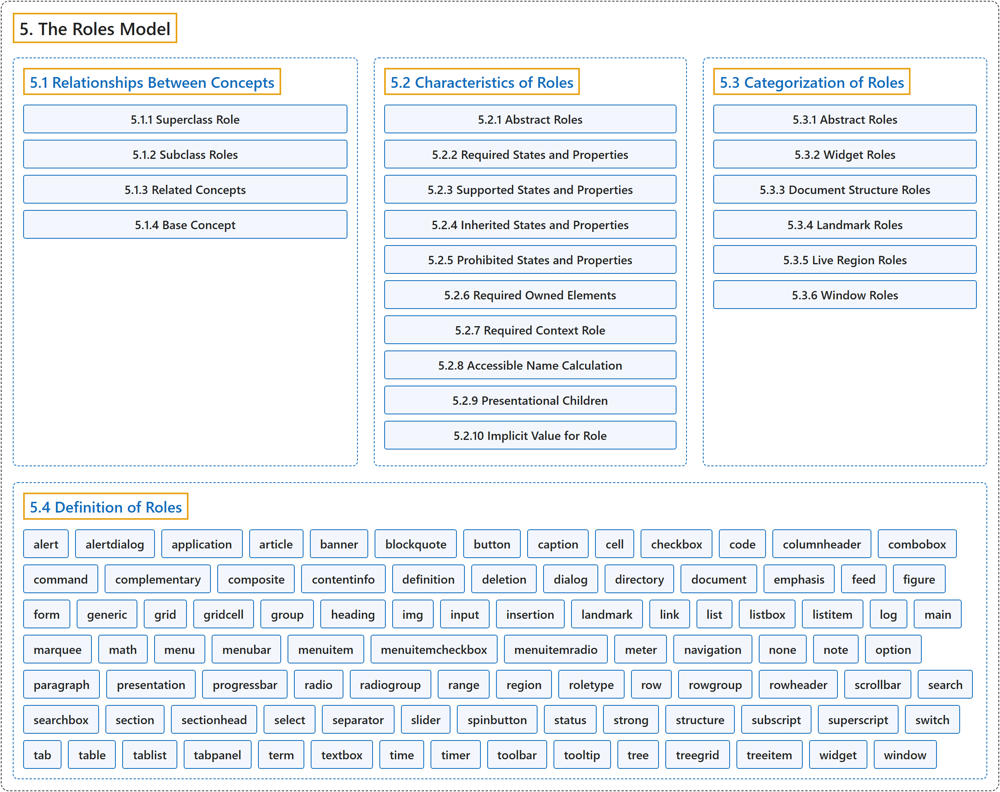

# 5. The Roles Model

## Classification

## Glossary

| Term | Definition | 中文翻译 | Source |
|---|---|---|---|
| **5. The Roles Model** 角色模型 | "This section **defines WAI-ARIA roles** and describes their **characteristics and properties**." | 本节**定义 WAI-ARIA 角色**，并描述它们的**特征和属性**。 | [World Wide Web Consortium, 2023, section 5](https://www.w3.org/TR/wai-aria-1.2/) |
| **[5.1 Relationships Between Concepts](relationships-between-concepts/index.md)** 概念之间的关系 | "The Roles Model uses the following **relationships** to **relate WAI-ARIA roles to each other and to concepts from other specifications**, such as HTML." | 角色模型用下列**关系**来**把 WAI-ARIA 角色相互关联，并与其他规范（如 HTML）的概念关联**。 | [World Wide Web Consortium, 2023, section 5.1](https://www.w3.org/TR/wai-aria-1.2/) |
| **[5.2 Characteristics of Roles](characteristics-of-roles/index.md)** 角色的特征 | "Roles are **defined and described by their characteristics**." | 角色**由其特征来定义和描述**。 | [World Wide Web Consortium, 2023, section 5.2](https://www.w3.org/TR/wai-aria-1.2/) |
| **[5.3 Categorization of Roles](categorization-of-roles/index.md)** 角色的分类 | "To support the current user scenario, this specification **categorizes roles** that **define user interface widgets** (sliders, tree controls, etc.) and those that **define page structure** (sections, navigation, etc.)." | 为了支持当前的用户场景，本规范把**角色分类**为**定义用户界面控件**的角色（滑块、树形控件等）和**定义页面结构**的角色（节、导航等）。 | [World Wide Web Consortium, 2023, section 5.3](https://www.w3.org/TR/wai-aria-1.2/) |
| **[5.4 Definition of Roles](definition-of-roles.md)** 角色的定义 | "Below is an **alphabetical list of WAI-ARIA roles** to be used by authors." | 下面是供作者使用的 **WAI-ARIA 角色的字母顺序列表**。 | [World Wide Web Consortium, 2023, section 5.4](https://www.w3.org/TR/wai-aria-1.2/) |

## References

World Wide Web Consortium. (2023, June 6). *Accessible Rich Internet Applications (WAI-ARIA) 1.2* (W3C Recommendation). <https://www.w3.org/TR/wai-aria-1.2/>
