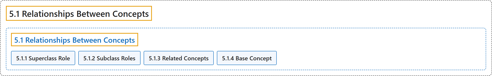

# 5.1 Relationships Between Concepts

## Classification

## Glossary

| Term | Definition | 中文翻译 | Source |
|---|---|---|---|
| **5.1 Relationships Between Concepts** 概念之间的关系 | "The Roles Model uses the following **relationships** to **relate WAI-ARIA roles to each other and to concepts from other specifications**, such as HTML." | 角色模型用下列**关系**来**把 WAI-ARIA 角色相互关联，并与其他规范（如 HTML）的概念关联**。 | [World Wide Web Consortium, 2023, section 5.1](https://www.w3.org/TR/wai-aria-1.2/) |
| **[5.1.1 Superclass Role](superclass-role.md)** 超类角色 | "The role that the **current subclassed role extends** in the Roles Model." | 在角色模型中，**当前子类角色所扩展**的角色。 | [World Wide Web Consortium, 2023, section 5.1.1](https://www.w3.org/TR/wai-aria-1.2/) |
| **[5.1.2 Subclass Roles](subclass-roles.md)** 子类角色 | "Informative **list of roles for which this role is the superclass**." | 信息性的**以本角色为超类的角色列表**。 | [World Wide Web Consortium, 2023, section 5.1.2](https://www.w3.org/TR/wai-aria-1.2/) |
| **[5.1.3 Related Concepts](related-concepts.md)** 相关概念 | "Informative data about a **similar or related idea from other specifications**." | 关于**其他规范中相似或相关想法**的信息性数据。 | [World Wide Web Consortium, 2023, section 5.1.3](https://www.w3.org/TR/wai-aria-1.2/) |
| **[5.1.4 Base Concept](base-concept.md)** 基础概念 | "Informative data about **objects that are considered prototypes for the role**." | 关于**被视为该角色原型的对象**的信息性数据。 | [World Wide Web Consortium, 2023, section 5.1.4](https://www.w3.org/TR/wai-aria-1.2/) |

## References

World Wide Web Consortium. (2023, June 6). *Accessible Rich Internet Applications (WAI-ARIA) 1.2* (W3C Recommendation). <https://www.w3.org/TR/wai-aria-1.2/>
