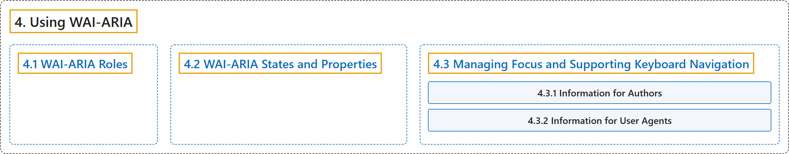

# 4. Using WAI-ARIA

## Classification

## Glossary

| Term | Definition | 中文翻译 | Source |
|---|---|---|---|
| **4. Using WAI-ARIA** 使用 WAI-ARIA | "WAI-ARIA divides the semantics into **roles** (the type defining a user interface element) and **states and properties** supported by the roles." | WAI-ARIA 把语义分为**角色**（定义用户界面元素的类型），以及角色所支持的**状态和属性**。 | [World Wide Web Consortium, 2023, section 4](https://www.w3.org/TR/wai-aria-1.2/) |
| **[4.1 WAI-ARIA Roles](wai-aria-roles.md)** WAI-ARIA 角色 | "A WAI-ARIA role is **set on an element using a role attribute**, similar to the role attribute defined in Role Attribute [ROLE-ATTRIBUTE]." | WAI-ARIA 角色**通过 role 属性设置在元素上**，类似于 Role Attribute [ROLE-ATTRIBUTE] 中定义的 role 属性。 | [World Wide Web Consortium, 2023, section 4.1](https://www.w3.org/TR/wai-aria-1.2/) |
| **[4.2 WAI-ARIA States and Properties](wai-aria-states-and-properties.md)** WAI-ARIA 状态和属性 | "WAI-ARIA provides a **collection of accessibility states and properties** which are used to **support platform accessibility APIs** on various operating system platforms." | WAI-ARIA 提供**一组无障碍状态和属性**，用于在各种操作系统平台上**支持平台无障碍 API**。 | [World Wide Web Consortium, 2023, section 4.2](https://www.w3.org/TR/wai-aria-1.2/) |
| **[4.3 Managing Focus and Supporting Keyboard Navigation](managing-focus-and-supporting-keyboard-navigation/index.md)** 管理焦点和支持键盘导航 | "When using standard HTML interactive elements and simple WAI-ARIA widgets, application developers can **manipulate the tab order or associate keyboard shortcuts** with elements in the document." | 使用标准 HTML 交互元素和简单的 WAI-ARIA 控件时，应用开发者可以**操纵 Tab 顺序或为文档中的元素关联键盘快捷键**。 | [World Wide Web Consortium, 2023, section 4.3](https://www.w3.org/TR/wai-aria-1.2/) |

## References

World Wide Web Consortium. (2023, June 6). *Accessible Rich Internet Applications (WAI-ARIA) 1.2* (W3C Recommendation). <https://www.w3.org/TR/wai-aria-1.2/>
