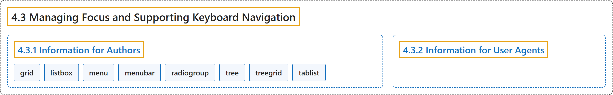

# 4.3 Managing Focus and Supporting Keyboard Navigation

## Classification

## Glossary

| Term | Definition | 中文翻译 | Source |
|---|---|---|---|
| **4.3 Managing Focus and Supporting Keyboard Navigation** 管理焦点和支持键盘导航 | "When using standard HTML interactive elements and simple WAI-ARIA widgets, application developers can **manipulate the tab order or associate keyboard shortcuts** with elements in the document." | 使用标准 HTML 交互元素和简单的 WAI-ARIA 控件时，应用开发者可以**操纵 Tab 顺序或为文档中的元素关联键盘快捷键**。 | [World Wide Web Consortium, 2023, section 4.3](https://www.w3.org/TR/wai-aria-1.2/) |
| **[4.3.1 Information for Authors](information-for-authors.md)** 给作者的信息 | "Authors SHOULD ensure that **all interactive elements are focusable** and that all parts of composite widgets are either focusable or have a documented alternative method to achieve their function." | 作者应确保**所有交互元素都可聚焦**，并且复合控件的所有部分要么可聚焦，要么有文档说明的替代方法来实现其功能。 | [World Wide Web Consortium, 2023, section 4.3.1](https://www.w3.org/TR/wai-aria-1.2/) |
| **[4.3.2 Information for User Agents](information-for-user-agents.md)** 给用户代理的信息 | (context) "Implement the host language method for keyboard navigation so that **widgets that support aria-activedescendant may be included in the tab order**." | （语境）实现宿主语言的键盘导航方法，使**支持 aria-activedescendant 的控件可以进入 Tab 顺序**。 | [World Wide Web Consortium, 2023, section 4.3.2](https://www.w3.org/TR/wai-aria-1.2/) |

## References

World Wide Web Consortium. (2023, June 6). *Accessible Rich Internet Applications (WAI-ARIA) 1.2* (W3C Recommendation). <https://www.w3.org/TR/wai-aria-1.2/>
