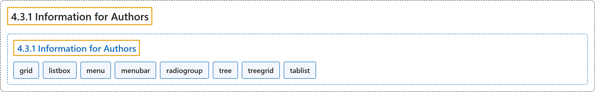

# 4.3.1 Information for Authors

## Classification

## Glossary

| Term | Definition | 中文翻译 | Source |
|---|---|---|---|
| **4.3.1 Information for Authors** 给作者的信息 | "Authors SHOULD ensure that **all interactive elements are focusable** and that all parts of composite widgets are either focusable or have a documented alternative method to achieve their function." | 作者应确保**所有交互元素都可聚焦**，并且复合控件的所有部分要么可聚焦，要么有文档说明的替代方法来实现其功能。 | [World Wide Web Consortium, 2023, section 4.3.1](https://www.w3.org/TR/wai-aria-1.2/) |
| **grid** 网格 | "A composite widget containing a **collection of one or more rows with one or more cells** where some or all cells in the grid are **focusable by using methods of two-dimensional navigation**, such as directional arrow keys." | 一种复合控件，包含**一行或多行、每行一个或多个单元格的集合**，其中部分或全部单元格**可以通过二维导航方法聚焦**，例如方向键。 | [World Wide Web Consortium, 2023, section 5.4, grid](https://www.w3.org/TR/wai-aria-1.2/#grid) |
| **listbox** 列表框 | "A widget that allows the user to **select one or more items from a list of choices**." | 一种控件，允许用户**从选项列表中选择一项或多项**。 | [World Wide Web Consortium, 2023, section 5.4, listbox](https://www.w3.org/TR/wai-aria-1.2/#listbox) |
| **menu** 菜单 | "A type of widget that **offers a list of choices** to the user." | 一种控件，向用户**提供选项列表**。 | [World Wide Web Consortium, 2023, section 5.4, menu](https://www.w3.org/TR/wai-aria-1.2/#menu) |
| **menubar** 菜单栏 | "A presentation of menu that **usually remains visible** and is **usually presented horizontally**." | 菜单的一种呈现形式，**通常保持可见**并**通常水平呈现**。 | [World Wide Web Consortium, 2023, section 5.4, menubar](https://www.w3.org/TR/wai-aria-1.2/#menubar) |
| **radiogroup** 单选组 | "A **group of radio buttons**." | **一组单选按钮**。 | [World Wide Web Consortium, 2023, section 5.4, radiogroup](https://www.w3.org/TR/wai-aria-1.2/#radiogroup) |
| **tree** 树 | "A widget that allows the user to **select one or more items from a hierarchically organized collection**." | 一种控件，允许用户**从按层次组织的集合中选择一项或多项**。 | [World Wide Web Consortium, 2023, section 5.4, tree](https://www.w3.org/TR/wai-aria-1.2/#tree) |
| **treegrid** 树形网格 | "A grid whose **rows can be expanded and collapsed** in the same manner as for a tree." | 一种网格，其**行可以像树一样展开和折叠**。 | [World Wide Web Consortium, 2023, section 5.4, treegrid](https://www.w3.org/TR/wai-aria-1.2/#treegrid) |
| **tablist** 标签页列表 | "A **list of tab elements**, which are references to tabpanel elements." | **tab 元素的列表**，它们是对 tabpanel 元素的引用。 | [World Wide Web Consortium, 2023, section 5.4, tablist](https://www.w3.org/TR/wai-aria-1.2/#tablist) |

## References

World Wide Web Consortium. (2023, June 6). *Accessible Rich Internet Applications (WAI-ARIA) 1.2* (W3C Recommendation). <https://www.w3.org/TR/wai-aria-1.2/>
