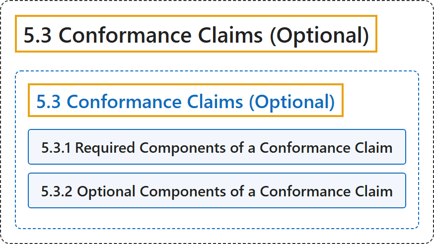

# 5.3 Conformance Claims (Optional)

## Classification

## Glossary

| Term | Definition | 中文翻译 | Source |
|---|---|---|---|
| **5.3 Conformance Claims (Optional)** 一致性声明（可选） | "Conformance is defined only for web pages. However, **a conformance claim may be made to cover one page, a series of pages, or multiple related web pages**." | 一致性只针对网页定义。不过，**一致性声明可以覆盖一个页面、一系列页面或多个相关网页**。 | [World Wide Web Consortium, 2024, section 5.3](https://www.w3.org/TR/WCAG22/#conformance) |
| **5.3.1 Required Components of a Conformance Claim** 一致性声明的必需组成 | "**Conformance claims are not required**. Authors can conform to WCAG 2.2 without making a claim. However, if a conformance claim is made, then the conformance claim must include the following information:" | **一致性声明不是必需的**。作者可以不作声明而符合 WCAG 2.2。但如果作出一致性声明，则该声明必须包含下列信息： | [World Wide Web Consortium, 2024, section 5.3.1](https://www.w3.org/TR/WCAG22/#conformance) |
| **5.3.2 Optional Components of a Conformance Claim** 一致性声明的可选组成 | "In addition to the required components of a conformance claim above, **consider providing additional information to assist users**. Recommended additional information includes:" | 除上述一致性声明的必需组成外，**考虑提供附加信息以帮助用户**。建议的附加信息包括： | [World Wide Web Consortium, 2024, section 5.3.2](https://www.w3.org/TR/WCAG22/#conformance) |

## References

World Wide Web Consortium. (2024, December 12). *Web Content Accessibility Guidelines (WCAG) 2.2* (W3C Recommendation). <https://www.w3.org/TR/WCAG22/>
