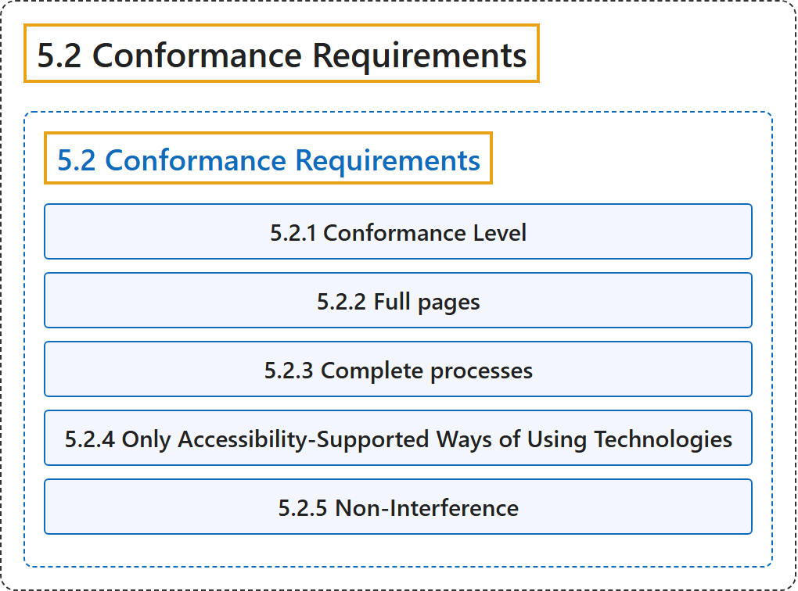

# 5.2 Conformance Requirements

## Classification

## Glossary

| Term | Definition | 中文翻译 | Source |
|---|---|---|---|
| **5.2 Conformance Requirements** 一致性要求 | "In order for a web page to conform to WCAG 2.2, **all of the following conformance requirements must be satisfied**:" | 网页要符合 WCAG 2.2，**必须满足下列全部一致性要求**： | [World Wide Web Consortium, 2024, section 5.2](https://www.w3.org/TR/WCAG22/#conformance) |
| **5.2.1 Conformance Level** 一致性级别 | "**One of the following levels of conformance is met in full**." | **完全达到下列一致性级别之一**。 | [World Wide Web Consortium, 2024, section 5.2.1](https://www.w3.org/TR/WCAG22/#conformance) |
| **5.2.2 Full pages** 完整页面 | "Conformance (and conformance level) is **for full web page(s) only**, and cannot be achieved if part of a web page is excluded." | 一致性（和一致性级别）**只针对完整的网页**，如果网页的一部分被排除，则无法达到。 | [World Wide Web Consortium, 2024, section 5.2.2](https://www.w3.org/TR/WCAG22/#conformance) |
| **5.2.3 Complete processes** 完整流程 | "When a web page is one of a series of web pages presenting a process (i.e., a sequence of steps that need to be completed in order to accomplish an activity), **all web pages in the process conform at the specified level or better**. (Conformance is not possible at a particular level if any page in the process does not conform at that level or better.)" | 当一个网页是呈现某个流程（即为完成某项活动而需要依次完成的一系列步骤）的一系列网页之一时，**该流程中的所有网页都符合指定级别或更高级别**。（如果流程中任何页面不符合该级别或更高级别，则无法在该级别达到一致性。） | [World Wide Web Consortium, 2024, section 5.2.3](https://www.w3.org/TR/WCAG22/#conformance) |
| **5.2.4 Only Accessibility-Supported Ways of Using Technologies** 只以无障碍支持的方式使用技术 | "**Only accessibility-supported ways of using technologies are relied upon** to satisfy the success criteria. Any information or functionality that is provided in a way that is not accessibility supported is also available in a way that is accessibility supported. (See Understanding accessibility support.)" | **只有以无障碍支持的方式使用技术才被依赖**来满足成功标准。以非无障碍支持的方式提供的任何信息或功能，也以无障碍支持的方式提供。 | [World Wide Web Consortium, 2024, section 5.2.4](https://www.w3.org/TR/WCAG22/#conformance) |
| **5.2.5 Non-Interference** 不干扰 | "If technologies are used in a way that is not accessibility supported, or if they are used in a non-conforming way, then they **do not block the ability of users to access the rest of the page**. In addition, the web page as a whole continues to meet the conformance requirements under each of the following conditions:" | 如果技术以非无障碍支持的方式或不符合规范的方式使用，那么它们**不会阻碍用户访问页面的其余部分**。此外，在下列每种情况下，整个网页仍然满足一致性要求： | [World Wide Web Consortium, 2024, section 5.2.5](https://www.w3.org/TR/WCAG22/#conformance) |

## References

World Wide Web Consortium. (2024, December 12). *Web Content Accessibility Guidelines (WCAG) 2.2* (W3C Recommendation). <https://www.w3.org/TR/WCAG22/>
