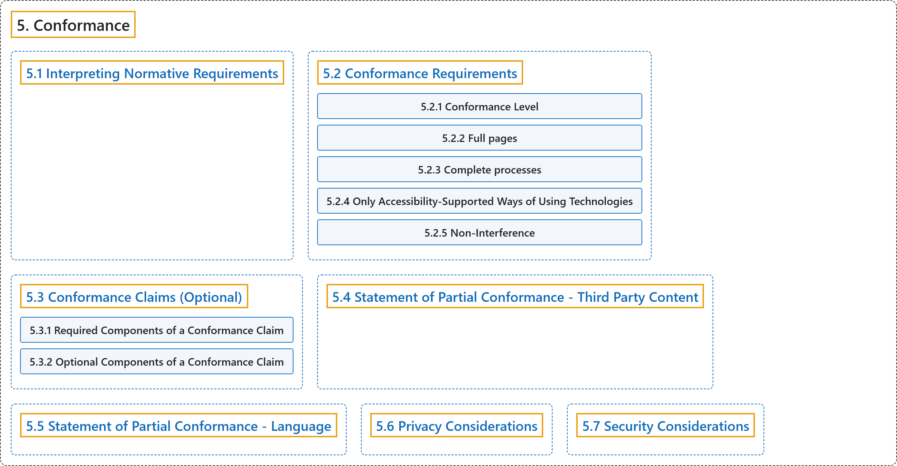

# 5. Conformance

## Classification

## Glossary

| Term | Definition | 中文翻译 | Source |
|---|---|---|---|
| **5. Conformance** 一致性 | "This section lists **requirements for conformance to WCAG 2.2**. It also gives information about how to make conformance claims, which are optional. Finally, it describes what it means to be accessibility supported, since only accessibility-supported ways of using technologies can be relied upon for conformance. Understanding Conformance includes further explanation of the accessibility-supported concept." | 本节列出**符合 WCAG 2.2 的要求**。它还说明如何作出一致性声明（可选）。最后，它说明“无障碍支持”的含义，因为只有以无障碍支持的方式使用技术才能被一致性所依赖。 | [World Wide Web Consortium, 2024, section 5](https://www.w3.org/TR/WCAG22/#conformance) |
| **[5.1 Interpreting Normative Requirements](interpreting-normative-requirements.md)** 解读规范性要求 | "The main content of WCAG 2.2 is **normative** and defines **requirements that impact conformance claims**. Introductory material, appendices, sections marked as "non-normative", diagrams, examples, and notes are informative (non-normative). Non-normative material provides advisory information to help interpret the guidelines but does not create requirements that impact a conformance claim." | WCAG 2.2 的主要内容是**规范性的**，并规定**影响一致性声明的要求**。引言材料、附录、标为“非规范性”的部分、图、示例和注释是信息性的（非规范性）。非规范性材料提供建议性信息以帮助解读指南，但不产生影响一致性声明的要求。 | [World Wide Web Consortium, 2024, section 5.1](https://www.w3.org/TR/WCAG22/#conformance) |
| **[5.2 Conformance Requirements](conformance-requirements.md)** 一致性要求 | "In order for a web page to conform to WCAG 2.2, **all of the following conformance requirements must be satisfied**:" | 网页要符合 WCAG 2.2，**必须满足下列全部一致性要求**： | [World Wide Web Consortium, 2024, section 5.2](https://www.w3.org/TR/WCAG22/#conformance) |
| **[5.3 Conformance Claims (Optional)](conformance-claims-optional.md)** 一致性声明（可选） | "Conformance is defined only for web pages. However, **a conformance claim may be made to cover one page, a series of pages, or multiple related web pages**." | 一致性只针对网页定义。不过，**一致性声明可以覆盖一个页面、一系列页面或多个相关网页**。 | [World Wide Web Consortium, 2024, section 5.3](https://www.w3.org/TR/WCAG22/#conformance) |
| **[5.4 Statement of Partial Conformance - Third Party Content](statement-of-partial-conformance-third-party-content.md)** 部分一致性声明：第三方内容 | "Web pages that will later have additional content added **can use a 'statement of partial conformance'**. For example, an email program, a blog, an article that allows users to add comments, or applications supporting user-contributed content. Another example would be a page, such as a portal or news site, composed of content aggregated from multiple contributors, or sites that automatically insert content from other sources over time, such as when advertisements are inserted dynamically." | 之后会添加更多内容的网页**可以使用“部分一致性声明”**。例如电子邮件程序、博客、允许用户添加评论的文章，或支持用户贡献内容的应用。另一个例子是由多个贡献者聚合内容组成的页面（如门户或新闻站点），或自动插入其他来源内容的站点（如动态插入的广告）。 | [World Wide Web Consortium, 2024, section 5.4](https://www.w3.org/TR/WCAG22/#conformance) |
| **[5.5 Statement of Partial Conformance - Language](statement-of-partial-conformance-language.md)** 部分一致性声明：语言 | "A "statement of partial conformance due to language" **may be made when the page does not conform, but would conform if accessibility support existed** for (all of) the language(s) used on the page. The form of that statement would be, "This page does not conform, but would conform to WCAG 2.2 at level X if accessibility support existed for the following language(s):"" | “因语言而作的部分一致性声明”**可以在页面不符合、但如果页面所用（全部）语言有无障碍支持就会符合的情况下作出**。该声明的形式是：“本页面不符合，但如果下列语言有无障碍支持，就会在 X 级符合 WCAG 2.2：” | [World Wide Web Consortium, 2024, section 5.5](https://www.w3.org/TR/WCAG22/#conformance) |
| **[5.6 Privacy Considerations](privacy-considerations.md)** 隐私考虑 | "Success criteria within this specification which the Working Group has identified **possible implications for privacy**, either by providing protections for end users or which are important for website providers to take in to consideration when implementing features designed to protect user privacy, are listed below. This list reflects the current understanding of the Working Group but other Success criteria may have privacy implications that the Working Group is not aware of at the time of publishing." | 本规范中工作组认定**可能涉及隐私**的成功标准（为最终用户提供保护，或网站提供者在实现保护用户隐私的功能时需要考虑的）列在下面。这个清单反映工作组目前的理解，但其他成功标准也可能与隐私有关。 | [World Wide Web Consortium, 2024, section 5.6](https://www.w3.org/TR/WCAG22/#conformance) |
| **[5.7 Security Considerations](security-considerations.md)** 安全考虑 | "Success criteria within this specification which the Working Group has identified **possible implications for security**, either by providing protections for end users or which are important for website providers to take in to consideration when implementing features designed to protect user security, are listed below. This list reflects the current understanding of the Working Group but other Success criteria may have security implications that the Working Group is not aware of at the time of publishing." | 本规范中工作组认定**可能涉及安全**的成功标准（为最终用户提供保护，或网站提供者在实现保护用户安全的功能时需要考虑的）列在下面。这个清单反映工作组目前的理解，但其他成功标准也可能与安全有关。 | [World Wide Web Consortium, 2024, section 5.7](https://www.w3.org/TR/WCAG22/#conformance) |

## References

World Wide Web Consortium. (2024, December 12). *Web Content Accessibility Guidelines (WCAG) 2.2* (W3C Recommendation). <https://www.w3.org/TR/WCAG22/>
