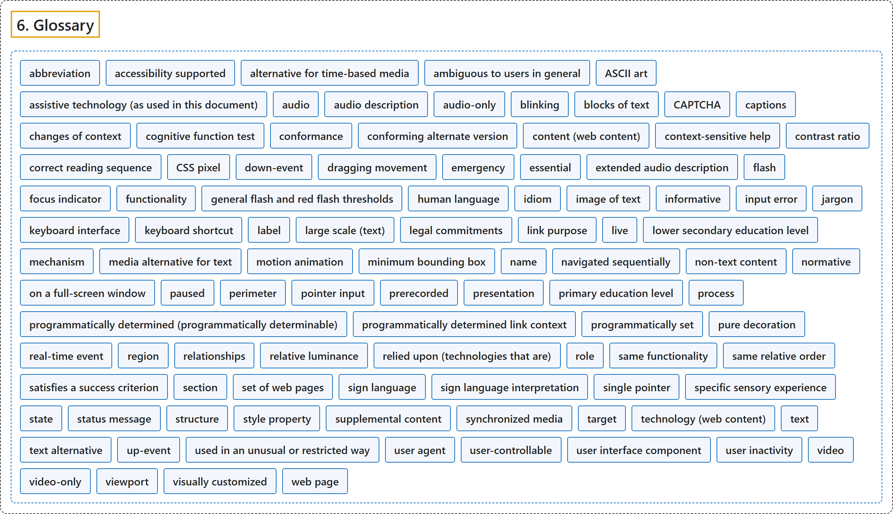

# 6. Glossary

## Classification

## Glossary

| Term | Definition | 中文翻译 | Source |
|---|---|---|---|
| **6. Glossary** 术语表 | (context) "The new success criteria may reference **new terms that have also been added to the glossary** and **form part of the normative requirements** of the success criteria." | （语境）新的成功标准可能引用**同样已加入术语表的新术语**，这些术语**构成成功标准规范性要求的一部分**。 | [World Wide Web Consortium, 2024, "New Features in WCAG 2.2"](https://www.w3.org/TR/WCAG22/#new-features-in-wcag-2-2) |
| **abbreviation** 缩写 | "**shortened form of a word, phrase, or name** where the abbreviation **has not become part of the language**" | **词、短语或名称的缩短形式**，且该缩写**尚未成为语言的一部分** | [World Wide Web Consortium, 2024, section 6](https://www.w3.org/TR/WCAG22/#glossary) |
| **accessibility supported** 无障碍支持 | "**supported by users' assistive technologies** as well as the **accessibility features in browsers and other user agents**" | **受用户的辅助技术支持**，也受**浏览器和其他用户代理中的无障碍功能**支持 | [World Wide Web Consortium, 2024, section 6](https://www.w3.org/TR/WCAG22/#glossary) |
| **alternative for time-based media** 基于时间的媒体的替代 | "document including **correctly sequenced text descriptions of time-based visual and auditory information** and providing a means for **achieving the outcomes of any time-based interaction**" | 包含**按正确顺序排列的、对基于时间的视觉和听觉信息的文字描述**的文档，并提供**实现任何基于时间的交互结果**的手段 | [World Wide Web Consortium, 2024, section 6](https://www.w3.org/TR/WCAG22/#glossary) |
| **ambiguous to users in general** 对一般用户含糊不清 | "**the purpose cannot be determined from the link** and all information of the web page presented to the user simultaneously with the link (i.e., **readers without disabilities would not know what a link would do until they activated it**)" | **从链接以及与链接同时呈现给用户的网页全部信息中无法确定其目的**（即**没有残障的读者在激活链接之前也不知道它会做什么**） | [World Wide Web Consortium, 2024, section 6](https://www.w3.org/TR/WCAG22/#glossary) |
| **ASCII art** ASCII 艺术 | "**picture created by a spatial arrangement of characters or glyphs** (typically from the **95 printable characters defined by ASCII**)" | **由字符或字形的空间排列构成的图画**（通常用 **ASCII 定义的 95 个可打印字符**） | [World Wide Web Consortium, 2024, section 6](https://www.w3.org/TR/WCAG22/#glossary) |
| **assistive technology (as used in this document)** 辅助技术（本文档所用） | "**hardware and/or software that acts as a user agent, or along with a mainstream user agent**, to provide functionality to **meet the requirements of users with disabilities** that go beyond those offered by mainstream user agents" | **作为用户代理、或与主流用户代理一起工作的硬件和/或软件**，提供功能以**满足残障用户的需求**，超出主流用户代理所提供的 | [World Wide Web Consortium, 2024, section 6](https://www.w3.org/TR/WCAG22/#glossary) |
| **audio** 音频 | "**the technology** of **sound reproduction**" | **声音再现**的**技术** | [World Wide Web Consortium, 2024, section 6](https://www.w3.org/TR/WCAG22/#glossary) |
| **audio description** 音频描述 | "**narration added to the soundtrack** to **describe important visual details** that cannot be understood from the main soundtrack alone" | **添加到音轨中的旁白**，用来**描述仅凭主音轨无法理解的重要视觉细节** | [World Wide Web Consortium, 2024, section 6](https://www.w3.org/TR/WCAG22/#glossary) |
| **audio-only** 纯音频 | "a **time-based presentation** that **contains only audio** (no video and no interaction)" | 一种**基于时间的呈现**，**只包含音频**（没有视频，没有交互） | [World Wide Web Consortium, 2024, section 6](https://www.w3.org/TR/WCAG22/#glossary) |
| **blinking** 闪动 | "**switch back and forth between two visual states** in a way that is **meant to draw attention**" | **在两种视觉状态之间来回切换**，目的是**引起注意** | [World Wide Web Consortium, 2024, section 6](https://www.w3.org/TR/WCAG22/#glossary) |
| **blocks of text** 文本块 | "**more than one sentence** of **text**" | **多于一句**的**文本** | [World Wide Web Consortium, 2024, section 6](https://www.w3.org/TR/WCAG22/#glossary) |
| **CAPTCHA** 验证码 | "**initialism** for "**Completely Automated Public Turing test to tell Computers and Humans Apart**"" | “**全自动区分计算机和人类的公开图灵测试**”的**首字母缩写** | [World Wide Web Consortium, 2024, section 6](https://www.w3.org/TR/WCAG22/#glossary) |
| **captions** 字幕 | "**synchronized visual and/or text alternative** for both **speech and non-speech audio information** needed to understand the media content" | **同步的视觉和/或文字替代**，针对理解媒体内容所需的**语音和非语音音频信息** | [World Wide Web Consortium, 2024, section 6](https://www.w3.org/TR/WCAG22/#glossary) |
| **changes of context** 上下文的改变 | "**major changes** that, if made without user awareness, can **disorient users who are not able to view the entire page simultaneously**" | **重大改变**，如果在用户不知情时发生，会让**无法同时查看整个页面的用户迷失方向** | [World Wide Web Consortium, 2024, section 6](https://www.w3.org/TR/WCAG22/#glossary) |
| **cognitive function test** 认知功能测试 | "**A task** that requires the user to **remember, manipulate, or transcribe information**. Examples include, but are not limited to:" | 要求用户**记忆、处理或转录信息**的**任务**。例子包括但不限于： | [World Wide Web Consortium, 2024, section 6](https://www.w3.org/TR/WCAG22/#glossary) |
| **conformance** 一致性 | "**satisfying all the requirements** of a given **standard, guideline or specification**" | **满足全部要求**，针对给定的**标准、指南或规范** | [World Wide Web Consortium, 2024, section 6](https://www.w3.org/TR/WCAG22/#glossary) |
| **conforming alternate version** 符合要求的替代版本 | "version that 1. **conforms at the designated level**, and 2. **provides all of the same information and functionality in the same human language**, and 3. **is as up to date as the non-conforming content**, and" | 这样的版本：1. **在指定级别符合要求**，且 2. **以同一人类语言提供全部相同的信息和功能**，且 3. **与不符合要求的内容同样及时更新**，且 | [World Wide Web Consortium, 2024, section 6](https://www.w3.org/TR/WCAG22/#glossary) |
| **content (web content)** 内容（网络内容） | "**information and sensory experience** to be **communicated to the user by means of a user agent**, including code or markup that defines the content's structure, presentation, and interactions" | **通过用户代理传达给用户**的**信息和感官体验**，包括定义内容结构、呈现和交互的代码或标记 | [World Wide Web Consortium, 2024, section 6](https://www.w3.org/TR/WCAG22/#glossary) |
| **context-sensitive help** 上下文相关帮助 | "**help text** that provides information **related to the function currently being performed**" | 提供**与当前正在执行的功能相关**信息的**帮助文本** | [World Wide Web Consortium, 2024, section 6](https://www.w3.org/TR/WCAG22/#glossary) |
| **contrast ratio** 对比度 | "**(L1 + 0.05) / (L2 + 0.05)**, where **L1 is the relative luminance of the lighter of the colors**, and **L2 is the relative luminance of the darker of the colors**." | **(L1 + 0.05) / (L2 + 0.05)**，其中 **L1 是较亮颜色的相对亮度**，**L2 是较暗颜色的相对亮度**。 | [World Wide Web Consortium, 2024, section 6](https://www.w3.org/TR/WCAG22/#glossary) |
| **correct reading sequence** 正确的阅读顺序 | "any sequence where **words and paragraphs are presented in an order** that **does not change the meaning of the content**" | 任何这样的顺序：**词和段落按某个次序呈现**，该次序**不改变内容意义** | [World Wide Web Consortium, 2024, section 6](https://www.w3.org/TR/WCAG22/#glossary) |
| **CSS pixel** CSS 像素 | "**visual angle** of **about 0.0213 degrees**" | **约 0.0213 度**的**视角** | [World Wide Web Consortium, 2024, section 6](https://www.w3.org/TR/WCAG22/#glossary) |
| **down-event** 按下事件 | "**platform event** that occurs when the **trigger stimulus of a pointer is depressed**" | **指针的触发刺激被按下**时发生的**平台事件** | [World Wide Web Consortium, 2024, section 6](https://www.w3.org/TR/WCAG22/#glossary) |
| **dragging movement** 拖动操作 | "an operation where **the pointer engages with an element on the down-event** and the element (or a representation of its position) **follows the pointer until an up-event**" | 一种操作：**指针在按下事件时与元素接合**，元素（或其位置的表示）**跟随指针直到抬起事件** | [World Wide Web Consortium, 2024, section 6](https://www.w3.org/TR/WCAG22/#glossary) |
| **emergency** 紧急情况 | "a **sudden, unexpected situation or occurrence** that **requires immediate action to preserve health, safety, or property**" | **突然、意外的情况或事件**，**需要立即采取行动以保护健康、安全或财产** | [World Wide Web Consortium, 2024, section 6](https://www.w3.org/TR/WCAG22/#glossary) |
| **essential** 必不可少 | "**if removed, would fundamentally change the information or functionality of the content**, and information and functionality **cannot be achieved in another way that would conform**" | **如果去掉，会从根本上改变内容的信息或功能**，并且这些信息和功能**无法以其他符合要求的方式实现** | [World Wide Web Consortium, 2024, section 6](https://www.w3.org/TR/WCAG22/#glossary) |
| **extended audio description** 扩展音频描述 | "**audio description** that is added to an audiovisual presentation by **pausing the video so that there is time to add additional description**" | 通过**暂停视频以便有时间加入更多描述**而添加到视听呈现中的**音频描述** | [World Wide Web Consortium, 2024, section 6](https://www.w3.org/TR/WCAG22/#glossary) |
| **flash** 闪烁 | "**a pair of opposing changes in relative luminance** that **can cause seizures in some people** if it is large enough and in the right frequency range" | **一对相反的相对亮度变化**，如果幅度足够大且频率在特定范围内，**可能使某些人癫痫发作** | [World Wide Web Consortium, 2024, section 6](https://www.w3.org/TR/WCAG22/#glossary) |
| **focus indicator** 焦点指示器 | "**pixels that are changed** to **visually indicate when a user interface component is in a focused state**" | **被改变的像素**，用来**在视觉上指示用户界面组件处于聚焦状态** | [World Wide Web Consortium, 2024, section 6](https://www.w3.org/TR/WCAG22/#glossary) |
| **functionality** 功能 | "**processes and outcomes** **achievable through user action**" | **通过用户操作可以实现**的**过程和结果** | [World Wide Web Consortium, 2024, section 6](https://www.w3.org/TR/WCAG22/#glossary) |
| **general flash and red flash thresholds** 一般闪烁和红色闪烁阈值 | "**a flash or rapidly changing image sequence** is **below the threshold (i.e., content passes)** if any of the following are true:" | **闪烁或快速变化的图像序列**在下列任一条件为真时**低于阈值（即内容通过）**： | [World Wide Web Consortium, 2024, section 6](https://www.w3.org/TR/WCAG22/#glossary) |
| **human language** 人类语言 | "language that is **spoken, written or signed** (through visual or tactile means) **to communicate with humans**" | **以口头、书面或手语**（通过视觉或触觉方式）**与人交流**的语言 | [World Wide Web Consortium, 2024, section 6](https://www.w3.org/TR/WCAG22/#glossary) |
| **idiom** 习语 | "phrase whose **meaning cannot be deduced from the meaning of the individual words** and the **specific words cannot be changed without losing the meaning**" | **含义无法从单个词的含义推出**的短语，且**其中的具体词不能更换，否则失去含义** | [World Wide Web Consortium, 2024, section 6](https://www.w3.org/TR/WCAG22/#glossary) |
| **image of text** 文本图像 | "text that has been **rendered in a non-text form** (e.g., an image) in order to **achieve a particular visual effect**" | **以非文本形式（例如图像）呈现**的文本，目的是**实现特定的视觉效果** | [World Wide Web Consortium, 2024, section 6](https://www.w3.org/TR/WCAG22/#glossary) |
| **informative** 信息性 | "**for information purposes** and **not required for conformance**" | **为提供信息而给出**，**不是一致性所必需** | [World Wide Web Consortium, 2024, section 6](https://www.w3.org/TR/WCAG22/#glossary) |
| **input error** 输入错误 | "**information provided by the user** that is **not accepted**" | **用户提供的**、**未被接受**的信息 | [World Wide Web Consortium, 2024, section 6](https://www.w3.org/TR/WCAG22/#glossary) |
| **jargon** 行话 | "**words used in a particular way** by **people in a particular field**" | **特定领域的人**以**特定方式使用的词** | [World Wide Web Consortium, 2024, section 6](https://www.w3.org/TR/WCAG22/#glossary) |
| **keyboard interface** 键盘接口 | "**interface used by software** to **obtain keystroke input**" | **软件用来**获取**按键输入的接口** | [World Wide Web Consortium, 2024, section 6](https://www.w3.org/TR/WCAG22/#glossary) |
| **keyboard shortcut** 键盘快捷键 | "**alternative means of triggering an action** by the **pressing of one or more keys**" | 通过**按一个或多个键**来**触发动作的替代方式** | [World Wide Web Consortium, 2024, section 6](https://www.w3.org/TR/WCAG22/#glossary) |
| **label** 标签 | "**text or other component with a text alternative** that is presented to a user to **identify a component within web content**" | **文本或带文本替代的其他组件**，呈现给用户以**标识网络内容中的某个组件** | [World Wide Web Consortium, 2024, section 6](https://www.w3.org/TR/WCAG22/#glossary) |
| **large scale (text)** 大号（文本） | "with **at least 18 point or 14 point bold** or font size that would yield equivalent size for **Chinese, Japanese and Korean (CJK) fonts**" | **至少 18 磅，或 14 磅加粗**，或对**中日韩（CJK）字体**产生同等大小的字号 | [World Wide Web Consortium, 2024, section 6](https://www.w3.org/TR/WCAG22/#glossary) |
| **legal commitments** 法律承诺 | "**transactions** where the person incurs a **legally binding obligation or benefit**" | 使人承担**具有法律约束力的义务或获得利益**的**交易** | [World Wide Web Consortium, 2024, section 6](https://www.w3.org/TR/WCAG22/#glossary) |
| **link purpose** 链接目的 | "**nature of the result** obtained by **activating a hyperlink**" | **激活超链接**所得**结果的性质** | [World Wide Web Consortium, 2024, section 6](https://www.w3.org/TR/WCAG22/#glossary) |
| **live** 直播 | "information **captured from a real-world event** and transmitted to the receiver with **no more than a broadcast delay**" | **从真实事件中捕获**、以**不超过广播延迟**的时间传送给接收者的信息 | [World Wide Web Consortium, 2024, section 6](https://www.w3.org/TR/WCAG22/#glossary) |
| **lower secondary education level** 初中教育水平 | "the **two or three year period of education** that **begins after completion of six years of school** and ends nine years after the beginning of primary education" | **两到三年的教育阶段**，**在完成六年学业后开始**，在小学教育开始后第九年结束 | [World Wide Web Consortium, 2024, section 6](https://www.w3.org/TR/WCAG22/#glossary) |
| **mechanism** 机制 | "**process or technique** for **achieving a result**" | **实现某种结果**的**过程或技术** | [World Wide Web Consortium, 2024, section 6](https://www.w3.org/TR/WCAG22/#glossary) |
| **media alternative for text** 文本的媒体替代 | "**media** that **presents no more information than is already presented in text** (directly or via text alternatives)" | **呈现的信息不多于文本中已呈现的**（直接呈现或通过文本替代）的**媒体** | [World Wide Web Consortium, 2024, section 6](https://www.w3.org/TR/WCAG22/#glossary) |
| **motion animation** 运动动画 | "**addition of steps between conditions** to **create the illusion of movement** or to give a sense of a smooth transition" | **在状态之间加入过渡步骤**以**制造运动的错觉**，或给人平滑过渡的感觉 | [World Wide Web Consortium, 2024, section 6](https://www.w3.org/TR/WCAG22/#glossary) |
| **minimum bounding box** 最小外接框 | "the **smallest enclosing rectangle aligned to the horizontal axis** within which **all the points of a shape lie**. For components which wrap onto multiple lines as part of a sentence or block of text (such as hypertext links), the bounding box is based on how the component would appear on a single line." | **与水平轴对齐的最小矩形**，**形状的所有点都在其中** | [World Wide Web Consortium, 2024, section 6](https://www.w3.org/TR/WCAG22/#glossary) |
| **name** 名称 | "**text by which software can identify a component** within web content **to the user**" | **软件用来标识网络内容中某个组件的文本**，面向**用户** | [World Wide Web Consortium, 2024, section 6](https://www.w3.org/TR/WCAG22/#glossary) |
| **navigated sequentially** 按顺序导航 | "**navigated in the order defined for advancing focus** (from one element to the next) **using a keyboard interface**" | **按为推进焦点而定义的顺序导航**（从一个元素到下一个），**使用键盘接口** | [World Wide Web Consortium, 2024, section 6](https://www.w3.org/TR/WCAG22/#glossary) |
| **non-text content** 非文本内容 | "any content that is **not a sequence of characters that can be programmatically determined** or where the sequence is **not expressing something in human language**" | 任何**不是可由程序确定的字符序列**的内容，或该序列**不表达人类语言**的内容 | [World Wide Web Consortium, 2024, section 6](https://www.w3.org/TR/WCAG22/#glossary) |
| **normative** 规范性 | "**required** for **conformance**" | **一致性**所**必需** | [World Wide Web Consortium, 2024, section 6](https://www.w3.org/TR/WCAG22/#glossary) |
| **on a full-screen window** 在全屏窗口中 | "on the **most common sized desktop/laptop display** with the **viewport maximized**" | 在**最常见尺寸的台式机/笔记本显示器**上，**视口最大化** | [World Wide Web Consortium, 2024, section 6](https://www.w3.org/TR/WCAG22/#glossary) |
| **paused** 已暂停 | "**stopped by user request** and **not resumed until requested by user**" | **应用户请求停止**，**在用户请求之前不恢复** | [World Wide Web Consortium, 2024, section 6](https://www.w3.org/TR/WCAG22/#glossary) |
| **perimeter** 周长 | "**continuous line forming the boundary of a shape** not including shared pixels, or the minimum bounding box, **whichever is shortest**." | **构成形状边界的连续线**，不含共享像素，或最小外接框，**取较短者**。 | [World Wide Web Consortium, 2024, section 6](https://www.w3.org/TR/WCAG22/#glossary) |
| **pointer input** 指针输入 | "input from a device that can **target a specific coordinate (or set of coordinates) on a screen**, such as a **mouse, pen, or touch contact**" | 来自能够**指向屏幕上特定坐标（或一组坐标）**的设备的输入，例如**鼠标、笔或触摸接触** | [World Wide Web Consortium, 2024, section 6](https://www.w3.org/TR/WCAG22/#glossary) |
| **prerecorded** 预录 | "**information** that is **not live**" | **非直播**的**信息** | [World Wide Web Consortium, 2024, section 6](https://www.w3.org/TR/WCAG22/#glossary) |
| **presentation** 呈现 | "**rendering of the content** in a form to be **perceived by users**" | **把内容渲染**成可供**用户感知**的形式 | [World Wide Web Consortium, 2024, section 6](https://www.w3.org/TR/WCAG22/#glossary) |
| **primary education level** 小学教育水平 | "**six year time period** that **begins between the ages of five and seven**, possibly without any previous education" | **从五到七岁之间开始**的**六年阶段**，之前可能没有任何教育 | [World Wide Web Consortium, 2024, section 6](https://www.w3.org/TR/WCAG22/#glossary) |
| **process** 流程 | "**series of user actions** where **each action is required in order to complete an activity**" | **一系列用户操作**，其中**每一步都是完成某项活动所必需的** | [World Wide Web Consortium, 2024, section 6](https://www.w3.org/TR/WCAG22/#glossary) |
| **programmatically determined (programmatically determinable)** 可由程序确定 | "**determined by software from author-supplied data** provided in a way that **different user agents, including assistive technologies, can extract and present this information** to users in different modalities" | **由软件根据作者提供的数据确定**，这些数据以**不同用户代理（包括辅助技术）都能提取并呈现**给用户的方式提供 | [World Wide Web Consortium, 2024, section 6](https://www.w3.org/TR/WCAG22/#glossary) |
| **programmatically determined link context** 可由程序确定的链接上下文 | "**additional information that can be programmatically determined from relationships with a link**, **combined with the link text**, and presented to users in different modalities" | **可由程序从与链接的关系中确定的附加信息**，**与链接文本结合**，以不同方式呈现给用户 | [World Wide Web Consortium, 2024, section 6](https://www.w3.org/TR/WCAG22/#glossary) |
| **programmatically set** 由程序设置 | "**set by software** using **methods that are supported by user agents, including assistive technologies**" | **由软件设置**，使用**用户代理（包括辅助技术）支持的方法** | [World Wide Web Consortium, 2024, section 6](https://www.w3.org/TR/WCAG22/#glossary) |
| **pure decoration** 纯装饰 | "**serving only an aesthetic purpose**, **providing no information, and having no functionality**" | **只起美观作用**，**不提供信息，也没有功能** | [World Wide Web Consortium, 2024, section 6](https://www.w3.org/TR/WCAG22/#glossary) |
| **real-time event** 实时事件 | "event that a) **occurs at the same time as the viewing** and b) is **not completely generated by the content**" | a) **与观看同时发生**，且 b) **不完全由内容生成**的事件 | [World Wide Web Consortium, 2024, section 6](https://www.w3.org/TR/WCAG22/#glossary) |
| **region** 区域 | "**perceivable, programmatically determined** **section of content**" | **可感知的、可由程序确定的**一个**内容部分** | [World Wide Web Consortium, 2024, section 6](https://www.w3.org/TR/WCAG22/#glossary) |
| **relationships** 关系 | "**meaningful associations** between **distinct pieces of content**" | **不同内容片段**之间**有意义的关联** | [World Wide Web Consortium, 2024, section 6](https://www.w3.org/TR/WCAG22/#glossary) |
| **relative luminance** 相对亮度 | "the **relative brightness of any point in a colorspace**, **normalized to 0 for darkest black and 1 for lightest white**" | **色彩空间中任意一点的相对明亮程度**，**归一化为最暗的黑为 0、最亮的白为 1** | [World Wide Web Consortium, 2024, section 6](https://www.w3.org/TR/WCAG22/#glossary) |
| **relied upon (technologies that are)** 被依赖的（技术） | "**the content would not conform** if that technology is **turned off or is not supported**" | 如果该技术**被关闭或不受支持**，**内容就不符合要求** | [World Wide Web Consortium, 2024, section 6](https://www.w3.org/TR/WCAG22/#glossary) |
| **role** 角色 | "**text or number** by which software can **identify the function of a component** within Web content" | 软件用来**标识网络内容中某个组件的功能**的**文本或数字** | [World Wide Web Consortium, 2024, section 6](https://www.w3.org/TR/WCAG22/#glossary) |
| **same functionality** 相同功能 | "**same result** **when used**" | **使用时**得到**相同的结果** | [World Wide Web Consortium, 2024, section 6](https://www.w3.org/TR/WCAG22/#glossary) |
| **same relative order** 相同的相对顺序 | "**same position** **relative to other items**" | **相对于其他项目**的**位置相同** | [World Wide Web Consortium, 2024, section 6](https://www.w3.org/TR/WCAG22/#glossary) |
| **satisfies a success criterion** 满足成功标准 | "the success criterion **does not evaluate to 'false'** when **applied to the page**" | 该成功标准**应用于页面**时**不判定为“false”** | [World Wide Web Consortium, 2024, section 6](https://www.w3.org/TR/WCAG22/#glossary) |
| **section** 节 | "a **self-contained portion of written content** that deals with **one or more related topics or thoughts**" | **书面内容中自成一体的部分**，处理**一个或多个相关的主题或想法** | [World Wide Web Consortium, 2024, section 6](https://www.w3.org/TR/WCAG22/#glossary) |
| **set of web pages** 一组网页 | "collection of web pages that **share a common purpose** and that are **created by the same author, group or organization**" | **有共同目的**、**由同一作者、团体或组织创建**的网页集合 | [World Wide Web Consortium, 2024, section 6](https://www.w3.org/TR/WCAG22/#glossary) |
| **sign language** 手语 | "a language using **combinations of movements of the hands and arms, facial expressions, or body positions** to **convey meaning**" | 用**手和手臂的动作、面部表情或身体姿势的组合**来**传达意义**的语言 | [World Wide Web Consortium, 2024, section 6](https://www.w3.org/TR/WCAG22/#glossary) |
| **sign language interpretation** 手语翻译 | "**translation of one language, generally a spoken language**, **into a sign language**" | **把一种语言（通常是口语）翻译**，译**成手语** | [World Wide Web Consortium, 2024, section 6](https://www.w3.org/TR/WCAG22/#glossary) |
| **single pointer** 单指针 | "an input modality that **only targets a single point on the page/screen at a time** – such as a **mouse, single finger on a touch screen, or stylus**." | **一次只指向页面/屏幕上一个点**的输入方式，例如**鼠标、触摸屏上的单根手指或触控笔**。 | [World Wide Web Consortium, 2024, section 6](https://www.w3.org/TR/WCAG22/#glossary) |
| **specific sensory experience** 特定感官体验 | "a sensory experience that is **not purely decorative** and **does not primarily convey important information or perform a function**" | **不是纯装饰**、也**不主要传达重要信息或执行功能**的感官体验 | [World Wide Web Consortium, 2024, section 6](https://www.w3.org/TR/WCAG22/#glossary) |
| **state** 状态 | "**dynamic property expressing characteristics of a user interface component** that **may change in response to user action or automated processes**" | **表达用户界面组件特征的动态属性**，**可能因用户操作或自动过程而改变** | [World Wide Web Consortium, 2024, section 6](https://www.w3.org/TR/WCAG22/#glossary) |
| **status message** 状态消息 | "**change in content that is not a change of context**, and that provides information to the user on the **success or results of an action**, on the waiting state of an application, on the progress of a process, or on the existence of errors" | **不是上下文改变的内容变化**，向用户提供关于**操作成功或结果**、应用等待状态、流程进度或错误存在的信息 | [World Wide Web Consortium, 2024, section 6](https://www.w3.org/TR/WCAG22/#glossary) |
| **structure** 结构 | "**The way the parts of a web page are organized in relation to each other**; and **The way a collection of web pages is organized**" | **网页各部分相互之间的组织方式**；以及 **一组网页的组织方式** | [World Wide Web Consortium, 2024, section 6](https://www.w3.org/TR/WCAG22/#glossary) |
| **style property** 样式属性 | "**property whose value determines the presentation** (e.g. font, color, size, location, padding, volume, synthesized speech prosody) of content elements **as they are rendered** (e.g. onscreen, via loudspeaker, via braille display) by user agents" | **其值决定内容元素呈现方式的属性**（例如字体、颜色、大小、位置、内边距、音量、合成语音的韵律），**当内容被渲染时**（例如屏幕、扬声器、盲文显示器）由用户代理 | [World Wide Web Consortium, 2024, section 6](https://www.w3.org/TR/WCAG22/#glossary) |
| **supplemental content** 补充内容 | "**additional content** that **illustrates or clarifies the primary content**" | **说明或阐释主要内容**的**附加内容** | [World Wide Web Consortium, 2024, section 6](https://www.w3.org/TR/WCAG22/#glossary) |
| **synchronized media** 同步媒体 | "**audio or video synchronized with another format** for presenting information and/or with **time-based interactive components**, unless the media is a media alternative for text that is clearly labeled as such" | **与另一种呈现信息的格式同步的音频或视频**，和/或与**基于时间的交互组件**同步，除非该媒体是文本的媒体替代 | [World Wide Web Consortium, 2024, section 6](https://www.w3.org/TR/WCAG22/#glossary) |
| **target** 目标 | "**region of the display that will accept a pointer action**, such as the **interactive area of a user interface component**" | **显示区域中接受指针操作的区域**，例如**用户界面组件的交互区** | [World Wide Web Consortium, 2024, section 6](https://www.w3.org/TR/WCAG22/#glossary) |
| **technology (web content)** 技术（网络内容） | "**mechanism for encoding instructions** to be **rendered, played or executed by user agents**" | **编码指令的机制**，这些指令**由用户代理渲染、播放或执行** | [World Wide Web Consortium, 2024, section 6](https://www.w3.org/TR/WCAG22/#glossary) |
| **text** 文本 | "**sequence of characters that can be programmatically determined**, where the sequence is **expressing something in human language**" | **可由程序确定的字符序列**，且该序列**表达人类语言** | [World Wide Web Consortium, 2024, section 6](https://www.w3.org/TR/WCAG22/#glossary) |
| **text alternative** 文本替代 | "**Text that is programmatically associated with non-text content** or **referred to from text that is programmatically associated with non-text content**. Programmatically associated text is text whose location can be programmatically determined from the non-text content." | **与非文本内容以程序方式关联的文本**，或**从与非文本内容以程序方式关联的文本所引用**的文本 | [World Wide Web Consortium, 2024, section 6](https://www.w3.org/TR/WCAG22/#glossary) |
| **up-event** 抬起事件 | "**platform event** that occurs when the **trigger stimulus of a pointer is released**" | **指针的触发刺激被释放**时发生的**平台事件** | [World Wide Web Consortium, 2024, section 6](https://www.w3.org/TR/WCAG22/#glossary) |
| **used in an unusual or restricted way** 以不常见或受限方式使用 | "words used in such a way that requires users to **know exactly which definition to apply** in order to **understand the content correctly**" | 以要求用户**确切知道该采用哪个定义**才能**正确理解内容**的方式使用的词 | [World Wide Web Consortium, 2024, section 6](https://www.w3.org/TR/WCAG22/#glossary) |
| **user agent** 用户代理 | "**any software** that **retrieves and presents web content for users**" | **任何软件**，只要它**为用户获取并呈现网络内容** | [World Wide Web Consortium, 2024, section 6](https://www.w3.org/TR/WCAG22/#glossary) |
| **user-controllable** 用户可控的 | "**data** that is **intended to be accessed by users**" | **供用户访问**的**数据** | [World Wide Web Consortium, 2024, section 6](https://www.w3.org/TR/WCAG22/#glossary) |
| **user interface component** 用户界面组件 | "a part of the content that is **perceived by users as a single control** **for a distinct function**" | 内容中**被用户感知为单个控件**、**执行某一特定功能**的部分 | [World Wide Web Consortium, 2024, section 6](https://www.w3.org/TR/WCAG22/#glossary) |
| **user inactivity** 用户无操作 | "**any continuous period of time** where **no user actions occur**" | **没有任何用户操作**的**任何连续时间段** | [World Wide Web Consortium, 2024, section 6](https://www.w3.org/TR/WCAG22/#glossary) |
| **video** 视频 | "**the technology** of **moving or sequenced pictures or images**" | **运动的或连续的图片或图像**的**技术** | [World Wide Web Consortium, 2024, section 6](https://www.w3.org/TR/WCAG22/#glossary) |
| **video-only** 纯视频 | "a **time-based presentation** that **contains only video** (no audio and no interaction)" | 一种**基于时间的呈现**，**只包含视频**（没有音频，没有交互） | [World Wide Web Consortium, 2024, section 6](https://www.w3.org/TR/WCAG22/#glossary) |
| **viewport** 视口 | "**object** in which the **user agent presents content**" | **用户代理在其中呈现内容**的**对象** | [World Wide Web Consortium, 2024, section 6](https://www.w3.org/TR/WCAG22/#glossary) |
| **visually customized** 视觉上可定制 | "the **font, size, color, and background** **can be set**" | **字体、大小、颜色和背景**都**可以设置** | [World Wide Web Consortium, 2024, section 6](https://www.w3.org/TR/WCAG22/#glossary) |
| **web page** 网页 | "a **non-embedded resource obtained from a single URI using HTTP** plus any other resources that are used in the rendering or **intended to be rendered together with it by a user agent**" | **通过 HTTP 从单个 URI 获取的非嵌入资源**，加上用户代理渲染它时所用、或**打算由用户代理与它一起渲染**的任何其他资源 | [World Wide Web Consortium, 2024, section 6](https://www.w3.org/TR/WCAG22/#glossary) |

## References

World Wide Web Consortium. (2024, December 12). *Web Content Accessibility Guidelines (WCAG) 2.2* (W3C Recommendation). <https://www.w3.org/TR/WCAG22/>
