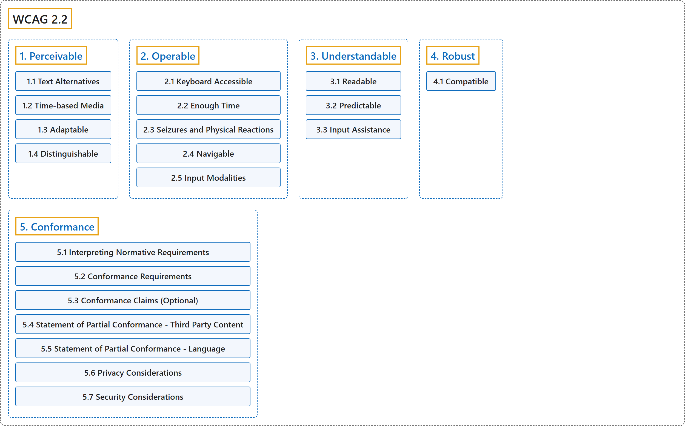

# WCAG 2.2

## Classification

## Glossary

| Term | Definition | 中文翻译 | Source |
|---|---|---|---|
| **WCAG 2.2** 网络内容无障碍指南 2.2 | "Web Content Accessibility Guidelines (WCAG) 2.2 covers a **wide range of recommendations** for **making web content more accessible**." | 网络内容无障碍指南（WCAG）2.2 涵盖**广泛的建议**，用于**让网络内容更加无障碍**。 | [World Wide Web Consortium, 2024, Abstract](https://www.w3.org/TR/WCAG22/#abstract) |
| **[1. Perceivable](perceivable/index.md)** 可感知 | "Information and user interface components must be **presentable to users in ways they can perceive**." | 信息和用户界面组件必须能够**以用户可感知的方式呈现给用户**。 | [World Wide Web Consortium, 2024, Principle 1](https://www.w3.org/TR/WCAG22/#perceivable) |
| **[2. Operable](operable/index.md)** 可操作 | "User interface components and navigation **must be operable**." | 用户界面组件和导航**必须可操作**。 | [World Wide Web Consortium, 2024, Principle 2](https://www.w3.org/TR/WCAG22/#operable) |
| **[3. Understandable](understandable/index.md)** 可理解 | "Information and the operation of the user interface **must be understandable**." | 信息和用户界面的操作**必须可理解**。 | [World Wide Web Consortium, 2024, Principle 3](https://www.w3.org/TR/WCAG22/#understandable) |
| **[4. Robust](robust/index.md)** 健壮 | "Content must be robust enough that it can be **interpreted by a wide variety of user agents, including assistive technologies**." | 内容必须足够健壮，能够**被各种各样的用户代理（包括辅助技术）解读**。 | [World Wide Web Consortium, 2024, Principle 4](https://www.w3.org/TR/WCAG22/#robust) |
| **[5. Conformance](conformance/index.md)** 一致性 | "This section lists **requirements for conformance to WCAG 2.2**. It also gives information about how to make conformance claims, which are optional. Finally, it describes what it means to be accessibility supported, since only accessibility-supported ways of using technologies can be relied upon for conformance. Understanding Conformance includes further explanation of the accessibility-supported concept." | 本节列出**符合 WCAG 2.2 的要求**。它还说明如何作出一致性声明（可选）。最后，它说明“无障碍支持”的含义，因为只有以无障碍支持的方式使用技术才能被一致性所依赖。 | [World Wide Web Consortium, 2024, section 5](https://www.w3.org/TR/WCAG22/#conformance) |

## References

World Wide Web Consortium. (2024, December 12). *Web Content Accessibility Guidelines (WCAG) 2.2* (W3C Recommendation). <https://www.w3.org/TR/WCAG22/>
