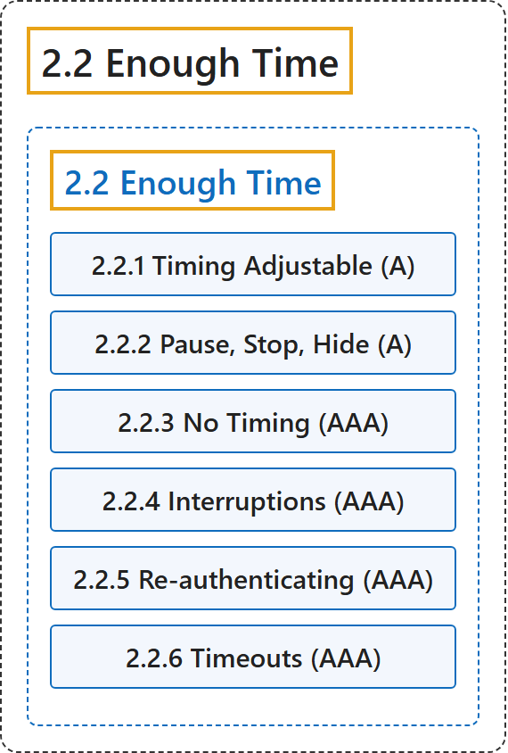

# 2.2 Enough Time

## Classification

## Glossary

| Term | Definition | 中文翻译 | Source |
|---|---|---|---|
| **2.2 Enough Time** 充足的时间 | "Provide users **enough time to read and use content**." | 为用户提供**足够的时间来阅读和使用内容**。 | [World Wide Web Consortium, 2024, Guideline 2.2](https://www.w3.org/TR/WCAG22/#enough-time) |
| **2.2.1 Timing Adjustable** 可调整的时限（A 级） | "**For each time limit that is set by the content**, at least one of the following is true:" | **对于内容设定的每个时限**，下列至少一项成立： | [World Wide Web Consortium, 2024, Success Criterion 2.2.1](https://www.w3.org/TR/WCAG22/#timing-adjustable) |
| **2.2.2 Pause, Stop, Hide** 暂停、停止、隐藏（A 级） | "For **moving, blinking, scrolling, or auto-updating information**, all of the following are true:" | 对于**移动、闪烁、滚动或自动更新的信息**，下列各项成立： | [World Wide Web Consortium, 2024, Success Criterion 2.2.2](https://www.w3.org/TR/WCAG22/#pause-stop-hide) |
| **2.2.3 No Timing** 无时限（AAA 级） | "**Timing is not an essential part of the event or activity** presented by the content, except for non-interactive synchronized media and real-time events." | **时间限制不是内容所呈现的事件或活动的必要部分**，非交互的同步媒体和实时事件除外。 | [World Wide Web Consortium, 2024, Success Criterion 2.2.3](https://www.w3.org/TR/WCAG22/#no-timing) |
| **2.2.4 Interruptions** 打断（AAA 级） | "**Interruptions can be postponed or suppressed by the user**, except interruptions involving an emergency." | **打断可以由用户推迟或抑制**，涉及紧急情况的打断除外。 | [World Wide Web Consortium, 2024, Success Criterion 2.2.4](https://www.w3.org/TR/WCAG22/#interruptions) |
| **2.2.5 Re-authenticating** 重新认证（AAA 级） | "When an authenticated session expires, the user can **continue the activity without loss of data after re-authenticating**." | 当已认证的会话过期时，用户可以在**重新认证后继续活动而不丢失数据**。 | [World Wide Web Consortium, 2024, Success Criterion 2.2.5](https://www.w3.org/TR/WCAG22/#re-authenticating) |
| **2.2.6 Timeouts** 超时（AAA 级） | "**Users are warned of the duration of any user inactivity that could cause data loss**, unless the data is preserved for more than 20 hours when the user does not take any actions." | **向用户警示可能导致数据丢失的用户无操作时长**，除非用户不进行任何操作时数据保留超过 20 小时。 | [World Wide Web Consortium, 2024, Success Criterion 2.2.6](https://www.w3.org/TR/WCAG22/#timeouts) |

## References

World Wide Web Consortium. (2024, December 12). *Web Content Accessibility Guidelines (WCAG) 2.2* (W3C Recommendation). <https://www.w3.org/TR/WCAG22/>
