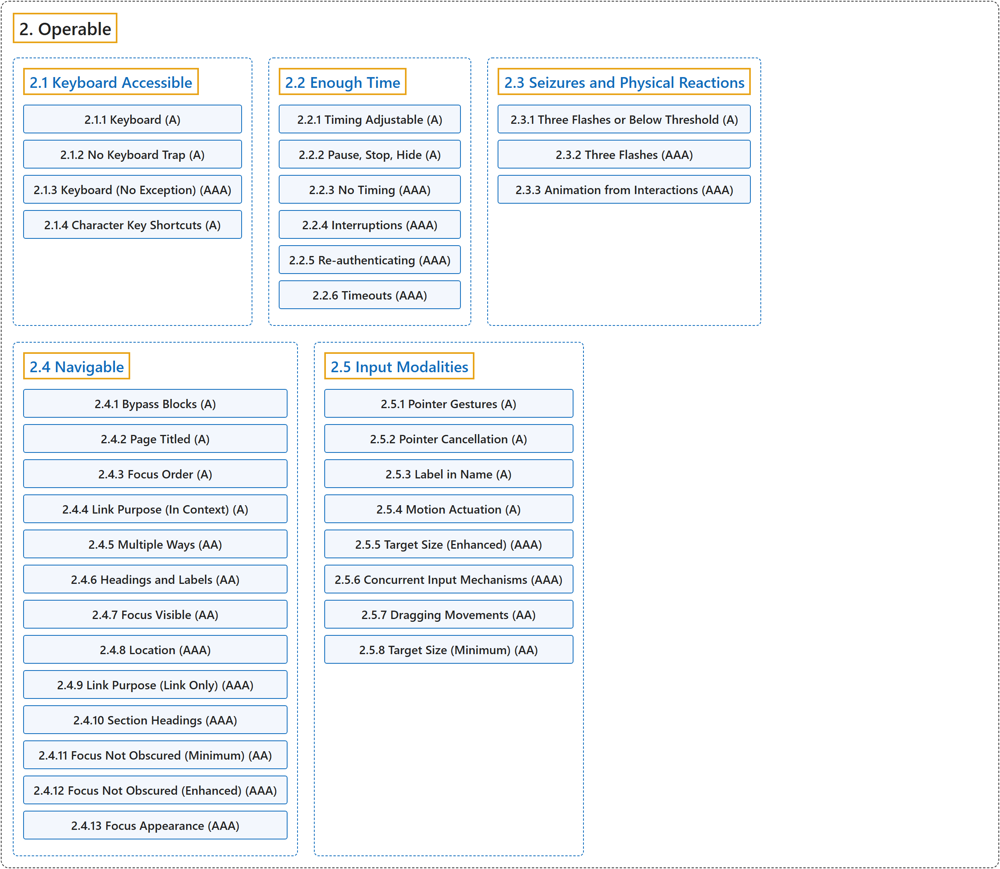

# 2. Operable

## Classification

## Glossary

| Term | Definition | 中文翻译 | Source |
|---|---|---|---|
| **2. Operable** 可操作 | "User interface components and navigation **must be operable**." | 用户界面组件和导航**必须可操作**。 | [World Wide Web Consortium, 2024, Principle 2](https://www.w3.org/TR/WCAG22/#operable) |
| **[2.1 Keyboard Accessible](keyboard-accessible.md)** 键盘可访问 | "Make **all functionality available from a keyboard**." | 让**所有功能都可以通过键盘使用**。 | [World Wide Web Consortium, 2024, Guideline 2.1](https://www.w3.org/TR/WCAG22/#keyboard-accessible) |
| **[2.2 Enough Time](enough-time.md)** 充足的时间 | "Provide users **enough time to read and use content**." | 为用户提供**足够的时间来阅读和使用内容**。 | [World Wide Web Consortium, 2024, Guideline 2.2](https://www.w3.org/TR/WCAG22/#enough-time) |
| **[2.3 Seizures and Physical Reactions](seizures-and-physical-reactions.md)** 癫痫发作与生理反应 | "Do not design content in a way that is **known to cause seizures or physical reactions**." | 不要以**已知会引起癫痫发作或生理反应**的方式设计内容。 | [World Wide Web Consortium, 2024, Guideline 2.3](https://www.w3.org/TR/WCAG22/#seizures-and-physical-reactions) |
| **[2.4 Navigable](navigable.md)** 可导航 | "Provide ways to help users **navigate, find content, and determine where they are**." | 提供方法帮助用户**导航、查找内容并确定自己所在的位置**。 | [World Wide Web Consortium, 2024, Guideline 2.4](https://www.w3.org/TR/WCAG22/#navigable) |
| **[2.5 Input Modalities](input-modalities.md)** 输入方式 | "Make it easier for users to operate functionality through **various inputs beyond keyboard**." | 让用户更容易通过**键盘之外的各种输入方式**操作功能。 | [World Wide Web Consortium, 2024, Guideline 2.5](https://www.w3.org/TR/WCAG22/#input-modalities) |

## References

World Wide Web Consortium. (2024, December 12). *Web Content Accessibility Guidelines (WCAG) 2.2* (W3C Recommendation). <https://www.w3.org/TR/WCAG22/>
