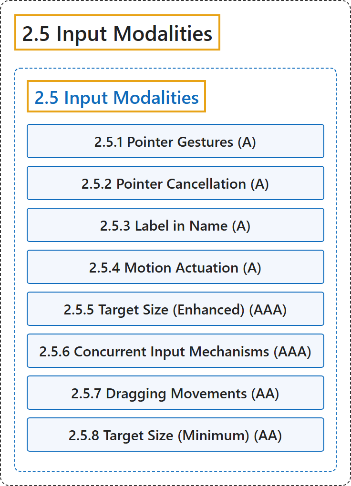

# 2.5 Input Modalities

## Classification

## Glossary

| Term | Definition | 中文翻译 | Source |
|---|---|---|---|
| **2.5 Input Modalities** 输入方式 | "Make it easier for users to operate functionality through **various inputs beyond keyboard**." | 让用户更容易通过**键盘之外的各种输入方式**操作功能。 | [World Wide Web Consortium, 2024, Guideline 2.5](https://www.w3.org/TR/WCAG22/#input-modalities) |
| **2.5.1 Pointer Gestures** 指针手势（A 级） | "All functionality that uses multipoint or path-based gestures for operation **can be operated with a single pointer without a path-based gesture**, unless a multipoint or path-based gesture is essential." | 所有使用多点或基于路径的手势来操作的功能都**可以用单指针操作，而无需基于路径的手势**，除非多点或基于路径的手势是必不可少的。 | [World Wide Web Consortium, 2024, Success Criterion 2.5.1](https://www.w3.org/TR/WCAG22/#pointer-gestures) |
| **2.5.2 Pointer Cancellation** 指针取消（A 级） | "For **functionality that can be operated using a single pointer**, at least one of the following is true:" | 对于**可以用单指针操作的功能**，下列至少一项成立： | [World Wide Web Consortium, 2024, Success Criterion 2.5.2](https://www.w3.org/TR/WCAG22/#pointer-cancellation) |
| **2.5.3 Label in Name** 名称中的标签（A 级） | "For user interface components with labels that include text or images of text, **the name contains the text that is presented visually**." | 对于标签含有文本或文本图像的用户界面组件，**其名称包含视觉呈现的文本**。 | [World Wide Web Consortium, 2024, Success Criterion 2.5.3](https://www.w3.org/TR/WCAG22/#label-in-name) |
| **2.5.4 Motion Actuation** 运动触发（A 级） | "Functionality that can be operated by device motion or user motion **can also be operated by user interface components** and responding to the motion can be disabled to prevent accidental actuation, except when:" | 可以通过设备运动或用户运动操作的功能**也可以通过用户界面组件操作**，并且可以禁用对运动的响应以防误触发，除非： | [World Wide Web Consortium, 2024, Success Criterion 2.5.4](https://www.w3.org/TR/WCAG22/#motion-actuation) |
| **2.5.5 Target Size (Enhanced)** 目标大小（增强）（AAA 级） | "The size of the target for pointer inputs is **at least 44 by 44 CSS pixels** except when:" | 指针输入的目标大小**至少为 44 乘 44 CSS 像素**，除非： | [World Wide Web Consortium, 2024, Success Criterion 2.5.5](https://www.w3.org/TR/WCAG22/#target-size-enhanced) |
| **2.5.6 Concurrent Input Mechanisms** 并行输入机制（AAA 级） | "Web content **does not restrict use of input modalities available on a platform** except where the restriction is essential, required to ensure the security of the content, or required to respect user settings." | 网页内容**不限制平台上可用的输入方式的使用**，除非该限制是必不可少的、为确保内容安全所需，或为尊重用户设置所需。 | [World Wide Web Consortium, 2024, Success Criterion 2.5.6](https://www.w3.org/TR/WCAG22/#concurrent-input-mechanisms) |
| **2.5.7 Dragging Movements** 拖动操作（AA 级） | "All functionality that uses a dragging movement for operation **can be achieved by a single pointer without dragging**, unless dragging is essential or the functionality is determined by the user agent and not modified by the author." | 所有使用拖动操作的功能都**可以用单指针不拖动来完成**，除非拖动是必不可少的，或该功能由用户代理决定且未被作者修改。 | [World Wide Web Consortium, 2024, Success Criterion 2.5.7](https://www.w3.org/TR/WCAG22/#dragging-movements) |
| **2.5.8 Target Size (Minimum)** 目标大小（最低）（AA 级） | "The size of the target for pointer inputs is **at least 24 by 24 CSS pixels**, except when:" | 指针输入的目标大小**至少为 24 乘 24 CSS 像素**，除非： | [World Wide Web Consortium, 2024, Success Criterion 2.5.8](https://www.w3.org/TR/WCAG22/#target-size-minimum) |

## References

World Wide Web Consortium. (2024, December 12). *Web Content Accessibility Guidelines (WCAG) 2.2* (W3C Recommendation). <https://www.w3.org/TR/WCAG22/>
