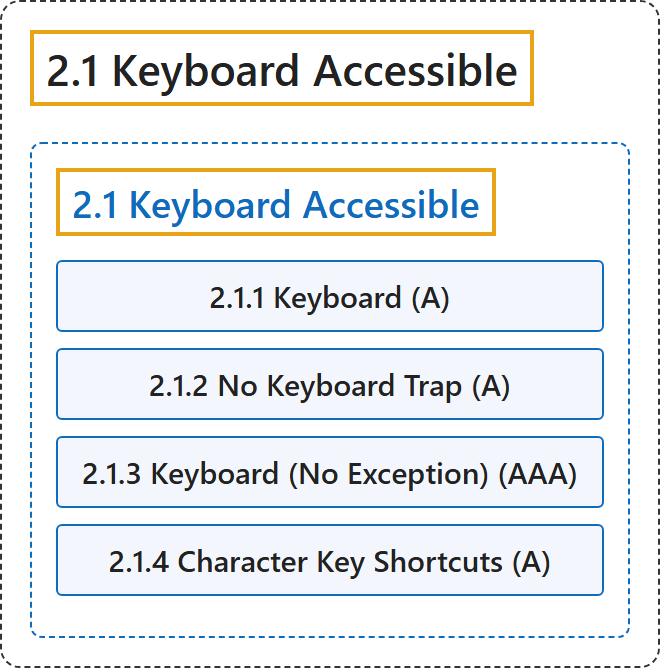

# 2.1 Keyboard Accessible

## Classification

## Glossary

| Term | Definition | 中文翻译 | Source |
|---|---|---|---|
| **2.1 Keyboard Accessible** 键盘可访问 | "Make **all functionality available from a keyboard**." | 让**所有功能都可以通过键盘使用**。 | [World Wide Web Consortium, 2024, Guideline 2.1](https://www.w3.org/TR/WCAG22/#keyboard-accessible) |
| **2.1.1 Keyboard** 键盘（A 级） | "All functionality of the content is **operable through a keyboard interface without requiring specific timings for individual keystrokes**, except where the underlying function requires input that depends on the path of the user's movement and not just the endpoints." | 内容的所有功能都**可以通过键盘接口操作，且不要求单次按键有特定的时间限制**，除非底层功能需要依赖用户移动路径的输入，而不只是终点。 | [World Wide Web Consortium, 2024, Success Criterion 2.1.1](https://www.w3.org/TR/WCAG22/#keyboard) |
| **2.1.2 No Keyboard Trap** 无键盘陷阱（A 级） | "If keyboard focus can be moved to a component of the page using a keyboard interface, then **focus can be moved away from that component using only a keyboard interface**, and, if it requires more than unmodified arrow or tab keys or other standard exit methods, the user is advised of the method for moving focus away." | 如果可以用键盘接口把键盘焦点移到页面的某个组件上，那么**只用键盘接口就能把焦点从该组件移开**；如果这需要的不只是未修饰的方向键或 Tab 键或其他标准退出方法，则告知用户移开焦点的方法。 | [World Wide Web Consortium, 2024, Success Criterion 2.1.2](https://www.w3.org/TR/WCAG22/#no-keyboard-trap) |
| **2.1.3 Keyboard (No Exception)** 键盘（无例外）（AAA 级） | "All functionality of the content is **operable through a keyboard interface** without requiring specific timings for individual keystrokes." | 内容的所有功能都**可以通过键盘接口操作**，且不要求单次按键有特定的时间限制。 | [World Wide Web Consortium, 2024, Success Criterion 2.1.3](https://www.w3.org/TR/WCAG22/#keyboard-no-exception) |
| **2.1.4 Character Key Shortcuts** 字符键快捷键（A 级） | "If a **keyboard shortcut is implemented in content using only letter** (including upper- and lower-case letters), punctuation, number, or symbol characters, then at least one of the following is true:" | 如果内容中的**键盘快捷键只用字母**（包括大小写字母）、标点、数字或符号字符实现，则下列至少一项成立： | [World Wide Web Consortium, 2024, Success Criterion 2.1.4](https://www.w3.org/TR/WCAG22/#character-key-shortcuts) |

## References

World Wide Web Consortium. (2024, December 12). *Web Content Accessibility Guidelines (WCAG) 2.2* (W3C Recommendation). <https://www.w3.org/TR/WCAG22/>
