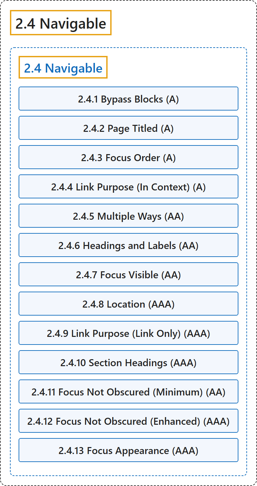

# 2.4 Navigable

## Classification

## Glossary

| Term | Definition | 中文翻译 | Source |
|---|---|---|---|
| **2.4 Navigable** 可导航 | "Provide ways to help users **navigate, find content, and determine where they are**." | 提供方法帮助用户**导航、查找内容并确定自己所在的位置**。 | [World Wide Web Consortium, 2024, Guideline 2.4](https://www.w3.org/TR/WCAG22/#navigable) |
| **2.4.1 Bypass Blocks** 跳过区块（A 级） | "A mechanism is available to **bypass blocks of content that are repeated on multiple web pages**." | 提供一种机制来**跳过在多个网页上重复出现的内容区块**。 | [World Wide Web Consortium, 2024, Success Criterion 2.4.1](https://www.w3.org/TR/WCAG22/#bypass-blocks) |
| **2.4.2 Page Titled** 页面标题（A 级） | "Web pages have **titles that describe topic or purpose**." | 网页有**描述主题或目的的标题**。 | [World Wide Web Consortium, 2024, Success Criterion 2.4.2](https://www.w3.org/TR/WCAG22/#page-titled) |
| **2.4.3 Focus Order** 焦点顺序（A 级） | "If a web page can be navigated sequentially and the navigation sequences affect meaning or operation, focusable components **receive focus in an order that preserves meaning and operability**." | 如果网页可以按顺序导航且导航顺序影响意义或操作，则可聚焦组件**按保持意义和可操作性的顺序获得焦点**。 | [World Wide Web Consortium, 2024, Success Criterion 2.4.3](https://www.w3.org/TR/WCAG22/#focus-order) |
| **2.4.4 Link Purpose (In Context)** 链接目的（在上下文中）（A 级） | "The **purpose of each link can be determined from the link text alone or from the link text together with its programmatically determined link context**, except where the purpose of the link would be ambiguous to users in general." | **每个链接的目的可以单从链接文本确定，或从链接文本及其由程序确定的链接上下文一起确定**，除非该链接的目的对一般用户来说本来就含糊不清。 | [World Wide Web Consortium, 2024, Success Criterion 2.4.4](https://www.w3.org/TR/WCAG22/#link-purpose-in-context) |
| **2.4.5 Multiple Ways** 多种方式（AA 级） | "**More than one way is available to locate a web page** within a set of web pages except where the web page is the result of, or a step in, a process." | 在一组网页中**有多于一种方式可以找到某个网页**，除非该网页是某个流程的结果或其中一步。 | [World Wide Web Consortium, 2024, Success Criterion 2.4.5](https://www.w3.org/TR/WCAG22/#multiple-ways) |
| **2.4.6 Headings and Labels** 标题与标签（AA 级） | "**Headings and labels describe topic or purpose**." | **标题和标签描述主题或目的**。 | [World Wide Web Consortium, 2024, Success Criterion 2.4.6](https://www.w3.org/TR/WCAG22/#headings-and-labels) |
| **2.4.7 Focus Visible** 焦点可见（AA 级） | "Any keyboard operable user interface has a mode of operation where the **keyboard focus indicator is visible**." | 任何可用键盘操作的用户界面都有一种**键盘焦点指示器可见**的操作模式。 | [World Wide Web Consortium, 2024, Success Criterion 2.4.7](https://www.w3.org/TR/WCAG22/#focus-visible) |
| **2.4.8 Location** 位置（AAA 级） | "**Information about the user's location within a set of web pages** is available." | 提供**用户在一组网页中所处位置的信息**。 | [World Wide Web Consortium, 2024, Success Criterion 2.4.8](https://www.w3.org/TR/WCAG22/#location) |
| **2.4.9 Link Purpose (Link Only)** 链接目的（仅链接）（AAA 级） | "A mechanism is available to allow the **purpose of each link to be identified from link text alone**, except where the purpose of the link would be ambiguous to users in general." | 提供一种机制，让**每个链接的目的可以单从链接文本识别**，除非该链接的目的对一般用户来说本来就含糊不清。 | [World Wide Web Consortium, 2024, Success Criterion 2.4.9](https://www.w3.org/TR/WCAG22/#link-purpose-link-only) |
| **2.4.10 Section Headings** 章节标题（AAA 级） | "**Section headings are used to organize the content**." | **使用章节标题来组织内容**。 | [World Wide Web Consortium, 2024, Success Criterion 2.4.10](https://www.w3.org/TR/WCAG22/#section-headings) |
| **2.4.11 Focus Not Obscured (Minimum)** 焦点不被遮挡（最低）（AA 级） | "When a user interface component receives keyboard focus, the component is **not entirely hidden due to author-created content**." | 当用户界面组件获得键盘焦点时，该组件**不会因作者创建的内容而被完全遮挡**。 | [World Wide Web Consortium, 2024, Success Criterion 2.4.11](https://www.w3.org/TR/WCAG22/#focus-not-obscured-minimum) |
| **2.4.12 Focus Not Obscured (Enhanced)** 焦点不被遮挡（增强）（AAA 级） | "When a user interface component receives keyboard focus, **no part of the component is hidden by author-created content**." | 当用户界面组件获得键盘焦点时，**该组件没有任何部分被作者创建的内容遮挡**。 | [World Wide Web Consortium, 2024, Success Criterion 2.4.12](https://www.w3.org/TR/WCAG22/#focus-not-obscured-enhanced) |
| **2.4.13 Focus Appearance** 焦点外观（AAA 级） | "When the keyboard focus indicator is visible, **an area of the focus indicator meets all the following**:" | 当键盘焦点指示器可见时，**焦点指示器的某个区域满足下列全部条件**： | [World Wide Web Consortium, 2024, Success Criterion 2.4.13](https://www.w3.org/TR/WCAG22/#focus-appearance) |

## References

World Wide Web Consortium. (2024, December 12). *Web Content Accessibility Guidelines (WCAG) 2.2* (W3C Recommendation). <https://www.w3.org/TR/WCAG22/>
