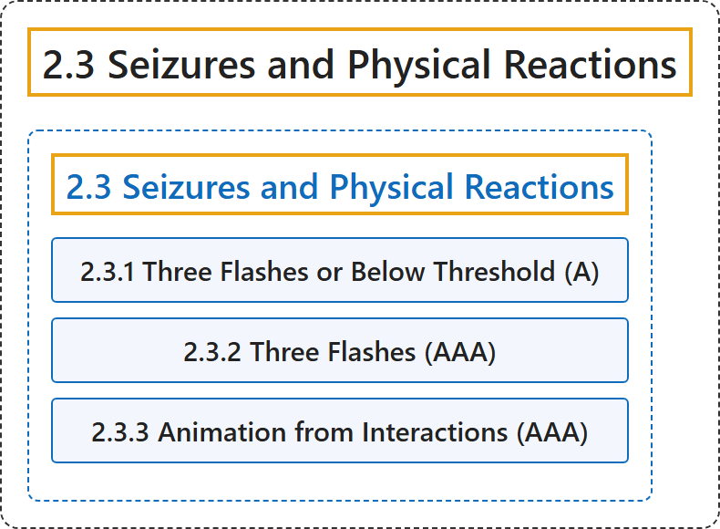

# 2.3 Seizures and Physical Reactions

## Classification

## Glossary

| Term | Definition | 中文翻译 | Source |
|---|---|---|---|
| **2.3 Seizures and Physical Reactions** 癫痫发作与生理反应 | "Do not design content in a way that is **known to cause seizures or physical reactions**." | 不要以**已知会引起癫痫发作或生理反应**的方式设计内容。 | [World Wide Web Consortium, 2024, Guideline 2.3](https://www.w3.org/TR/WCAG22/#seizures-and-physical-reactions) |
| **2.3.1 Three Flashes or Below Threshold** 三次闪烁或低于阈值（A 级） | "Web pages do not contain anything that **flashes more than three times in any one second period**, or the flash is below the general flash and red flash thresholds." | 网页不包含任何**在任意一秒内闪烁超过三次**的内容，或闪烁低于一般闪烁和红色闪烁阈值。 | [World Wide Web Consortium, 2024, Success Criterion 2.3.1](https://www.w3.org/TR/WCAG22/#three-flashes-or-below-threshold) |
| **2.3.2 Three Flashes** 三次闪烁（AAA 级） | "Web pages do not contain anything that **flashes more than three times in any one second period**." | 网页不包含任何**在任意一秒内闪烁超过三次**的内容。 | [World Wide Web Consortium, 2024, Success Criterion 2.3.2](https://www.w3.org/TR/WCAG22/#three-flashes) |
| **2.3.3 Animation from Interactions** 交互触发的动画（AAA 级） | "**Motion animation triggered by interaction can be disabled**, unless the animation is essential to the functionality or the information being conveyed." | **由交互触发的运动动画可以被禁用**，除非该动画对功能或所传达的信息必不可少。 | [World Wide Web Consortium, 2024, Success Criterion 2.3.3](https://www.w3.org/TR/WCAG22/#animation-from-interactions) |

## References

World Wide Web Consortium. (2024, December 12). *Web Content Accessibility Guidelines (WCAG) 2.2* (W3C Recommendation). <https://www.w3.org/TR/WCAG22/>
