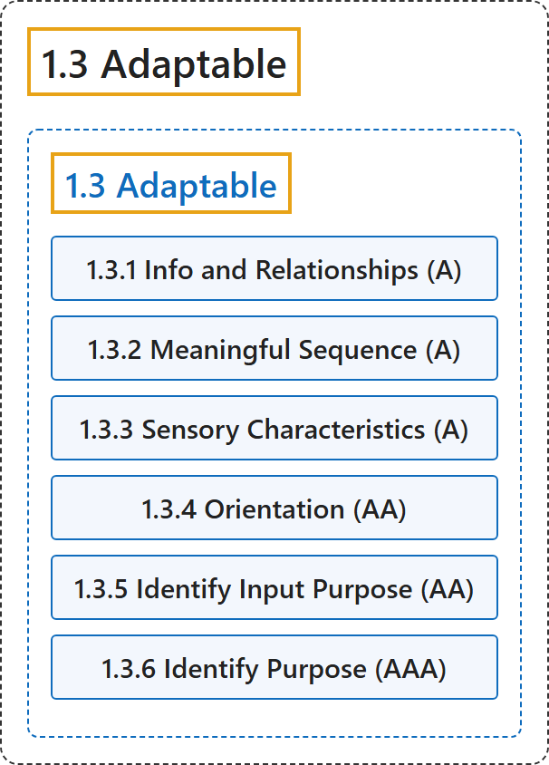

# 1.3 Adaptable

## Classification

## Glossary

| Term | Definition | 中文翻译 | Source |
|---|---|---|---|
| **1.3 Adaptable** 可适配 | "Create content that can be **presented in different ways** (for example simpler layout) without losing information or structure." | 创建可以**以不同方式呈现**（例如更简单的布局）而不丢失信息或结构的内容。 | [World Wide Web Consortium, 2024, Guideline 1.3](https://www.w3.org/TR/WCAG22/#adaptable) |
| **1.3.1 Info and Relationships** 信息与关系（A 级） | "**Information, structure, and relationships conveyed through presentation** can be **programmatically determined** or are available in text." | 通过呈现方式传达的**信息、结构和关系**可以**由程序确定**，或以文本形式提供。 | [World Wide Web Consortium, 2024, Success Criterion 1.3.1](https://www.w3.org/TR/WCAG22/#info-and-relationships) |
| **1.3.2 Meaningful Sequence** 有意义的顺序（A 级） | "When the sequence in which content is presented affects its meaning, **a correct reading sequence can be programmatically determined**." | 当内容的呈现顺序影响其意义时，**正确的阅读顺序可以由程序确定**。 | [World Wide Web Consortium, 2024, Success Criterion 1.3.2](https://www.w3.org/TR/WCAG22/#meaningful-sequence) |
| **1.3.3 Sensory Characteristics** 感官特征（A 级） | "Instructions provided for understanding and operating content **do not rely solely on sensory characteristics** of components such as shape, color, size, visual location, orientation, or sound." | 为理解和操作内容而提供的说明**不单独依赖组件的感官特征**，例如形状、颜色、大小、视觉位置、方向或声音。 | [World Wide Web Consortium, 2024, Success Criterion 1.3.3](https://www.w3.org/TR/WCAG22/#sensory-characteristics) |
| **1.3.4 Orientation** 方向（AA 级） | "Content **does not restrict its view and operation to a single display orientation**, such as portrait or landscape, unless a specific display orientation is essential." | 内容**不把查看和操作限制在单一显示方向**（如竖屏或横屏），除非特定显示方向是必不可少的。 | [World Wide Web Consortium, 2024, Success Criterion 1.3.4](https://www.w3.org/TR/WCAG22/#orientation) |
| **1.3.5 Identify Input Purpose** 识别输入目的（AA 级） | "The **purpose of each input field collecting information about the user** can be programmatically determined when:" | **收集用户信息的每个输入字段的目的**可以由程序确定，当： | [World Wide Web Consortium, 2024, Success Criterion 1.3.5](https://www.w3.org/TR/WCAG22/#identify-input-purpose) |
| **1.3.6 Identify Purpose** 识别目的（AAA 级） | "In content implemented using markup languages, the **purpose of user interface components, icons, and regions** can be programmatically determined." | 在用标记语言实现的内容中，**用户界面组件、图标和区域的目的**可以由程序确定。 | [World Wide Web Consortium, 2024, Success Criterion 1.3.6](https://www.w3.org/TR/WCAG22/#identify-purpose) |

## References

World Wide Web Consortium. (2024, December 12). *Web Content Accessibility Guidelines (WCAG) 2.2* (W3C Recommendation). <https://www.w3.org/TR/WCAG22/>
