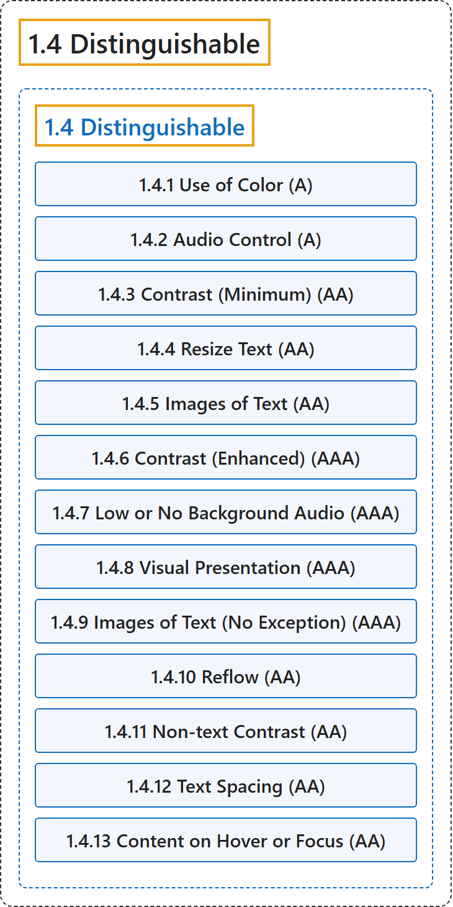

# 1.4 Distinguishable

## Classification

## Glossary

| Term | Definition | 中文翻译 | Source |
|---|---|---|---|
| **1.4 Distinguishable** 可辨别 | "Make it **easier for users to see and hear content** including separating foreground from background." | 让用户**更容易看到和听到内容**，包括把前景与背景分开。 | [World Wide Web Consortium, 2024, Guideline 1.4](https://www.w3.org/TR/WCAG22/#distinguishable) |
| **1.4.1 Use of Color** 颜色的使用（A 级） | "**Color is not used as the only visual means of conveying information**, indicating an action, prompting a response, or distinguishing a visual element." | **颜色不作为传达信息、指示动作、提示响应或区分视觉元素的唯一视觉手段**。 | [World Wide Web Consortium, 2024, Success Criterion 1.4.1](https://www.w3.org/TR/WCAG22/#use-of-color) |
| **1.4.2 Audio Control** 音频控制（A 级） | "If any audio on a web page **plays automatically for more than 3 seconds**, either a mechanism is available to **pause or stop the audio**, or a mechanism is available to control audio volume independently from the overall system volume level." | 如果网页上的任何音频**自动播放超过 3 秒**，则提供一种机制来**暂停或停止该音频**，或提供一种机制来独立于系统总音量控制音频音量。 | [World Wide Web Consortium, 2024, Success Criterion 1.4.2](https://www.w3.org/TR/WCAG22/#audio-control) |
| **1.4.3 Contrast (Minimum)** 对比度（最低）（AA 级） | "The visual presentation of text and images of text has a **contrast ratio of at least 4.5:1**, except for the following:" | 文本和文本图像的视觉呈现具有**至少 4.5:1 的对比度**，下列情形除外： | [World Wide Web Consortium, 2024, Success Criterion 1.4.3](https://www.w3.org/TR/WCAG22/#contrast-minimum) |
| **1.4.4 Resize Text** 调整文本大小（AA 级） | "Except for captions and images of text, text can be **resized without assistive technology up to 200 percent** without loss of content or functionality." | 除字幕和文本图像外，文本可以**在不使用辅助技术的情况下放大到 200%**，而不丢失内容或功能。 | [World Wide Web Consortium, 2024, Success Criterion 1.4.4](https://www.w3.org/TR/WCAG22/#resize-text) |
| **1.4.5 Images of Text** 文本图像（AA 级） | "If the technologies being used can achieve the visual presentation, **text is used to convey information rather than images of text** except for the following:" | 如果所用技术能够实现该视觉呈现，则**用文本而不是文本图像来传达信息**，下列情形除外： | [World Wide Web Consortium, 2024, Success Criterion 1.4.5](https://www.w3.org/TR/WCAG22/#images-of-text) |
| **1.4.6 Contrast (Enhanced)** 对比度（增强）（AAA 级） | "The visual presentation of text and images of text has a **contrast ratio of at least 7:1**, except for the following:" | 文本和文本图像的视觉呈现具有**至少 7:1 的对比度**，下列情形除外： | [World Wide Web Consortium, 2024, Success Criterion 1.4.6](https://www.w3.org/TR/WCAG22/#contrast-enhanced) |
| **1.4.7 Low or No Background Audio** 低背景音或无背景音（AAA 级） | "For prerecorded audio-only content that (1) **contains primarily speech in the foreground**, (2) is not an audio CAPTCHA or audio logo, and (3) is not vocalization intended to be primarily musical expression such as singing or rapping, at least one of the following is true:" | 对于预录的纯音频内容，若其 (1) **前景主要是语音**，(2) 不是音频验证码或音频标志，且 (3) 不是旨在作为音乐表达的发声（如歌唱或说唱），则下列至少一项成立： | [World Wide Web Consortium, 2024, Success Criterion 1.4.7](https://www.w3.org/TR/WCAG22/#low-or-no-background-audio) |
| **1.4.8 Visual Presentation** 视觉呈现（AAA 级） | "For the **visual presentation of blocks of text**, a mechanism is available to achieve the following:" | 对于**文本块的视觉呈现**，提供一种机制来实现下列各项： | [World Wide Web Consortium, 2024, Success Criterion 1.4.8](https://www.w3.org/TR/WCAG22/#visual-presentation) |
| **1.4.9 Images of Text (No Exception)** 文本图像（无例外）（AAA 级） | "**Images of text are only used for pure decoration** or where a particular presentation of text is essential to the information being conveyed." | **文本图像只用于纯装饰**，或用于文本的特定呈现对所传达信息必不可少的情形。 | [World Wide Web Consortium, 2024, Success Criterion 1.4.9](https://www.w3.org/TR/WCAG22/#images-of-text-no-exception) |
| **1.4.10 Reflow** 重排（AA 级） | "Content can be presented without loss of information or functionality, and **without requiring scrolling in two dimensions** for:" | 内容可以在不丢失信息或功能、且**无需在两个方向上滚动**的情况下呈现，适用于： | [World Wide Web Consortium, 2024, Success Criterion 1.4.10](https://www.w3.org/TR/WCAG22/#reflow) |
| **1.4.11 Non-text Contrast** 非文本对比度（AA 级） | "The visual presentation of the following have a **contrast ratio of at least 3:1 against adjacent color(s)**:" | 下列各项的视觉呈现与相邻颜色之间具有**至少 3:1 的对比度**： | [World Wide Web Consortium, 2024, Success Criterion 1.4.11](https://www.w3.org/TR/WCAG22/#non-text-contrast) |
| **1.4.12 Text Spacing** 文本间距（AA 级） | "In content implemented using markup languages that support the following text style properties, **no loss of content or functionality occurs by setting all of the following** and by changing no other style property:" | 在用支持下列文本样式属性的标记语言实现的内容中，**设置下列全部属性而不改变其他样式属性时不会丢失内容或功能**： | [World Wide Web Consortium, 2024, Success Criterion 1.4.12](https://www.w3.org/TR/WCAG22/#text-spacing) |
| **1.4.13 Content on Hover or Focus** 悬停或聚焦时的内容（AA 级） | "Where receiving and then removing pointer hover or keyboard focus **triggers additional content to become visible and then hidden**, the following are true:" | 当指针悬停或键盘焦点的进入与移除**触发附加内容显示然后隐藏**时，下列各项成立： | [World Wide Web Consortium, 2024, Success Criterion 1.4.13](https://www.w3.org/TR/WCAG22/#content-on-hover-or-focus) |

## References

World Wide Web Consortium. (2024, December 12). *Web Content Accessibility Guidelines (WCAG) 2.2* (W3C Recommendation). <https://www.w3.org/TR/WCAG22/>
