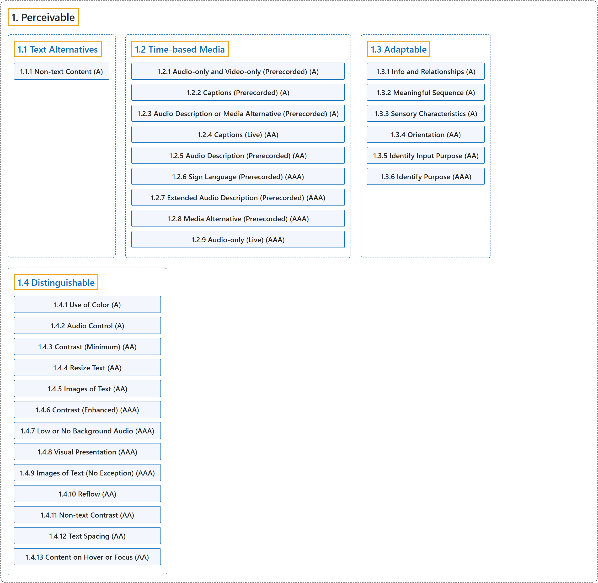

# 1. Perceivable

## Classification

## Glossary

| Term | Definition | 中文翻译 | Source |
|---|---|---|---|
| **1. Perceivable** 可感知 | "Information and user interface components must be **presentable to users in ways they can perceive**." | 信息和用户界面组件必须能够**以用户可感知的方式呈现给用户**。 | [World Wide Web Consortium, 2024, Principle 1](https://www.w3.org/TR/WCAG22/#perceivable) |
| **[1.1 Text Alternatives](text-alternatives.md)** 文本替代 | "Provide **text alternatives for any non-text content** so that it can be changed into other forms people need, such as large print, braille, speech, symbols or simpler language." | 为任何**非文本内容提供文本替代**，使其可以转换为人们需要的其他形式，例如大字、盲文、语音、符号或更简单的语言。 | [World Wide Web Consortium, 2024, Guideline 1.1](https://www.w3.org/TR/WCAG22/#text-alternatives) |
| **[1.2 Time-based Media](time-based-media.md)** 基于时间的媒体 | "Provide **alternatives for time-based media**." | 为**基于时间的媒体提供替代**。 | [World Wide Web Consortium, 2024, Guideline 1.2](https://www.w3.org/TR/WCAG22/#time-based-media) |
| **[1.3 Adaptable](adaptable.md)** 可适配 | "Create content that can be **presented in different ways** (for example simpler layout) without losing information or structure." | 创建可以**以不同方式呈现**（例如更简单的布局）而不丢失信息或结构的内容。 | [World Wide Web Consortium, 2024, Guideline 1.3](https://www.w3.org/TR/WCAG22/#adaptable) |
| **[1.4 Distinguishable](distinguishable.md)** 可辨别 | "Make it **easier for users to see and hear content** including separating foreground from background." | 让用户**更容易看到和听到内容**，包括把前景与背景分开。 | [World Wide Web Consortium, 2024, Guideline 1.4](https://www.w3.org/TR/WCAG22/#distinguishable) |

## References

World Wide Web Consortium. (2024, December 12). *Web Content Accessibility Guidelines (WCAG) 2.2* (W3C Recommendation). <https://www.w3.org/TR/WCAG22/>
