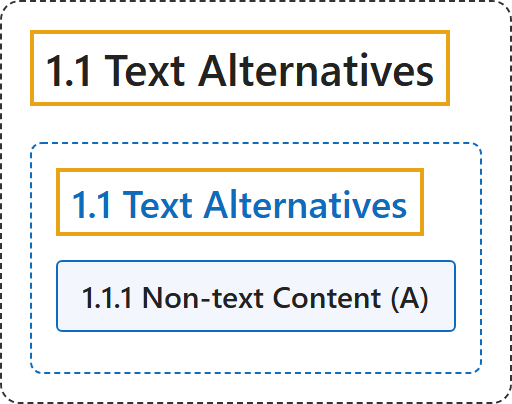

# 1.1 Text Alternatives

## Classification

## Glossary

| Term | Definition | 中文翻译 | Source |
|---|---|---|---|
| **1.1 Text Alternatives** 文本替代 | "Provide **text alternatives for any non-text content** so that it can be changed into other forms people need, such as large print, braille, speech, symbols or simpler language." | 为任何**非文本内容提供文本替代**，使其可以转换为人们需要的其他形式，例如大字、盲文、语音、符号或更简单的语言。 | [World Wide Web Consortium, 2024, Guideline 1.1](https://www.w3.org/TR/WCAG22/#text-alternatives) |
| **1.1.1 Non-text Content** 非文本内容（A 级） | "All non-text content that is presented to the user has a **text alternative that serves the equivalent purpose**, except for the situations listed below." | 呈现给用户的所有非文本内容都有**起同等作用的文本替代**，下列情形除外。 | [World Wide Web Consortium, 2024, Success Criterion 1.1.1](https://www.w3.org/TR/WCAG22/#non-text-content) |

## References

World Wide Web Consortium. (2024, December 12). *Web Content Accessibility Guidelines (WCAG) 2.2* (W3C Recommendation). <https://www.w3.org/TR/WCAG22/>
