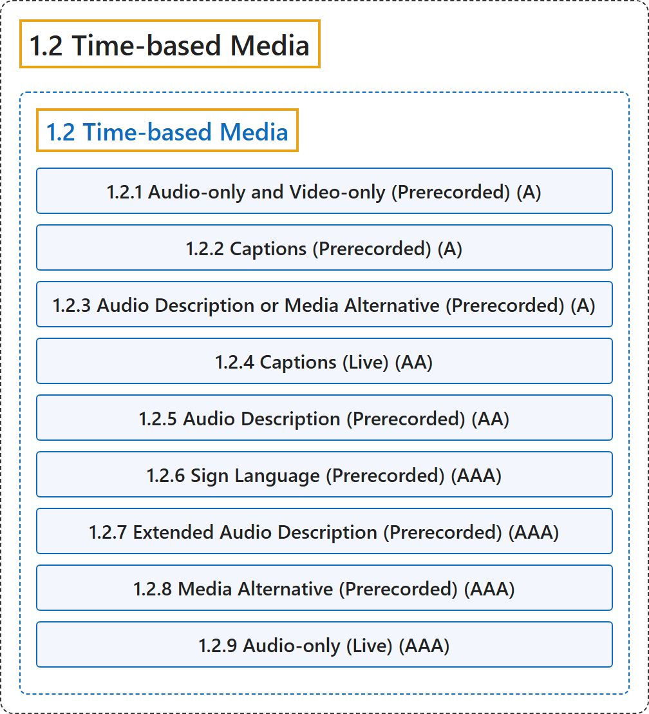

# 1.2 Time-based Media

## Classification

## Glossary

| Term | Definition | 中文翻译 | Source |
|---|---|---|---|
| **1.2 Time-based Media** 基于时间的媒体 | "Provide **alternatives for time-based media**." | 为**基于时间的媒体提供替代**。 | [World Wide Web Consortium, 2024, Guideline 1.2](https://www.w3.org/TR/WCAG22/#time-based-media) |
| **1.2.1 Audio-only and Video-only (Prerecorded)** 纯音频和纯视频（预录）（A 级） | "For **prerecorded audio-only and prerecorded video-only media**, the following are true, except when the audio or video is a media alternative for text and is clearly labeled as such:" | 对于**预录的纯音频和预录的纯视频媒体**，下列各项成立，除非该音频或视频是文本的媒体替代并有明确标注： | [World Wide Web Consortium, 2024, Success Criterion 1.2.1](https://www.w3.org/TR/WCAG22/#audio-only-and-video-only-prerecorded) |
| **1.2.2 Captions (Prerecorded)** 字幕（预录）（A 级） | "**Captions are provided for all prerecorded audio content** in synchronized media, except when the media is a media alternative for text and is clearly labeled as such." | **为同步媒体中所有预录的音频内容提供字幕**，除非该媒体是文本的媒体替代并有明确标注。 | [World Wide Web Consortium, 2024, Success Criterion 1.2.2](https://www.w3.org/TR/WCAG22/#captions-prerecorded) |
| **1.2.3 Audio Description or Media Alternative (Prerecorded)** 音频描述或媒体替代（预录）（A 级） | "An **alternative for time-based media or audio description** of the prerecorded video content is provided for synchronized media, except when the media is a media alternative for text and is clearly labeled as such." | 为同步媒体提供**基于时间的媒体的替代或预录视频内容的音频描述**，除非该媒体是文本的媒体替代并有明确标注。 | [World Wide Web Consortium, 2024, Success Criterion 1.2.3](https://www.w3.org/TR/WCAG22/#audio-description-or-media-alternative-prerecorded) |
| **1.2.4 Captions (Live)** 字幕（直播）（AA 级） | "**Captions are provided for all live audio content** in synchronized media." | **为同步媒体中所有直播的音频内容提供字幕**。 | [World Wide Web Consortium, 2024, Success Criterion 1.2.4](https://www.w3.org/TR/WCAG22/#captions-live) |
| **1.2.5 Audio Description (Prerecorded)** 音频描述（预录）（AA 级） | "**Audio description is provided for all prerecorded video content** in synchronized media." | **为同步媒体中所有预录的视频内容提供音频描述**。 | [World Wide Web Consortium, 2024, Success Criterion 1.2.5](https://www.w3.org/TR/WCAG22/#audio-description-prerecorded) |
| **1.2.6 Sign Language (Prerecorded)** 手语（预录）（AAA 级） | "**Sign language interpretation is provided** for all prerecorded audio content in synchronized media." | 为同步媒体中所有预录的音频内容**提供手语翻译**。 | [World Wide Web Consortium, 2024, Success Criterion 1.2.6](https://www.w3.org/TR/WCAG22/#sign-language-prerecorded) |
| **1.2.7 Extended Audio Description (Prerecorded)** 扩展音频描述（预录）（AAA 级） | "Where pauses in foreground audio are insufficient to allow audio descriptions to convey the sense of the video, **extended audio description is provided** for all prerecorded video content in synchronized media." | 当前景音频中的停顿不足以让音频描述传达视频的意义时，为同步媒体中所有预录的视频内容**提供扩展音频描述**。 | [World Wide Web Consortium, 2024, Success Criterion 1.2.7](https://www.w3.org/TR/WCAG22/#extended-audio-description-prerecorded) |
| **1.2.8 Media Alternative (Prerecorded)** 媒体替代（预录）（AAA 级） | "An **alternative for time-based media is provided for all prerecorded synchronized media** and for all prerecorded video-only media." | **为所有预录的同步媒体和所有预录的纯视频媒体提供基于时间的媒体的替代**。 | [World Wide Web Consortium, 2024, Success Criterion 1.2.8](https://www.w3.org/TR/WCAG22/#media-alternative-prerecorded) |
| **1.2.9 Audio-only (Live)** 纯音频（直播）（AAA 级） | "An alternative for time-based media that **presents equivalent information for live audio-only content** is provided." | 提供一种基于时间的媒体的替代，它**为直播的纯音频内容呈现同等的信息**。 | [World Wide Web Consortium, 2024, Success Criterion 1.2.9](https://www.w3.org/TR/WCAG22/#audio-only-live) |

## References

World Wide Web Consortium. (2024, December 12). *Web Content Accessibility Guidelines (WCAG) 2.2* (W3C Recommendation). <https://www.w3.org/TR/WCAG22/>
