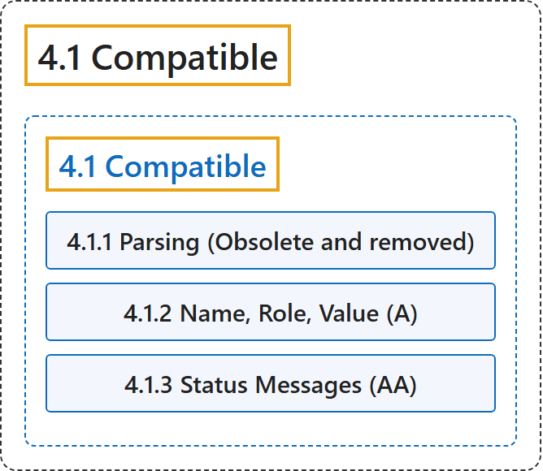

# 4.1 Compatible

## Classification

## Glossary

| Term | Definition | 中文翻译 | Source |
|---|---|---|---|
| **4.1 Compatible** 兼容 | "Maximize **compatibility with current and future user agents**, including assistive technologies." | 最大限度地提高**与当前和未来用户代理**（包括辅助技术）的兼容性。 | [World Wide Web Consortium, 2024, Guideline 4.1](https://www.w3.org/TR/WCAG22/#compatible) |
| **4.1.1 Parsing (Obsolete and removed)** 解析（已废弃并移除） | "This criterion was originally adopted to address problems that assistive technology had directly parsing HTML. Assistive technology no longer has any need to directly parse HTML. Consequently, these problems either no longer exist or are addressed by other criteria. **This criterion no longer has utility and is removed**." | 本标准最初是为了解决辅助技术直接解析 HTML 的问题而采用的。辅助技术不再需要直接解析 HTML。因此，这些问题要么已不存在，要么由其他标准解决。**本标准不再有用，已被移除**。 | [World Wide Web Consortium, 2024, Success Criterion 4.1.1](https://www.w3.org/TR/WCAG22/#parsing) |
| **4.1.2 Name, Role, Value** 名称、角色、值（A 级） | "For all user interface components (including but not limited to: form elements, links and components generated by scripts), **the name and role can be programmatically determined**; states, properties, and values that can be set by the user can be programmatically set; and notification of changes to these items is available to user agents, including assistive technologies." | 对于所有用户界面组件（包括但不限于表单元素、链接和脚本生成的组件），**名称和角色可以由程序确定**；用户可以设置的状态、属性和值可以由程序设置；这些项目的改变会通知给用户代理，包括辅助技术。 | [World Wide Web Consortium, 2024, Success Criterion 4.1.2](https://www.w3.org/TR/WCAG22/#name-role-value) |
| **4.1.3 Status Messages** 状态消息（AA 级） | "In content implemented using markup languages, **status messages can be programmatically determined through role or properties** such that they can be presented to the user by assistive technologies without receiving focus." | 在用标记语言实现的内容中，**状态消息可以通过角色或属性由程序确定**，从而辅助技术可以在不获得焦点的情况下把它们呈现给用户。 | [World Wide Web Consortium, 2024, Success Criterion 4.1.3](https://www.w3.org/TR/WCAG22/#status-messages) |

## References

World Wide Web Consortium. (2024, December 12). *Web Content Accessibility Guidelines (WCAG) 2.2* (W3C Recommendation). <https://www.w3.org/TR/WCAG22/>
