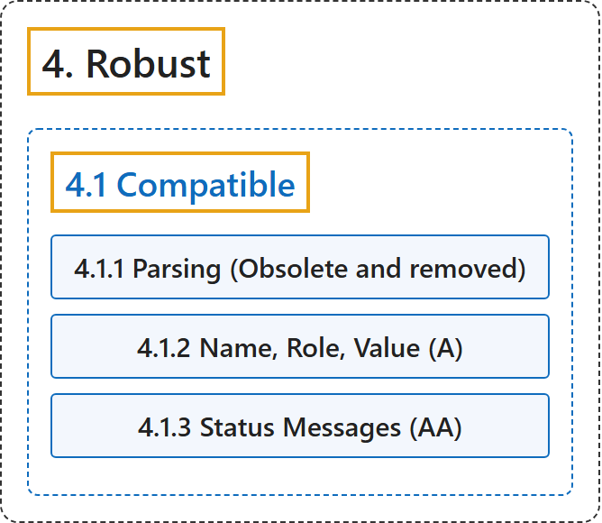

# 4. Robust

## Classification

## Glossary

| Term | Definition | 中文翻译 | Source |
|---|---|---|---|
| **4. Robust** 健壮 | "Content must be robust enough that it can be **interpreted by a wide variety of user agents, including assistive technologies**." | 内容必须足够健壮，能够**被各种各样的用户代理（包括辅助技术）解读**。 | [World Wide Web Consortium, 2024, Principle 4](https://www.w3.org/TR/WCAG22/#robust) |
| **[4.1 Compatible](compatible.md)** 兼容 | "Maximize **compatibility with current and future user agents**, including assistive technologies." | 最大限度地提高**与当前和未来用户代理**（包括辅助技术）的兼容性。 | [World Wide Web Consortium, 2024, Guideline 4.1](https://www.w3.org/TR/WCAG22/#compatible) |

## References

World Wide Web Consortium. (2024, December 12). *Web Content Accessibility Guidelines (WCAG) 2.2* (W3C Recommendation). <https://www.w3.org/TR/WCAG22/>
