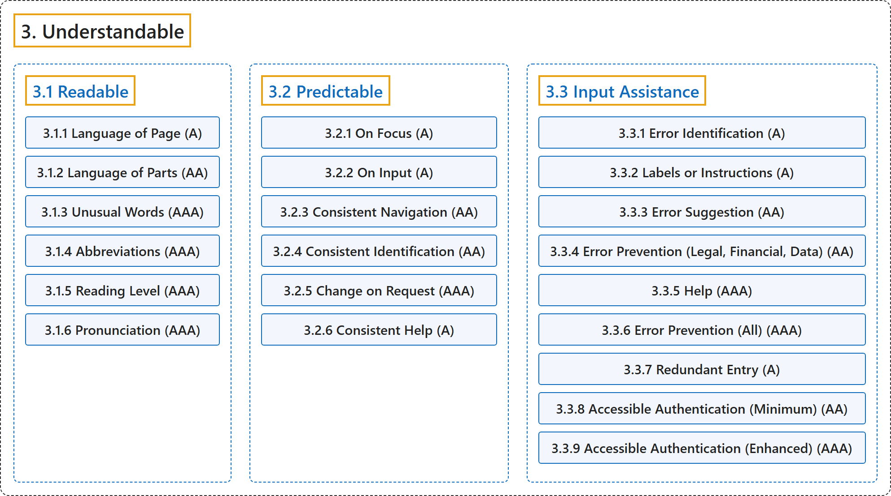

# 3. Understandable

## Classification

## Glossary

| Term | Definition | 中文翻译 | Source |
|---|---|---|---|
| **3. Understandable** 可理解 | "Information and the operation of the user interface **must be understandable**." | 信息和用户界面的操作**必须可理解**。 | [World Wide Web Consortium, 2024, Principle 3](https://www.w3.org/TR/WCAG22/#understandable) |
| **[3.1 Readable](readable.md)** 可读 | "Make text content **readable and understandable**." | 让文本内容**可读、可理解**。 | [World Wide Web Consortium, 2024, Guideline 3.1](https://www.w3.org/TR/WCAG22/#readable) |
| **[3.2 Predictable](predictable.md)** 可预测 | "Make web pages appear and operate in **predictable ways**." | 让网页**以可预测的方式**显示和运作。 | [World Wide Web Consortium, 2024, Guideline 3.2](https://www.w3.org/TR/WCAG22/#predictable) |
| **[3.3 Input Assistance](input-assistance.md)** 输入辅助 | "Help users **avoid and correct mistakes**." | 帮助用户**避免和纠正错误**。 | [World Wide Web Consortium, 2024, Guideline 3.3](https://www.w3.org/TR/WCAG22/#input-assistance) |

## References

World Wide Web Consortium. (2024, December 12). *Web Content Accessibility Guidelines (WCAG) 2.2* (W3C Recommendation). <https://www.w3.org/TR/WCAG22/>
