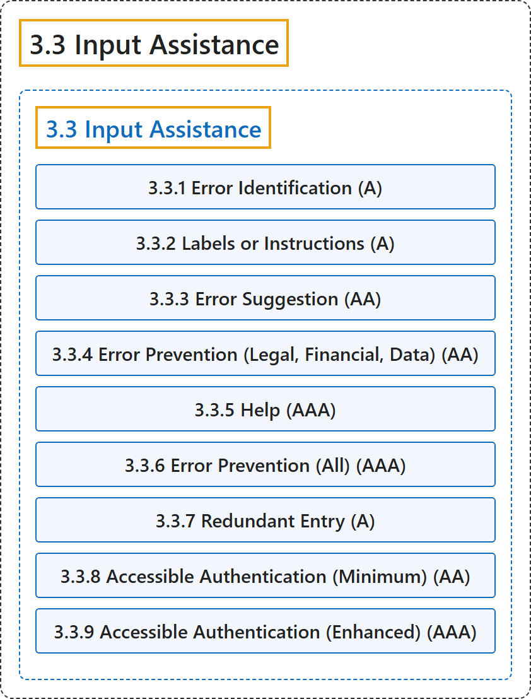

# 3.3 Input Assistance

## Classification

## Glossary

| Term | Definition | 中文翻译 | Source |
|---|---|---|---|
| **3.3 Input Assistance** 输入辅助 | "Help users **avoid and correct mistakes**." | 帮助用户**避免和纠正错误**。 | [World Wide Web Consortium, 2024, Guideline 3.3](https://www.w3.org/TR/WCAG22/#input-assistance) |
| **3.3.1 Error Identification** 错误识别（A 级） | "If an input error is automatically detected, **the item that is in error is identified and the error is described to the user in text**." | 如果自动检测到输入错误，则**标识出错的项目，并以文本向用户描述该错误**。 | [World Wide Web Consortium, 2024, Success Criterion 3.3.1](https://www.w3.org/TR/WCAG22/#error-identification) |
| **3.3.2 Labels or Instructions** 标签或说明（A 级） | "**Labels or instructions are provided when content requires user input**." | **当内容需要用户输入时提供标签或说明**。 | [World Wide Web Consortium, 2024, Success Criterion 3.3.2](https://www.w3.org/TR/WCAG22/#labels-or-instructions) |
| **3.3.3 Error Suggestion** 错误建议（AA 级） | "If an input error is automatically detected and suggestions for correction are known, then the **suggestions are provided to the user**, unless it would jeopardize the security or purpose of the content." | 如果自动检测到输入错误且已知纠正建议，则**向用户提供这些建议**，除非这会危及内容的安全或目的。 | [World Wide Web Consortium, 2024, Success Criterion 3.3.3](https://www.w3.org/TR/WCAG22/#error-suggestion) |
| **3.3.4 Error Prevention (Legal, Financial, Data)** 错误预防（法律、财务、数据）（AA 级） | "For web pages that **cause legal commitments or financial transactions for the user to occur**, that modify or delete user-controllable data in data storage systems, or that submit user test responses, at least one of the following is true:" | 对于**使用户产生法律承诺或财务交易**、修改或删除数据存储系统中用户可控数据，或提交用户测试答案的网页，下列至少一项成立： | [World Wide Web Consortium, 2024, Success Criterion 3.3.4](https://www.w3.org/TR/WCAG22/#error-prevention-legal-financial-data) |
| **3.3.5 Help** 帮助（AAA 级） | "**Context-sensitive help is available**." | **提供上下文相关的帮助**。 | [World Wide Web Consortium, 2024, Success Criterion 3.3.5](https://www.w3.org/TR/WCAG22/#help) |
| **3.3.6 Error Prevention (All)** 错误预防（全部）（AAA 级） | "For web pages that **require the user to submit information**, at least one of the following is true:" | 对于**要求用户提交信息**的网页，下列至少一项成立： | [World Wide Web Consortium, 2024, Success Criterion 3.3.6](https://www.w3.org/TR/WCAG22/#error-prevention-all) |
| **3.3.7 Redundant Entry** 重复输入（A 级） | "Information previously entered by or provided to the user that is **required to be entered again in the same process** is either:" | 之前由用户输入或提供给用户、且**在同一流程中需要再次输入**的信息，要么： | [World Wide Web Consortium, 2024, Success Criterion 3.3.7](https://www.w3.org/TR/WCAG22/#redundant-entry) |
| **3.3.8 Accessible Authentication (Minimum)** 无障碍认证（最低）（AA 级） | "A **cognitive function test** (such as remembering a password or solving a puzzle) **is not required for any step in an authentication process** unless that step provides at least one of the following:" | **认知功能测试**（如记住密码或解谜题）**在认证流程的任何步骤中都不是必需的**，除非该步骤提供下列至少一项： | [World Wide Web Consortium, 2024, Success Criterion 3.3.8](https://www.w3.org/TR/WCAG22/#accessible-authentication-minimum) |
| **3.3.9 Accessible Authentication (Enhanced)** 无障碍认证（增强）（AAA 级） | "A **cognitive function test** (such as remembering a password or solving a puzzle) **is not required for any step in an authentication process** unless that step provides at least one of the following:" | **认知功能测试**（如记住密码或解谜题）**在认证流程的任何步骤中都不是必需的**，除非该步骤提供下列至少一项： | [World Wide Web Consortium, 2024, Success Criterion 3.3.9](https://www.w3.org/TR/WCAG22/#accessible-authentication-enhanced) |

## References

World Wide Web Consortium. (2024, December 12). *Web Content Accessibility Guidelines (WCAG) 2.2* (W3C Recommendation). <https://www.w3.org/TR/WCAG22/>
