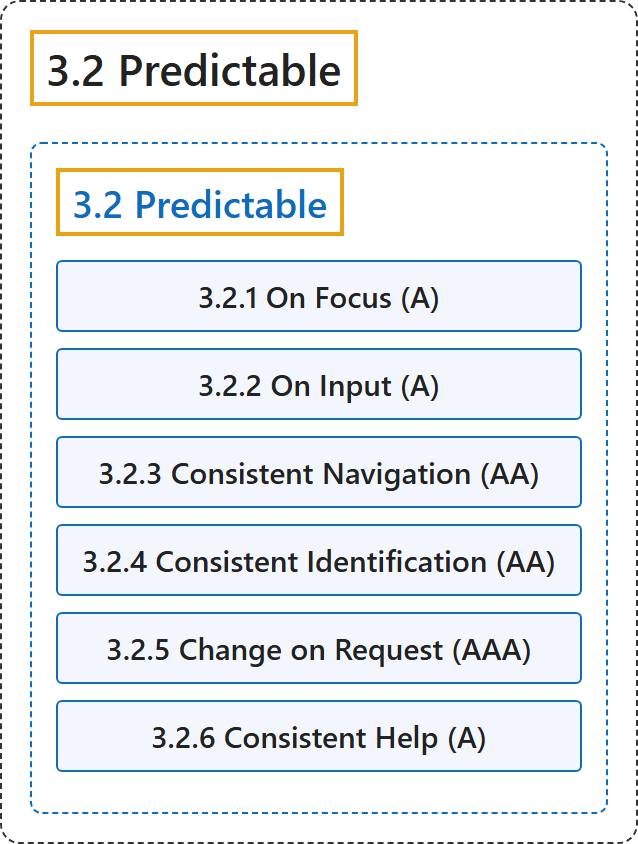

# 3.2 Predictable

## Classification

## Glossary

| Term | Definition | 中文翻译 | Source |
|---|---|---|---|
| **3.2 Predictable** 可预测 | "Make web pages appear and operate in **predictable ways**." | 让网页**以可预测的方式**显示和运作。 | [World Wide Web Consortium, 2024, Guideline 3.2](https://www.w3.org/TR/WCAG22/#predictable) |
| **3.2.1 On Focus** 聚焦时（A 级） | "When any user interface component receives focus, it **does not initiate a change of context**." | 当任何用户界面组件获得焦点时，它**不引发上下文的改变**。 | [World Wide Web Consortium, 2024, Success Criterion 3.2.1](https://www.w3.org/TR/WCAG22/#on-focus) |
| **3.2.2 On Input** 输入时（A 级） | "Changing the setting of any user interface component **does not automatically cause a change of context** unless the user has been advised of the behavior before using the component." | 改变任何用户界面组件的设置**不会自动引起上下文的改变**，除非用户在使用该组件前已被告知这一行为。 | [World Wide Web Consortium, 2024, Success Criterion 3.2.2](https://www.w3.org/TR/WCAG22/#on-input) |
| **3.2.3 Consistent Navigation** 一致的导航（AA 级） | "Navigational mechanisms that are repeated on multiple web pages within a set of web pages **occur in the same relative order each time they are repeated**, unless a change is initiated by the user." | 在一组网页中的多个网页上重复出现的导航机制，**每次重复时都以相同的相对顺序出现**，除非改变由用户发起。 | [World Wide Web Consortium, 2024, Success Criterion 3.2.3](https://www.w3.org/TR/WCAG22/#consistent-navigation) |
| **3.2.4 Consistent Identification** 一致的识别（AA 级） | "Components that have the same functionality within a set of web pages are **identified consistently**." | 在一组网页中具有相同功能的组件**以一致的方式标识**。 | [World Wide Web Consortium, 2024, Success Criterion 3.2.4](https://www.w3.org/TR/WCAG22/#consistent-identification) |
| **3.2.5 Change on Request** 按请求改变（AAA 级） | "Changes of context are **initiated only by user request** or a mechanism is available to turn off such changes." | 上下文的改变**只由用户请求发起**，或提供一种机制来关闭此类改变。 | [World Wide Web Consortium, 2024, Success Criterion 3.2.5](https://www.w3.org/TR/WCAG22/#change-on-request) |
| **3.2.6 Consistent Help** 一致的帮助（A 级） | "If a web page contains any of the following help mechanisms, and those mechanisms are repeated on multiple web pages within a set of web pages, they **occur in the same order relative to other page content**, unless a change is initiated by the user:" | 如果网页包含下列任何帮助机制，并且这些机制在一组网页中的多个网页上重复出现，则它们**相对于其他页面内容以相同的顺序出现**，除非改变由用户发起： | [World Wide Web Consortium, 2024, Success Criterion 3.2.6](https://www.w3.org/TR/WCAG22/#consistent-help) |

## References

World Wide Web Consortium. (2024, December 12). *Web Content Accessibility Guidelines (WCAG) 2.2* (W3C Recommendation). <https://www.w3.org/TR/WCAG22/>
