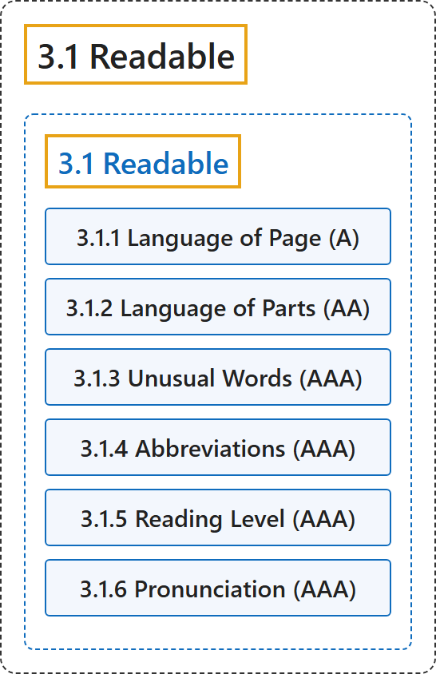

# 3.1 Readable

## Classification

## Glossary

| Term | Definition | 中文翻译 | Source |
|---|---|---|---|
| **3.1 Readable** 可读 | "Make text content **readable and understandable**." | 让文本内容**可读、可理解**。 | [World Wide Web Consortium, 2024, Guideline 3.1](https://www.w3.org/TR/WCAG22/#readable) |
| **3.1.1 Language of Page** 页面语言（A 级） | "The **default human language of each web page can be programmatically determined**." | **每个网页的默认人类语言可以由程序确定**。 | [World Wide Web Consortium, 2024, Success Criterion 3.1.1](https://www.w3.org/TR/WCAG22/#language-of-page) |
| **3.1.2 Language of Parts** 局部语言（AA 级） | "The **human language of each passage or phrase in the content can be programmatically determined** except for proper names, technical terms, words of indeterminate language, and words or phrases that have become part of the vernacular of the immediately surrounding text." | **内容中每个段落或短语的人类语言可以由程序确定**，专有名词、技术术语、语言不确定的词，以及已成为周围文本所用语言一部分的词或短语除外。 | [World Wide Web Consortium, 2024, Success Criterion 3.1.2](https://www.w3.org/TR/WCAG22/#language-of-parts) |
| **3.1.3 Unusual Words** 不常见的词（AAA 级） | "A mechanism is available for **identifying specific definitions of words or phrases used in an unusual or restricted way**, including idioms and jargon." | 提供一种机制，用于**识别以不常见或受限方式使用的词或短语的具体定义**，包括习语和行话。 | [World Wide Web Consortium, 2024, Success Criterion 3.1.3](https://www.w3.org/TR/WCAG22/#unusual-words) |
| **3.1.4 Abbreviations** 缩写（AAA 级） | "A mechanism for **identifying the expanded form or meaning of abbreviations** is available." | 提供一种**识别缩写的展开形式或含义**的机制。 | [World Wide Web Consortium, 2024, Success Criterion 3.1.4](https://www.w3.org/TR/WCAG22/#abbreviations) |
| **3.1.5 Reading Level** 阅读水平（AAA 级） | "When text requires reading ability **more advanced than the lower secondary education level** after removal of proper names and titles, supplemental content, or a version that does not require reading ability more advanced than the lower secondary education level, is available." | 当文本在去掉专有名词和标题后仍要求**高于初中教育水平**的阅读能力时，提供补充内容或一个不要求高于初中教育水平阅读能力的版本。 | [World Wide Web Consortium, 2024, Success Criterion 3.1.5](https://www.w3.org/TR/WCAG22/#reading-level) |
| **3.1.6 Pronunciation** 发音（AAA 级） | "A mechanism is available for **identifying specific pronunciation of words** where meaning of the words, in context, is ambiguous without knowing the pronunciation." | 提供一种机制，用于在不知道发音就无法确定词义的上下文中**识别词的具体发音**。 | [World Wide Web Consortium, 2024, Success Criterion 3.1.6](https://www.w3.org/TR/WCAG22/#pronunciation) |

## References

World Wide Web Consortium. (2024, December 12). *Web Content Accessibility Guidelines (WCAG) 2.2* (W3C Recommendation). <https://www.w3.org/TR/WCAG22/>
